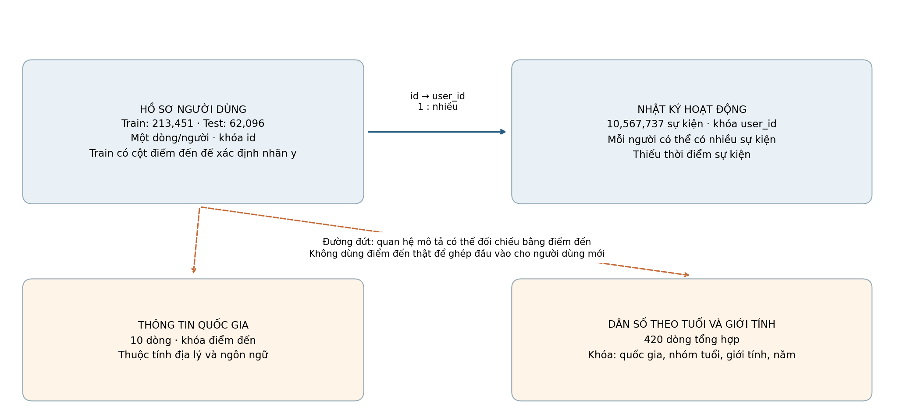
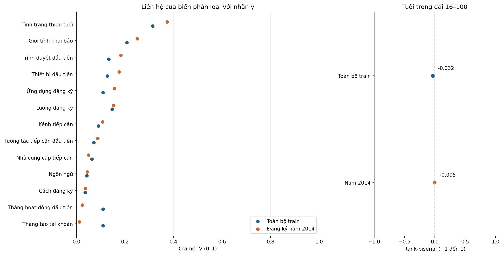
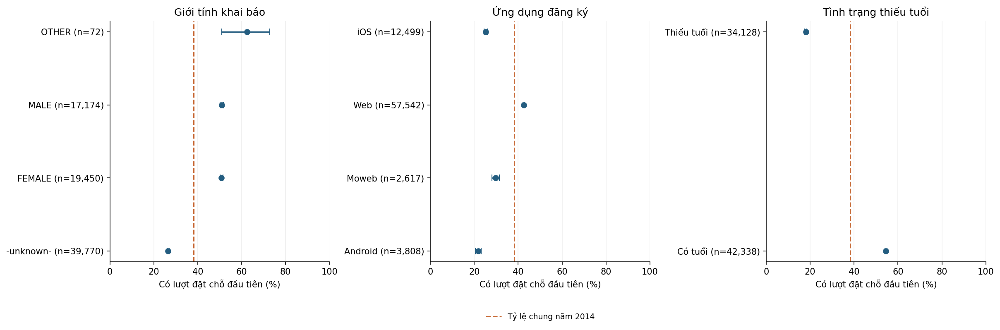
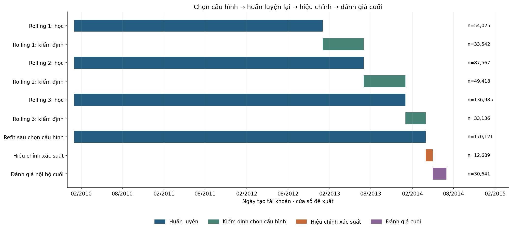

# AIRBNB — Hiểu người dùng mới, lượt đặt chỗ đầu tiên và độ phủ hành vi

> Phạm vi: EDA trên dữ liệu gốc. Không làm sạch/thay thế dữ liệu, không tạo tập feature, không huấn luyện mô hình.

Ngày phân tích: 2026-11-02. Đây không phải ngày thu thập dữ liệu.

## Thuật ngữ và cách đọc báo cáo

Mọi số liệu trong báo cáo là thống kê mô tả từ dữ liệu gốc. Chúng cho biết các liên hệ trong mẫu, chưa phải kết quả dự báo hoặc bằng chứng về tác động nhân quả. Báo cáo dừng ở EDA và thiết kế thí nghiệm, chưa xử lý dữ liệu cho mô hình hoặc huấn luyện mô hình.

Báo cáo dùng thống nhất “nhãn y” cho mục tiêu nhị phân và “lượt đặt chỗ đầu tiên” cho hành vi cần dự đoán. Tên cột và mã giá trị được giữ nguyên để đối chiếu với dữ liệu.

Quy ước số: dấu chấm biểu diễn phần thập phân; dấu phẩy phân tách hàng nghìn. Tên cột gốc chỉ dùng khi cần đối chiếu dữ liệu.

**Các thuật ngữ dùng trong báo cáo**

| Thuật ngữ | Giải nghĩa |
| --- | --- |
| EDA | Phân tích khám phá dữ liệu bằng bảng, biểu đồ và thống kê mô tả. |
| NDF | Mã No Destination Found trong country_destination, nghĩa là bộ dữ liệu không ghi nhận lượt đặt chỗ. Mã này không có nghĩa người dùng sẽ không bao giờ đặt chỗ. |
| Nhãn y | Mục tiêu nhị phân: y=1 nếu country_destination khác NDF, y=0 nếu bằng NDF. Cột country_destination giữ nguyên 12 giá trị điểm đến gốc. |
| Lượt đặt chỗ đầu tiên | Lượt đặt chỗ đầu tiên được ghi nhận trong bộ dữ liệu (first booking). |
| t0 | Thời điểm dự đoán, được chọn là ngay sau khi người dùng hoàn tất tạo tài khoản. |
| Thời hạn dự đoán (horizon) | Khoảng thời gian tính từ t0 để xét hành vi, chẳng hạn 90 ngày. Thời gian theo dõi thực tế của nhãn y hiện có còn cần xác minh. |
| Nhóm đăng ký (cohort) | Những người tạo tài khoản trong cùng một khoảng thời gian, thường là một tháng hoặc một năm. |
| Rò rỉ thông tin (leakage) | Việc dùng thông tin tiết lộ kết quả hoặc chưa có sẵn tại t0 làm đầu vào dự đoán. |
| Cramér V | Thước đo độ mạnh liên hệ giữa hai biến phân loại, từ 0 (không liên hệ) đến 1 (liên hệ hoàn toàn). |
| Rank-biserial | Thước đo chênh lệch thứ hạng giữa hai nhóm, từ −1 đến 1. Với tuổi, dấu dương nghĩa nhóm y=1 có xu hướng lớn tuổi hơn. Giá trị gần 0 nghĩa khác biệt rất nhỏ. |
| Khoảng Wilson 95% | Khoảng tin cậy cho tỷ lệ trong một nhóm. Khoảng rộng cho biết ước lượng còn kém chính xác, thường do nhóm ít người. |
| Sessions | Nhật ký hoạt động trên web hoặc ứng dụng. Mỗi người dùng có thể có nhiều sự kiện. |
| Train / test | Tập có nhãn dùng cho nghiên cứu / tập Kaggle không có nhãn, dùng đối chiếu cấu trúc và phân phối. |
| NA / unknown / untracked | Giá trị bị thiếu / mã không rõ thông tin / mã không theo dõi được. Báo cáo giữ riêng ba trường hợp. |
| Mốc bắt đầu dự đoán (origin) | Thời điểm lịch bắt đầu một lượt đánh giá. Dữ liệu dùng huấn luyện phải có sẵn trước mốc này. |

## Tóm tắt điều hành

**Kết luận:** Airbnb phù hợp nhất trong ba bộ dữ liệu để nghiên cứu xác suất người dùng mới có lượt đặt chỗ đầu tiên. Báo cáo chọn thời điểm dự đoán ngay sau khi tạo tài khoản và đề xuất bắt đầu thí nghiệm mô hình sau khi hoàn tất ba việc dưới đây.

**Năm phát hiện chính**

1. **Quy mô và nhãn y:** tập train có 213,451 người dùng, trong đó 88,908 người có lượt đặt chỗ đầu tiên (41.65%). Tập test có 62,096 người dùng. Hai nhóm nhãn y có quy mô đủ lớn để bắt đầu thí nghiệm với phân phối lớp hiện có. (Nguồn: bảng B1.)

2. **Thời gian phát sinh đặt chỗ:** trong 88,879 lượt đặt chỗ có độ trễ không âm, 75.33% xảy ra trong 30 ngày, 80.26% trong 60 ngày và 83.29% trong 90 ngày. Các tỷ lệ này chỉ tính trên người đã đặt chỗ và có độ trễ hợp lệ, không phải xác suất đặt chỗ của toàn bộ người dùng. Kết quả gợi ý xem xét thời hạn 90 ngày cho phương án triển khai. (Nguồn: bảng B2 và B6.)

3. **Liên hệ của hồ sơ đăng ký:** gender có V=0.207 trên toàn kỳ và 0.251 trong năm 2014, được diễn giải ở mức yếu đến vừa trong báo cáo. signup_app có liên hệ yếu hơn, với V lần lượt là 0.109 và 0.156. Hai biến này là ứng viên để kiểm tra giá trị bổ sung trong mô hình. (Nguồn: bảng B3.)

4. **Độ đầy đủ của hồ sơ tuổi:** age thiếu ở 41.22% người dùng. Trong năm 2014, cờ thiếu tuổi có V=0.374, còn tuổi trong dải 16–100 có rank-biserial=-0.005, gần 0. Mức độ đầy đủ của hồ sơ có liên hệ đáng chú ý với nhãn y, trong khi khác biệt thứ hạng tuổi giữa hai nhóm rất nhỏ. Chỉ được dùng tuổi và cờ thiếu tuổi nếu xác nhận chúng phản ánh hồ sơ tại t0, vì việc bổ sung hồ sơ sau đăng ký có thể làm lộ thông tin tương lai. (Nguồn: bảng B4.)

5. **Phạm vi nhật ký hoạt động:** trong năm 2014, 96.53% người dùng train và 99.31% người dùng test có sessions, chênh 2.78 điểm phần trăm. Tỷ lệ có đặt chỗ trong nhóm có nhật ký là 38.98%, so với 17.54% ở nhóm thiếu nhật ký. Vì dữ liệu trước năm 2014 không có sessions, nghiên cứu riêng nguồn này cần tập trung vào 76,466 người dùng train đăng ký năm 2014. (Nguồn: bảng B5.)

**Ba việc cần giải quyết trước khi huấn luyện**

1. **Xác minh nhãn và thời gian theo dõi.** Làm rõ 29 trường hợp có ngày đặt chỗ trước ngày tạo tài khoản và lý do độ trễ lớn nhất quan sát được là 365 ngày. Bổ sung ngày kết thúc theo dõi của từng người dùng để có thể xây dựng nhãn âm cho thời hạn 90 ngày. (Nguồn: bảng B6, B2 và Q3.)

2. **Chốt thông tin có sẵn tại t0.** Xác nhận hồ sơ phản ánh thời điểm đăng ký. Loại date_first_booking và cờ thiếu của cột này khỏi đầu vào vì chúng khớp nhãn y ở 100% trường hợp. Thiết kế chính cũng loại sessions vì nhật ký thiếu thời điểm sự kiện để xác định phần có trước t0. (Nguồn: bảng B8 và Q1.)

3. **Chốt thí nghiệm và tiêu chí đánh giá.** So sánh xác suất hằng, Logistic Regression có điều chuẩn L2 và CatBoost bằng các lượt chia theo thời gian. Dành tháng 4/2014 để hiệu chỉnh xác suất và tháng 5–6/2014 để đánh giá cuối. Trước khi huấn luyện, xác nhận nhãn dùng học đã có sẵn tại mốc bắt đầu dự đoán của mỗi lượt chia. (Nguồn: bảng B7.)

## 1. Bài toán và lý do chọn dữ liệu

**Bối cảnh nghiệp vụ:** doanh nghiệp muốn ưu tiên hỗ trợ và cá nhân hóa trải nghiệm cho người dùng mới dựa trên khả năng họ phát sinh lượt đặt chỗ đầu tiên. Mỗi người dùng nhận một điểm xác suất để phục vụ việc sắp thứ tự ưu tiên.

**Bài toán nghiên cứu:** ngay sau khi người dùng tạo tài khoản, mô hình dự kiến sử dụng thông tin đăng ký để ước lượng xác suất có lượt đặt chỗ đầu tiên được ghi nhận trong bộ dữ liệu. Đầu ra là xác suất trong [0; 1] cho từng người dùng. Bài toán dự đoán điểm đến với 12 lớp được trình bày để giải thích nguồn dữ liệu.

**Thời điểm dự đoán t0:** báo cáo chọn thời điểm ngay sau khi hoàn tất tạo tài khoản. Vì date_account_created chỉ ghi ngày, dữ liệu hiện tại chỉ cho phép kiểm tra thứ tự giữa các ngày. Để dùng thông tin hồ sơ tại t0, cần xác minh mỗi giá trị phản ánh hồ sơ lúc đăng ký.

**Nhãn y:** y=1 khi country_destination khác NDF và y=0 khi country_destination bằng NDF. Nhãn y thể hiện kết quả được ghi nhận trong bộ dữ liệu. Có 29 trường hợp ngày đặt chỗ trước ngày tạo tài khoản. Các trường hợp này cần được đánh dấu để xác minh trước khi quyết định đưa vào tập huấn luyện.

**Thời hạn dự đoán:** bài toán hiện tại dùng nhãn y với thời gian theo dõi theo bộ dữ liệu. Phương án triển khai đề xuất thời hạn 90 ngày vì khoảng này bao phủ 83.29% lượt đặt chỗ có độ trễ hợp lệ. Để xây dựng nhãn cho phương án đó, cần biết ngày kết thúc theo dõi của từng người dùng. Người không đặt chỗ chỉ được gán nhãn âm 90 ngày khi đã được theo dõi đủ khoảng thời gian này.

**Lý do chọn Airbnb so với hai bộ còn lại**

| Bộ dữ liệu | Đơn vị | Bằng chứng | Mức phù hợp | Quyết định |
| --- | --- | --- | --- | --- |
| AIRBNB | User mới | 213,451 user; 41.65% có booking | Đúng đối tượng chấm propensity khách hàng; có ID | Chọn cho nghiên cứu, còn điều kiện nhãn/t0 |
| HOTEL | Booking đã được tạo | Nhãn hủy/no-show; không quan sát đầy đủ người chưa đặt | Hợp cancellation propensity | Không trả lời trực tiếp ai sẽ tạo lượt đặt chỗ đầu tiên |
| EXPEDIA | Cặp search–hotel | Tương tác trong danh sách; thiếu user ID và search không click | Hợp ranking/propensity trong search | Không ưu tiên cho propensity onboarding theo user |

## 2. Tổng quan bộ dữ liệu

### Nguồn gốc và phạm vi thu thập

Nguồn công bố: [trang dữ liệu/nghiên cứu gốc](https://www.kaggle.com/c/airbnb-recruiting-new-user-bookings/data). [Giấy phép/điều khoản và trang phân phối](https://www.kaggle.com/competitions/airbnb-recruiting-new-user-bookings/rules). Báo cáo ghi rõ những thông tin chưa được lưu hoặc chưa xác minh.

**Thông tin nguồn và phiên bản**

| Nội dung | Mô tả |
| --- | --- |
| Tên / nơi công bố | Airbnb / Kaggle — Airbnb New User Bookings |
| Năm công bố | Cuộc thi công bố 2015, kết thúc 2016 |
| Mục đích thu thập/công bố | Dự đoán quốc gia của lượt đặt chỗ đầu tiên cho người dùng mới để cá nhân hóa nội dung. |
| Cách thu thập / quần thể | Dữ liệu gồm hồ sơ đăng ký, nhật ký web/ứng dụng và các bảng tổng hợp của người dùng từ Mỹ. CSV chưa lưu chi tiết cách chọn người dùng và ngày kết thúc theo dõi của từng người. |
| Thời gian bao phủ quan sát được | Account train 2010-01-01–2014-06-30; test 2014-07-01–2014-09-30 |
| Ngày tải raw | Chưa có bằng chứng trong hồ sơ dự án về ngày tải hoặc mã phiên bản Kaggle. Bản dữ liệu được nhận diện bằng SHA-256. |
| Quy mô bảng train/chính | 213,451 dòng × 16 cột thô |
| Dung lượng mọi CSV của bộ hiện có | 664,207,331 byte = 633.44 MiB; gồm cả bảng phụ/benchmark nếu có |
| Phiên bản local | Nhận diện bằng tên file, bytes, số dòng và SHA-256 tại phụ lục |
| Giấy phép / điều khoản | Competition Rules, không phải giấy phép mở CC0/CC BY. Điều khoản DATA có giới hạn mục đích sử dụng và phân phối; phải đối chiếu rules trước khi tái sử dụng hoặc công bố dữ liệu. |

**B1 · Quy mô người dùng và nhãn y**

| Tập dữ liệu | Số người dùng | Số có nhãn y=1 | Tỷ lệ y=1 (%) |
| --- | --- | --- | --- |
| Train | 213,451 | 88,908 | 41.6527 |
| Test | 62,096 | — | — |

### Bối cảnh, đơn vị quan sát và phạm vi nhãn

Train gồm **213,451 người dùng, 16 cột**, test gồm **62,096 người dùng, 15 cột**. Cột `country_destination` có 12 giá trị, gồm `NDF` và 11 điểm đến hoặc nhóm điểm đến. Báo cáo định nghĩa nhãn y từ cột này để phân tích khả năng có lượt đặt chỗ đầu tiên ở cấp người dùng.

Mục tiêu gốc của bộ dữ liệu là dự đoán điểm đến của lượt đặt chỗ đầu tiên. Nhãn y kế thừa phạm vi theo dõi của bộ dữ liệu. Phần 5 phân tích độ trễ và thông tin cần bổ sung để xây dựng nhãn cho thời hạn 30, 60 hoặc 90 ngày.

[Mô tả cuộc thi Airbnb New User Bookings](https://www.kaggle.com/c/airbnb-recruiting-new-user-bookings/data) nêu người dùng trong tập đến từ Mỹ. Vì vậy tính đại diện về địa lý, thời kỳ và sản phẩm có giới hạn. Test công khai không có nhãn để tính chất lượng dự đoán hoặc so sánh tỷ lệ đặt chỗ với train.

### Quan hệ giữa các bảng

Hồ sơ người dùng là đơn vị phân tích chính. Khi ghép nhật ký một–nhiều, phải tổng hợp về một dòng mỗi người trước khi xây dựng dữ liệu học. Hai bảng phụ mô tả điểm đến và dân số tổng hợp, nên cần phân biệt quan hệ có thể tra cứu với khóa đã biết tại thời điểm dự đoán.



**Quan sát:** hồ sơ có thể ghép với nhật ký qua định danh. Có 34,496 sự kiện thiếu định danh nên không ghép được về người dùng.

**Phạm vi và cách đọc:** mũi tên liền chỉ quan hệ khóa 1:nhiều. Mũi tên đứt chỉ quan hệ bối cảnh, chưa phải phép ghép được chấp nhận cho mô hình. Các con số là quy mô bảng, không phải số khách hàng bổ sung.

## 3. Chất lượng dữ liệu

### Chất lượng users, sentinel và rò rỉ nhãn

**Rò rỉ đã kiểm chứng:** việc `date_first_booking` có giá trị hay bị thiếu khớp nhãn y ở **100.00%** người dùng train. Vì cột này tiết lộ kết quả cần dự đoán, thiết kế đầu vào loại cả ngày đặt chỗ và cờ thiếu ngày đặt chỗ. Giá trị thiếu ở đây phản ánh cách ghi nhận kết quả nên không cần điền ngày thay thế.

Tuổi ngoài [16; 100] được thống kê riêng theo một **dải tham chiếu dùng cho EDA**. Các giá trị dạng 19xx/20xx gợi ý khả năng người dùng đã nhập năm sinh. Cần xác minh cách thu thập trước khi quyết định chuyển đổi hoặc thay thế tuổi. Các mã đặc biệt trong gender và browser được thống kê riêng với giá trị thiếu NA.

Người dùng có thể tìm kiếm trước khi đăng ký, nên ngày hoạt động đầu có thể sớm hơn ngày tạo tài khoản. Có **29** dòng ghi ngày đặt chỗ trước ngày tạo tài khoản. Những trường hợp này cần được đối chiếu với định nghĩa các mốc thời gian trước khi quyết định đưa vào tập huấn luyện.

**Kiểm tra định danh và logic thời gian**

| Nội dung kiểm tra | Số người dùng |
| --- | --- |
| ID train bị lặp (beyond first) | 0 |
| ID test bị lặp (beyond first) | 0 |
| ID xuất hiện ở cả train và test | 0 |
| date_first_booking.notna không khớp nhãn có booking | 0 |
| date_first_booking có giá trị trong test | 0 |
| Tuổi có giá trị nhưng ngoài [16; 100] (quy ước mô tả) | 2,410 |
| Lượt đặt chỗ đầu tiên trước ngày tạo tài khoản | 29 |
| Hoạt động đầu trước ngày tạo tài khoản | 178 |
| Ngày account không parse được | 0 |
| Timestamp hoạt động đầu không parse được | 0 |
| Ngày booking có giá trị nhưng không parse được | 0 |

**NA và giá trị đặc biệt là các khái niệm khác nhau**

| Cột gốc | null n | minus unknown n | untracked n |
| --- | --- | --- | --- |
| gender | 0 | 95,688 | 0 |
| first_browser | 0 | 27,266 | 0 |
| first_affiliate_tracked | 6,065 | 0 | 109,232 |

**Ngày booking có/không × nhãn có/không booking**

| has booking date | False | True |
| --- | --- | --- |
| 0 | 124,543 | 0 |
| 1 | 0 | 88,908 |

**B8 · Mức khớp giữa tình trạng ngày đặt chỗ và nhãn y**

| Số trường hợp khớp | Số người dùng train | Tỷ lệ khớp (%) |
| --- | --- | --- |
| 213,451 | 213,451 | 100 |

### Missing có quy luật hay không?

Heatmap chọn tối đa 12 cột có NA. Chọn dòng để hiển thị với seed=42 và sắp theo pattern; bảng tỷ lệ theo nhóm dùng quần thể phân tích công bố, không chỉ các dòng hiển thị.

**Missing (%) theo account year; toàn bộ users train AIRBNB**

| account year | Ngày đặt chỗ đầu tiên | Tuổi khai báo | Tương tác tiếp cận đầu tiên |
| --- | --- | --- | --- |
| 2010 | 42.5036 | 38.8092 | 28.1564 |
| 2011 | 45.3673 | 34.7346 | 20.3227 |
| 2012 | 55.0226 | 34.8183 | 3.312 |
| 2013 | 59.1562 | 42.1287 | 0.9462 |
| 2014 | 61.7621 | 44.6316 | 1.0397 |


**Quan sát:** date_first_booking thiếu 58.35% trong toàn bộ users train AIRBNB; chênh lệch missing lớn nhất giữa các nhóm account year là 27.21 điểm phần trăm ở first_affiliate_tracked. Ô xanh là NA. Mẫu dòng hiển thị dùng seed=42; việc sắp theo pattern chỉ để nhìn cụm thiếu, không phải thứ tự thời gian. Các khác biệt này không đủ kết luận cơ chế MCAR/MAR/MNAR.

**Phạm vi và cách đọc:** Bảng tỷ lệ dùng toàn bộ train; hình mẫu thiếu chỉ hiển thị tối đa 300 dòng, seed=42.

### Ngoại lai: lượng hóa và phân biệt quy tắc với kết luận lỗi

Quy tắc 1.5×IQR chỉ gắn cờ để kiểm tra, không tự chứng minh lỗi. Mẫu số là số giá trị không thiếu của từng cột; bảng giữ rõ quần thể và trường hợp IQR=0.

**Hàng rào IQR trên dữ liệu công bố**

| Cột gốc | population | nonnull n | q1 | q3 | iqr | lower fence | upper fence | flagged n | flagged pct nonnull | iqr zero |
| --- | --- | --- | --- | --- | --- | --- | --- | --- | --- | --- |
| age | toàn bộ users train AIRBNB | 125,461 | 28 | 43 | 15 | 5.5 | 65.5 | 5,594 | 4.4588 | 0 |


**Quan sát:** theo hàng rào Q1−1.5×IQR và Q3+1.5×IQR, age có 5,594/125,461 giá trị bị gắn cờ (4.46%) trong toàn bộ users train AIRBNB; đây là bất thường thống kê, chưa phải lỗi nhập liệu. Median age theo nhãn: 0=34.00, 1=33.00. Boxplot bên phải ẩn các điểm ngoài whisker để đọc vùng giữa, không xóa chúng khỏi bảng hay raw. Đơn vị xem từ điển; IQR=0 ở biến rời rạc có thể gắn cờ nhiều giá trị thật. Trục x boxplot raw dùng symlog; hàng rào IQR vẫn tính trên giá trị raw, không phải log.

**Phạm vi và cách đọc:** Tuổi không thiếu trong train. Dải ngoại lai là quy tắc mô tả; dữ liệu gốc được giữ nguyên.

### Vai trò dữ liệu trong thiết kế chính

Bảng dưới tóm tắt quyết định theo nhóm cột. Bảng quyết định đầy đủ trong phụ lục chỉ rõ từng cột, điều kiện tại t0 và câu hỏi Q1–Q3 liên quan. Các cột hồ sơ có trạng thái ứng viên có điều kiện, chưa được xác nhận là khả dụng tại t0.

**Tóm tắt quyết định sử dụng dữ liệu**

| Bảng dữ liệu | Quyết định cho thiết kế chính | Số cột |
| --- | --- | --- |
| Hồ sơ người dùng | Dùng đối chiếu và ghép; loại khỏi đầu vào | 1 |
| Hồ sơ người dùng | Dùng kiểm tra và chia thời gian; cân nhắc đầu vào riêng | 2 |
| Hồ sơ người dùng | Loại ngày và cờ thiếu khỏi đầu vào | 1 |
| Hồ sơ người dùng | Ứng viên có điều kiện | 9 |
| Hồ sơ người dùng | Ứng viên có điều kiện; tuổi và cờ thiếu cần cùng được kiểm tra | 1 |
| Hồ sơ người dùng | Ứng viên có điều kiện; không coi là đại lượng liên tục | 1 |
| Hồ sơ người dùng | Chỉ dùng tạo nhãn và đánh giá | 1 |
| Nhật ký hoạt động | Dùng đối chiếu khóa | 1 |
| Nhật ký hoạt động | Loại khỏi đầu vào của thiết kế tại t0 | 5 |
| Thông tin quốc gia | Dùng làm bối cảnh; chưa ghép làm đầu vào | 7 |
| Dân số theo tuổi và giới tính | Dùng làm bối cảnh; chưa ghép làm đầu vào | 5 |

**B4 · Tình trạng hồ sơ tuổi và liên hệ trong năm 2014**

| Số người dùng thiếu tuổi | Tỷ lệ thiếu tuổi (%) | V cờ thiếu tuổi · 2014 | Rank-biserial tuổi 16–100 · 2014 |
| --- | --- | --- | --- |
| 87,990 | 41.2226 | 0.3737 | -0.0049 |

## 4. Phân tích đơn biến

### Nhãn, tuổi và phân phối kênh/thiết bị

Có booking được ghi nhận: **88,908/213,451 (41.65%)**. Nhóm NDF chiếm **58.35%**. Bảng điểm đến trình bày hai mẫu số riêng: toàn bộ người dùng và chỉ người có booking; không nhầm tỷ trọng US trong toàn bộ users với tỷ trọng US trong nhóm đã book.

Độ tuổi được trình bày cả raw và cửa sổ [16; 100] để thấy tác động của giá trị cực đoan. Top category có mẫu số là toàn bộ users, kể cả NA. `signup_flow` là mã phân loại; không báo cáo mean của mã như một đặc điểm khách hàng.


**Quan sát:** NDF chiếm 58.35% toàn users; age thiếu 41.22% và có 2,410 giá trị ngoài dải tham chiếu 16–100. Histogram chỉ vẽ tuổi 16–100, không thay đổi raw hoặc khẳng định mọi tuổi ngoài dải đều sai.

**Phạm vi và cách đọc:** Toàn bộ người dùng train. Biểu đồ tuổi giới hạn hiển thị 16–100; bảng chi tiết giữ tuổi thiếu và ngoài dải.

### Biến phân loại và nhãn

Biểu đồ hiển thị top 8 nhóm theo số lượng; bảng kiểm kê giữ cả các nhóm nhỏ. Nhóm hiếm được báo với ngưỡng mô tả n<100, chưa gộp category.

**Tần suất đầy đủ của Ứng dụng đăng ký**

| Ứng dụng đăng ký | Số người dùng | Số có nhãn y=1 |
| --- | --- | --- |
| Web | 182,717 | 80,021 |
| iOS | 19,019 | 5,511 |
| Moweb | 6,261 | 2,143 |
| Android | 5,454 | 1,233 |


**Quan sát:** signup_app có 4 nhóm (không có NA); 0 nhóm dưới 100 quan sát. Nhóm lớn nhất Web có 182,717 quan sát, tỷ lệ nhãn 1 là 43.80%. Hai trục trả lời số lượng nhóm và tỷ lệ bên trong nhóm, không dùng lẫn mẫu số; phân tầng nhóm đăng ký được trình bày tại phần đa biến.

**Phạm vi và cách đọc:** Toàn bộ người dùng train. Số lượng dùng mẫu số toàn tập; tỷ lệ dùng mẫu số từng ứng dụng.

## 5. Nhãn, liên hệ đa biến, nhóm đăng ký và Nhật ký hoạt động

### Độ trễ booking và giới hạn định nghĩa nhãn

Độ trễ là số ngày lịch từ ngày tạo tài khoản đến ngày đặt chỗ đầu tiên, tính bằng date_first_booking − date_account_created. Có 88,879 lượt đặt chỗ có độ trễ không âm. Báo cáo thống kê riêng 29 trường hợp có ngày đặt chỗ trước ngày tạo tài khoản để kiểm tra lại định nghĩa thời gian.

**Trong các lượt đặt chỗ có độ trễ hợp lệ, 83.29% xảy ra trong 90 ngày đầu** và 16.71% xảy ra muộn hơn. Vì mẫu số chỉ gồm người đã đặt chỗ, các tỷ lệ này mô tả tốc độ phát sinh đặt chỗ trong nhóm đó. Xác suất đặt chỗ của toàn bộ người dùng cần một mẫu số khác, gồm cả người mang nhãn y=0.

Ngày đặt chỗ muộn nhất là 2015-06-29. Độ trễ lớn nhất trong mỗi nhóm năm tạo tài khoản đều là 365 ngày. Mẫu hình này gợi ý cần kiểm tra liệu dữ liệu có giới hạn theo dõi một năm cho từng người dùng hay không. Câu trả lời quyết định cách diễn giải nhãn y=0, nhất là ở các nhóm đăng ký gần cuối tập train.

Để xem kết quả phụ thuộc vào thời gian theo dõi như thế nào, báo cáo thử giả định mọi người dùng đều được theo dõi đến ngày đặt chỗ muộn nhất. Theo giả định này, toàn bộ train có khoảng cách lịch đủ 30, 60 và 90 ngày. Ngày kết thúc theo dõi thực tế vẫn cần được bổ sung để xác nhận ai đã được theo dõi đủ 90 ngày mà không đặt chỗ. Trong phạm vi hiện tại, bài toán dùng nhãn y được định nghĩa từ cột country_destination.

**B6 · Phân phối độ trễ: mẫu số và ngoại lệ**

| Số có nhãn y=1 | Số độ trễ không âm | Số độ trễ âm | Ngày đặt chỗ thiếu hoặc không đọc được | Trung vị (ngày) | Phân vị 75% (ngày) | Phân vị 90% (ngày) | Phân vị 95% (ngày) | Lớn nhất (ngày) |
| --- | --- | --- | --- | --- | --- | --- | --- | --- |
| 88,908 | 88,879 | 29 | 0 | 3 | 29 | 189 | 278 | 365 |

**B2 · Mức bao phủ các thời hạn trên lượt đặt chỗ đã ghi nhận**

| Thời hạn (ngày) | Số đặt chỗ trong thời hạn | Mẫu số · độ trễ hợp lệ | Trong số độ trễ hợp lệ (%) | Trong số người đã đặt chỗ (%) |
| --- | --- | --- | --- | --- |
| 7 | 55,366 | 88,879 | 62.2937 | 62.2734 |
| 30 | 66,950 | 88,879 | 75.3271 | 75.3026 |
| 60 | 71,333 | 88,879 | 80.2586 | 80.2324 |
| 90 | 74,027 | 88,879 | 83.2896 | 83.2625 |
| 180 | 79,524 | 88,879 | 89.4745 | 89.4453 |
| 365 | 88,879 | 88,879 | 100 | 99.9674 |

**Độ trễ theo năm tạo tài khoản**

| Năm đăng ký | Số người dùng | valid bookings | Số độ trễ âm | within 30 pct | within 60 pct | within 90 pct | max lag days | latest booking |
| --- | --- | --- | --- | --- | --- | --- | --- | --- |
| 2010 | 2,788 | 1,597 | 6 | 86.6625 | 90.3569 | 91.9224 | 365 | 2011-11-30 |
| 2011 | 11,775 | 6,422 | 11 | 80.5824 | 84.2884 | 86.4217 | 365 | 2012-12-09 |
| 2012 | 39,462 | 17,738 | 11 | 76.5024 | 81.4241 | 84.2541 | 365 | 2013-12-31 |
| 2013 | 82,960 | 33,883 | 1 | 74.4503 | 79.2492 | 82.3156 | 365 | 2014-12-30 |
| 2014 | 76,466 | 29,239 | 0 | 73.8568 | 79.2845 | 82.6738 | 365 | 2015-06-29 |

**Phân tích độ nhạy khi giả định cùng ngày kết thúc theo dõi**

| assumed common cutoff | Thời hạn (ngày) | users with calendar gap ge h | pct users | Trạng thái |
| --- | --- | --- | --- | --- |
| 2015-06-29 | 30 | 213,451 | 100 | Chỉ đúng nếu mọi user thực sự được theo dõi tới mốc giả định |
| 2015-06-29 | 60 | 213,451 | 100 | Chỉ đúng nếu mọi user thực sự được theo dõi tới mốc giả định |
| 2015-06-29 | 90 | 213,451 | 100 | Chỉ đúng nếu mọi user thực sự được theo dõi tới mốc giả định |
| 2015-06-29 | 365 | 212,861 | 99.7236 | Chỉ đúng nếu mọi user thực sự được theo dõi tới mốc giả định |


**Quan sát:** trong 88,879 lượt đặt chỗ có độ trễ không âm, 75.33% xảy ra trong 30 ngày, 80.26% trong 60 ngày và 83.29% trong 90 ngày. Phần tăng thêm từ ngày 30 đến ngày 90 cho thấy lợi ích về mức bao phủ khi kéo dài thời hạn. Mẫu số chỉ gồm các lượt đặt chỗ có độ trễ hợp lệ. Bảng ngoại lệ thống kê riêng 29 trường hợp độ trễ âm.

**Phạm vi và cách đọc:** Người đã đặt chỗ và có độ trễ không âm. Các tỷ lệ không đại diện cho toàn bộ người dùng.

### Độ mạnh liên hệ với nhãn y trên toàn bộ biến ứng viên

Phân tích xem xét 13 cột ứng viên và bổ sung góc nhìn về tình trạng thiếu tuổi, tổng cộng 14 phép so sánh. Cramér V đo độ mạnh liên hệ giữa biến phân loại và nhãn y trên thang 0–1. Hệ số của toàn bộ train được đối chiếu với kết quả riêng năm 2014 để kiểm tra ảnh hưởng của thành phần năm đăng ký.

Giới tính khai báo có V=0.207 trên toàn kỳ và 0.251 trong năm 2014. Ứng dụng đăng ký có V tương ứng 0.109 và 0.156, thể hiện liên hệ yếu hơn trong cả hai phạm vi. Đây là mô tả từng biến, không phải điểm chất lượng mô hình. Tuổi trong dải 16–100 dùng rank-biserial trên thang −1 đến 1. Giá trị -0.005 trong năm 2014 cho thấy khác biệt thứ hạng tuổi giữa hai nhóm nhãn rất nhỏ.

Công thức, giả định kiểm định và điều chỉnh nhiều phép so sánh nằm ở mục Tái lập và kiểm soát phạm vi. Báo cáo chưa đưa AUC vì chưa huấn luyện mô hình. [Phương pháp Cramér V](https://docs.scipy.org/doc/scipy/reference/generated/scipy.stats.contingency.association.html) và [Mann–Whitney](https://docs.scipy.org/doc/scipy/reference/generated/scipy.stats.mannwhitneyu.html) được đối chiếu từ tài liệu SciPy.

**B3 · Các liên hệ chính cần kiểm tra**

| Biến | Thước đo | Liên hệ · toàn kỳ | Liên hệ · năm 2014 |
| --- | --- | --- | --- |
| Giới tính khai báo | Cramér V | 0.2073 | 0.2507 |
| Cách đăng ký | Cramér V | 0.0359 | 0.0371 |
| Ứng dụng đăng ký | Cramér V | 0.1095 | 0.1559 |
| Tình trạng thiếu tuổi | Cramér V | 0.3142 | 0.3737 |
| Tuổi trong dải 16–100 | Rank-biserial | -0.0324 | -0.0049 |



**Quan sát:** tình trạng thiếu tuổi có V lớn nhất trong các biến phân loại được khảo sát. Liên hệ của các mốc theo tháng giảm khi chỉ xét năm 2014. Tuổi trong dải 16–100 có rank-biserial=-0.005 trong năm 2014, gần 0.

**Phạm vi và cách đọc:** V tính trên toàn bộ người dùng trong từng phạm vi, gồm giá trị thiếu như một nhóm. Rank-biserial chỉ tính trên tuổi 16–100 và được đặt trên trục riêng. Hai thước đo không dùng chung ngưỡng so sánh. Liên hệ của cờ thiếu cần được kiểm tra về thời điểm có sẵn tại t0.

### Tỷ lệ đặt chỗ và độ bất định theo các nhóm chính

Ba nhóm đặc điểm dưới đây được so sánh trên cùng quần thể đăng ký năm 2014. Mỗi điểm là tỷ lệ có nhãn y=1 trong nhóm, thanh ngang là khoảng Wilson 95%. Bảng gom các nhóm vào cùng một cấu trúc để đọc đồng thời cỡ mẫu, tỷ lệ và độ bất định. Bảng toàn bộ train và các đặc điểm khác nằm ở phụ lục.

**Tỷ lệ đặt chỗ theo nhóm · cùng năm đăng ký 2014**

| Đặc điểm | Nhóm | Số người dùng | Số có nhãn y=1 | Tỷ lệ đặt chỗ (%) | Cận dưới 95% (%) | Cận trên 95% (%) |
| --- | --- | --- | --- | --- | --- | --- |
| Giới tính khai báo | -unknown- | 39,770 | 10,555 | 26.5401 | 26.1084 | 26.9763 |
| Giới tính khai báo | FEMALE | 19,450 | 9,888 | 50.838 | 50.1354 | 51.5404 |
| Giới tính khai báo | MALE | 17,174 | 8,751 | 50.9549 | 50.2071 | 51.7023 |
| Giới tính khai báo | OTHER | 72 | 45 | 62.5 | 50.9529 | 72.7808 |
| Ứng dụng đăng ký | Android | 3,808 | 832 | 21.8487 | 20.565 | 23.1892 |
| Ứng dụng đăng ký | Moweb | 2,617 | 778 | 29.7287 | 28.0083 | 31.5085 |
| Ứng dụng đăng ký | Web | 57,542 | 24,475 | 42.5341 | 42.1307 | 42.9386 |
| Ứng dụng đăng ký | iOS | 12,499 | 3,154 | 25.234 | 24.4802 | 26.003 |
| Tình trạng thiếu tuổi | Có tuổi | 42,338 | 23,093 | 54.5444 | 54.0697 | 55.0182 |
| Tình trạng thiếu tuổi | Thiếu tuổi | 34,128 | 6,146 | 18.0087 | 17.6046 | 18.4199 |



**Quan sát:** đường đứt đánh dấu tỷ lệ chung 38.24% của người đăng ký năm 2014. Khoảng rộng ở các nhóm ít người cho thấy tỷ lệ ước lượng kém chính xác hơn.

**Phạm vi và cách đọc:** mẫu số của mỗi điểm là số người trong nhóm, được ghi cạnh tên. Khoảng Wilson 95% giả định người dùng độc lập. Mức chồng lấp khoảng tin cậy không thay thế kiểm định chênh lệch. Tuổi và tình trạng thiếu tuổi chỉ là ứng viên đầu vào sau khi xác minh tại t0.

### Tách thành phần nhóm đăng ký khỏi chênh lệch app, Giới tính khai báo và kênh

Mỗi cột trong bảng tương ứng với một năm tạo tài khoản. Đọc theo cột giúp so sánh ứng dụng, giới tính hoặc kênh tiếp cận trong cùng nhóm đăng ký. Một số ứng dụng chỉ xuất hiện ở các năm sau, nên so sánh toàn kỳ có thể chịu ảnh hưởng của thành phần năm.

Việc tách theo năm giúp kiểm tra một phần ảnh hưởng này. Khác biệt theo tháng hoặc các đặc điểm khác vẫn cần được xem xét khi xây dựng mô hình. Phụ lục cung cấp khoảng Wilson 95% cho từng ô để đọc cùng số người dùng.

**Ứng dụng đăng ký × năm signup: tỷ lệ và n**

| Ứng dụng đăng ký | 2010 | 2011 | 2012 | 2013 | 2014 |
| --- | --- | --- | --- | --- | --- |
| Android | Không có user | Không có user | 64.00% (n=25) | 23.75% (n=1,621) | 21.85% (n=3,808) |
| Moweb | Không có user | Không có user | 41.61% (n=560) | 36.71% (n=3,084) | 29.73% (n=2,617) |
| Web | 57.50% (n=2,788) | 54.63% (n=11,775) | 45.02% (n=38,184) | 41.86% (n=72,428) | 42.53% (n=57,542) |
| iOS | Không có user | Không có user | 44.44% (n=693) | 35.16% (n=5,827) | 25.23% (n=12,499) |

**Giới tính khai báo × năm signup: tỷ lệ và n**

| Giới tính khai báo | 2010 | 2011 | 2012 | 2013 | 2014 |
| --- | --- | --- | --- | --- | --- |
| -unknown- | 53.68% (n=1,509) | 54.45% (n=4,617) | 35.75% (n=10,993) | 28.89% (n=38,799) | 26.54% (n=39,770) |
| FEMALE | 61.89% (n=732) | 55.51% (n=3,693) | 48.52% (n=15,535) | 51.05% (n=23,631) | 50.84% (n=19,450) |
| MALE | 62.02% (n=545) | 53.74% (n=3,439) | 48.50% (n=12,846) | 51.64% (n=20,436) | 50.95% (n=17,174) |
| OTHER | 100.00% (n=2) | 80.77% (n=26) | 57.95% (n=88) | 60.64% (n=94) | 62.50% (n=72) |

**Kênh tiếp cận × năm signup: tỷ lệ và n**

| Kênh tiếp cận | 2010 | 2011 | 2012 | 2013 | 2014 |
| --- | --- | --- | --- | --- | --- |
| api | Không có user | 100.00% (n=1) | 45.73% (n=1,813) | 33.76% (n=3,504) | 27.10% (n=2,849) |
| content | 49.47% (n=95) | 37.50% (n=296) | 15.97% (n=432) | 10.05% (n=1,482) | 11.08% (n=1,643) |
| direct | 61.98% (n=1,310) | 56.32% (n=6,578) | 47.71% (n=25,114) | 43.03% (n=55,522) | 38.63% (n=49,203) |
| other | 52.62% (n=650) | 52.35% (n=1,593) | 39.05% (n=3,201) | 32.43% (n=2,661) | 36.33% (n=856) |
| remarketing | Không có user | 50.00% (n=94) | 44.96% (n=129) | 28.18% (n=181) | 30.64% (n=692) |
| sem-brand | 59.46% (n=37) | 54.95% (n=777) | 41.97% (n=2,783) | 41.28% (n=9,755) | 42.94% (n=12,693) |
| sem-non-brand | 49.11% (n=395) | 52.06% (n=1,800) | 38.75% (n=4,872) | 35.02% (n=6,604) | 35.14% (n=5,173) |
| seo | 61.79% (n=301) | 58.33% (n=636) | 45.26% (n=1,118) | 43.25% (n=3,251) | 44.27% (n=3,357) |


**Quan sát:** trong năm 2014, tỷ lệ đặt chỗ của Web là 42.53%, iOS là 25.23% và Android là 21.85%. Chênh lệch giữa các ứng dụng vẫn xuất hiện khi so sánh trong cùng năm. Nhóm FEMALE có tỷ lệ 50.84%, so với 26.54% ở nhóm giới tính unknown. Nhóm OTHER chỉ có 72 người nên cần đọc cùng khoảng Wilson trong phụ lục. Dấu * đánh dấu ô có n<100.

**Phạm vi và cách đọc:** Người dùng train, tách theo năm đăng ký. Ô có n<100 được đánh dấu; khoảng Wilson ở phụ lục.

### Tỷ lệ đặt chỗ theo các nhóm kết hợp trong năm 2014

Hai biểu đồ kết hợp ứng dụng đăng ký với kênh tiếp cận, và tình trạng thiếu tuổi với giới tính khai báo. Cách nhìn này giúp xác định những nhóm cần kiểm tra thêm trong mô hình. Màu biểu diễn tỷ lệ đặt chỗ, còn n cho biết số người dùng trong ô. Dấu * đánh dấu ô có dưới 100 người. Các nhóm và cờ thiếu được tính tạm để lập bảng EDA.


**Quan sát:** với người dùng Web năm 2014, nhóm direct có tỷ lệ đặt chỗ 45.18% (n=33,354). Nhóm content có tỷ lệ 11.08% (n=1,642). Trong nhóm FEMALE cùng năm, tỷ lệ của người có tuổi là 51.74%, so với 32.41% ở người thiếu tuổi. Các chênh lệch trong cùng năm là cơ sở để kiểm tra giá trị của những nhóm kết hợp khi huấn luyện. Dấu * đánh dấu ô có n<100.

**Phạm vi và cách đọc:** Người đăng ký năm 2014. Mẫu số là người trong từng ô kết hợp; dấu * là n<100.

### Sessions: so sánh cùng nhóm đăng ký và rà soát thông tin giao dịch

Phân tích đã quét toàn bộ 10,567,737 sự kiện. Trong nhóm đăng ký năm 2014, **73,815/76,466 người dùng train có sessions (96.53%)**. Tỷ lệ tương ứng ở test là **99.31%**, cao hơn 2.78 điểm phần trăm. Tỷ lệ trên toàn bộ train chỉ là 34.58% vì nhóm đăng ký năm 2010–2013 không có nhật ký trong dữ liệu hiện có. Vì vậy, cần so sánh độ phủ trong cùng năm đăng ký.

Nghiên cứu riêng sessions có phạm vi phù hợp là 76,466 người dùng train đăng ký năm 2014. Tuy nhiên, thiết kế dự đoán tại t0 cần biết sự kiện nào đã xảy ra trước thời điểm đó. Vì sessions thiếu thời điểm sự kiện, thiết kế chính loại nguồn này khỏi đầu vào cho đến khi xác minh được khoảng thời gian ghi nhật ký.

Bảng dưới so sánh người có và không có sessions trong năm 2014. Bảng số sự kiện giữ cả người không có nhật ký và gán event_n=0 khi tính thống kê. Cột secs_elapsed là thời lượng, nên không xác định được thời điểm hoặc thứ tự hành động.

Để rà soát rủi ro rò rỉ, phân tích chọn tên hành động liên quan giao dịch hoặc xác minh bằng biểu thức **(?:^|_)(?:book[a-z]*|reserv[a-z]*|pay[a-z]*|checkout|receipt|itinerar[a-z]*|confirm[a-z]*|request[a-z]*|billing)(?:_|$)**. Quy tắc tên được đặt trước khi xem liên hệ với nhãn y và khớp các thành phần tên phân cách bằng dấu gạch dưới. Bảng giữ đầy đủ action_type để đối chiếu. Mỗi người chỉ được đếm một lần cho mỗi tên hành động sau khi gộp toàn bộ dữ liệu.

**Kết quả rà soát:** trong những người có hành động receipt, 101/102 người có nhãn y=1 (99.02%). Với requested, con số tương ứng là 6,192/7,090 (87.33%). Các tỷ lệ cao cho thấy cần xác minh liệu nhật ký có chứa bước gần hoặc sau thời điểm đặt chỗ. Tên hành động có thể bao gồm yêu cầu thất bại, xác minh tài khoản hoặc chuẩn bị thanh toán, nên cần dữ liệu thời gian và mô tả nghiệp vụ để xác định ý nghĩa.

Hai cột pct_booked_users_with_action và pct_ndf_users_with_action có mẫu số là số người có sessions trong từng nhóm y=1 và y=0. Cột booking_rate_pct có mẫu số là số người có hành động đó. Các cột trả lời hai câu hỏi khác nhau: hành động phổ biến đến đâu trong mỗi nhóm nhãn, và tỷ lệ đặt chỗ của người có hành động là bao nhiêu.

**B5 · Độ phủ nhật ký và tỷ lệ đặt chỗ**

| Phạm vi | Số người dùng | Số có nhật ký | Độ phủ (%) | Chênh với train 2014 (điểm %) | Tỷ lệ đặt chỗ · có nhật ký (%) | Tỷ lệ đặt chỗ · thiếu nhật ký (%) |
| --- | --- | --- | --- | --- | --- | --- |
| Train toàn kỳ | 213,451 | 73,815 | 34.5817 | — | — | — |
| Train năm 2014 | 76,466 | 73,815 | 96.5331 | 0 | 38.9812 | 17.5406 |
| Test năm 2014 | 62,096 | 61,668 | 99.3107 | 2.7776 | — | — |

**Độ phủ năm account train**

| Năm đăng ký | Số người dùng | Số có nhật ký | Độ phủ (%) |
| --- | --- | --- | --- |
| 2,010 | 2,788 | 0 | 0 |
| 2,011 | 11,775 | 0 | 0 |
| 2,012 | 39,462 | 0 | 0 |
| 2,013 | 82,960 | 0 | 0 |
| 2,014 | 76,466 | 73,815 | 96.5331 |

**Booking trong nhóm có/không Nhật ký hoạt động — chỉ nhóm đăng ký 2014**

| Có nhật ký hoạt động | Số người dùng | Số có nhãn y=1 | Tỷ lệ đặt chỗ (%) | Cận dưới 95% (%) | Cận trên 95% (%) | Nhóm dưới 100 người |
| --- | --- | --- | --- | --- | --- | --- |
| 0 | 2,651 | 465 | 17.5406 | 16.1401 | 19.035 | 0 |
| 1 | 73,815 | 28,774 | 38.9812 | 38.63 | 39.3336 | 0 |

**Số sự kiện/user theo có log và nhãn — chỉ nhóm đăng ký 2014**

| Có nhật ký hoạt động | Nhãn y | Số người dùng | mean events | median events | p90 events | p99 events | max events |
| --- | --- | --- | --- | --- | --- | --- | --- |
| 0 | 0 | 2,186 | 0 | 0 | 0 | 0 | 0 |
| 0 | 1 | 465 | 0 | 0 | 0 | 0 | 0 |
| 1 | 0 | 45,041 | 67.8873 | 33 | 167 | 485.6 | 2,323 |
| 1 | 1 | 28,774 | 86.1975 | 45 | 207 | 592 | 2,644 |

**Presence tên ứng viên giao dịch/xác minh × nhãn, trong user 2014 có log**

| field | Giá trị | users with action | Số có nhãn y=1 | ndf users | booking rate pct | Cận dưới 95% (%) | Cận trên 95% (%) | pct booked users with action | pct ndf users with action | Nhóm dưới 100 người |
| --- | --- | --- | --- | --- | --- | --- | --- | --- | --- | --- |
| action | confirm_email | 30,986 | 15,611 | 15,375 | 50.3808 | 49.8241 | 50.9374 | 54.2538 | 34.1356 | 0 |
| action | requested | 7,090 | 6,192 | 898 | 87.3343 | 86.5398 | 88.0883 | 21.5194 | 1.9937 | 0 |
| action | payment_instruments | 3,804 | 1,395 | 2,409 | 36.6719 | 35.1547 | 38.2161 | 4.8481 | 5.3485 | 0 |
| action | request_new_confirm_email | 2,619 | 1,754 | 865 | 66.9721 | 65.1472 | 68.7473 | 6.0958 | 1.9205 | 0 |
| action | payment_methods | 1,901 | 859 | 1,042 | 45.1867 | 42.9615 | 47.4314 | 2.9853 | 2.3134 | 0 |
| action | apply_reservation | 1,344 | 889 | 455 | 66.1458 | 63.5731 | 68.6265 | 3.0896 | 1.0102 | 0 |
| action | payout_preferences | 933 | 386 | 547 | 41.3719 | 38.2534 | 44.5612 | 1.3415 | 1.2144 | 0 |
| action | tos_confirm | 899 | 287 | 612 | 31.9244 | 28.9594 | 35.0431 | 0.9974 | 1.3588 | 0 |
| action | recent_reservations | 796 | 365 | 431 | 45.8543 | 42.421 | 49.3274 | 1.2685 | 0.9569 | 0 |
| action | pay | 737 | 563 | 174 | 76.3908 | 73.1928 | 79.3151 | 1.9566 | 0.3863 | 0 |
| action | itinerary | 482 | 412 | 70 | 85.4772 | 82.0512 | 88.3421 | 1.4318 | 0.1554 | 0 |
| action | ajax_payout_options_by_country | 362 | 103 | 259 | 28.453 | 24.0504 | 33.3082 | 0.358 | 0.575 | 0 |
| action | ajax_payout_edit | 327 | 89 | 238 | 27.2171 | 22.6784 | 32.2849 | 0.3093 | 0.5284 | 0 |
| action | payout_update | 264 | 73 | 191 | 27.6515 | 22.6059 | 33.3382 | 0.2537 | 0.4241 | 0 |
| action | receipt | 102 | 101 | 1 | 99.0196 | 94.6542 | 99.8267 | 0.351 | 0.0022 | 0 |
| action | guest_booked_elsewhere | 75 | 75 | 0 | 100 | 95.1276 | 100 | 0.2607 | 0 | 1 |
| action | clear_reservation | 44 | 30 | 14 | 68.1818 | 53.4431 | 80.0007 | 0.1043 | 0.0311 | 1 |
| action | request_photography | 40 | 15 | 25 | 37.5 | 24.223 | 52.9676 | 0.0521 | 0.0555 | 1 |
| action | email_itinerary_colorbox | 37 | 37 | 0 | 100 | 90.5942 | 100 | 0.1286 | 0 | 1 |
| action | payoneer_account_redirect | 32 | 7 | 25 | 21.875 | 11.0238 | 38.755 | 0.0243 | 0.0555 | 1 |
| action | create_paypal | 25 | 7 | 18 | 28 | 14.2839 | 47.5766 | 0.0243 | 0.04 | 1 |
| action | update_reservation_requirements | 20 | 7 | 13 | 35 | 18.1192 | 56.7146 | 0.0243 | 0.0289 | 1 |
| action | payoneer_signup_complete | 18 | 2 | 16 | 11.1111 | 3.102 | 32.7998 | 0.007 | 0.0355 | 1 |
| action | reservation | 7 | 5 | 2 | 71.4286 | 35.8934 | 91.7781 | 0.0174 | 0.0044 | 1 |
| action | ajax_payout_split_edit | 5 | 0 | 5 | 0 | 0 | 43.4482 | 0 | 0.0111 | 1 |
| action | change_default_payout | 5 | 0 | 5 | 0 | 0 | 43.4482 | 0 | 0.0111 | 1 |
| action | payout_delete | 4 | 0 | 4 | 0 | 0 | 48.9891 | 0 | 0.0089 | 1 |
| action | guest_billing_receipt | 3 | 3 | 0 | 100 | 43.8503 | 100 | 0.0104 | 0 | 1 |
| action | booking | 2 | 1 | 1 | 50 | 9.4531 | 90.5469 | 0.0035 | 0.0022 | 1 |
| action | print_confirmation | 2 | 2 | 0 | 100 | 34.238 | 100 | 0.007 | 0 | 1 |
| action | confirmation | 1 | 0 | 1 | 0 | 0 | 79.3451 | 0 | 0.0022 | 1 |
| action_type | booking_request | 10,003 | 8,466 | 1,537 | 84.6346 | 83.9146 | 85.328 | 29.4224 | 3.4124 | 0 |
| action_type | booking_response | 2 | 1 | 1 | 50 | 9.4531 | 90.5469 | 0.0035 | 0.0022 | 1 |


**Quan sát:** độ phủ sessions trên toàn bộ train là 34.58%. Khi giới hạn ở nhóm đăng ký năm 2014, độ phủ train đạt 96.53%, gần hơn với mức 99.31% của test. Khoảng cách còn 2.78 điểm phần trăm. Nhóm đăng ký năm 2010–2013 không có nhật ký, nên tỷ lệ toàn kỳ chịu ảnh hưởng lớn của phạm vi thu thập.

**Phạm vi và cách đọc:** Người dùng trong từng tập và năm đăng ký. Có nhật ký chưa xác định nhật ký có trước t0.

### Nhóm đăng ký tháng có bất định và drift train–test

Train gồm người tạo tài khoản từ tháng 1/2010 đến tháng 6/2014. Test nối tiếp từ tháng 7 đến tháng 9/2014. Hình biểu diễn tỷ lệ đặt chỗ theo từng tháng cùng khoảng Wilson 95%. Vạch tại tháng 1/2014 đánh dấu thời kỳ bắt đầu có sessions. Nhóm tháng ít người có khoảng tin cậy rộng hơn, nên dao động của tỷ lệ cần được đọc cùng cỡ mẫu.

Total variation (TV) đo mức khác nhau giữa hai phân phối của một biến, từ 0 (giống nhau) đến 1 (không giao nhau). Cột tv_all_train_vs_test so sánh toàn bộ train với test. Cột tv_train2014_vs_test giới hạn train ở năm 2014. Nếu TV giảm nhiều trong phép so sánh thứ hai, thành phần năm đăng ký là một yếu tố cần xem xét. Hai phép so sánh mô tả sự thay đổi phân phối đầu vào. Kiểm định mô hình theo thời gian ở phần 7 sẽ đánh giá khả năng dự báo khi dữ liệu thay đổi.

**Khoảng thời gian account**

| population | account min | account max | Số người dùng |
| --- | --- | --- | --- |
| train | 2010-01-01 | 2014-06-30 | 213,451 |
| test | 2014-07-01 | 2014-09-30 | 62,096 |

**Khác biệt category train–test: toàn kỳ và cùng năm 2014**

| Cột gốc | tv all train vs test | test only categories | train missing pct | test missing pct | tv train2014 vs test |
| --- | --- | --- | --- | --- | --- |
| first_device_type | 0.3121 | 0 | 0 | 0 | 0.2337 |
| first_browser | 0.2595 | 3 | 0 | 0 | 0.1848 |
| signup_app | 0.2569 | 0 | 0 | 0 | 0.1534 |
| signup_flow | 0.2201 | 1 | 0 | 0 | 0.1372 |
| affiliate_channel | 0.1574 | 0 | 0 | 0 | 0.1119 |
| gender | 0.0959 | 0 | 0 | 0 | 0.0241 |
| affiliate_provider | 0.092 | 0 | 0 | 0 | 0.0944 |
| first_affiliate_tracked | 0.0798 | 0 | 2.8414 | 0.0322 | 0.0824 |
| signup_method | 0.0419 | 1 | 0 | 0 | 0.0237 |
| language | 0.0137 | 1 | 0 | 0 | 0.0105 |


**Quan sát:** nhóm đăng ký tháng 2010-01 chỉ có 61 người. Tỷ lệ đặt chỗ là 52.46% với khoảng Wilson 95% từ 40.16% đến 64.47%. Vì cỡ mẫu nhỏ, ước lượng của tháng này có độ bất định lớn. Vạch đứt tháng 1/2014 đánh dấu thời kỳ bắt đầu có sessions.

**Phạm vi và cách đọc:** Người dùng train theo tháng đăng ký. Khoảng Wilson 95% giả định người dùng độc lập.

## 6. Tổng hợp giới hạn và mức độ phù hợp

**Kết luận lựa chọn:** trong ba bộ dữ liệu, Airbnb phù hợp nhất để nghiên cứu xác suất có lượt đặt chỗ đầu tiên ở cấp người dùng. Cỡ mẫu và các liên hệ quan sát được là cơ sở để tiến hành thí nghiệm mô hình sau khi xử lý các điều kiện dữ liệu trong bảng dưới.

Ba việc cần hoàn tất là xác minh thông tin hồ sơ tại t0, làm rõ các ngoại lệ ngày đặt chỗ và xác nhận thời gian theo dõi của từng người dùng. Chúng quyết định khả năng sử dụng dữ liệu cho phương án dự đoán trong 90 ngày. Bảng dưới phân biệt tiêu chí đã có bằng chứng với điều kiện còn cần giải quyết.

Bảng dưới gộp rủi ro và tiêu chí phù hợp vào cùng một nơi. Trạng thái hiện tại phân biệt mức đủ cho nghiên cứu với điều kiện cần trước khi triển khai. Các vấn đề chưa thể giải quyết bằng CSV được theo dõi trong mục Câu hỏi mở và cách xác minh.

**Giới hạn, mức độ phù hợp và điều kiện sử dụng**

| Tiêu chí | Bằng chứng trong báo cáo | Trạng thái | Điều kiện còn lại |
| --- | --- | --- | --- |
| Đủ tín hiệu | 10 category được sàng lọc V; gender V=0.207, trong 2014=0.251; có bảng tương tác/cohort | Đạt ở mức EDA | Chưa chứng minh dự báo ngoài mẫu; không dùng p-value thay AUC EDA là mô tả, không phải kiểm định tác động can thiệp. Khoảng Wilson nếu có chỉ theo giả định độc lập; chưa đánh giá chất lượng mô hình hoặc tính công bằng của mô hình. |
| Đủ cỡ mẫu | 213,451 users; 88,908 booking; cohort 2014 76,466 | Đạt tổng thể | Một số category/ô tương tác ít user; dùng n và CI PT/AU và các category hiếm có ít quan sát; khác biệt theo giới/tuổi/kênh có thể bị cohort và missing chi phối. |
| Nhãn tin cậy | Việc có ngày đặt chỗ khớp nhãn y ở 100% trường hợp. Có 29 độ trễ âm và độ trễ tối đa 365 ngày. | Cần xác minh | Cần ngày kết thúc theo dõi của người có y=0 và giải thích ngoại lệ trước ngày tạo tài khoản. |
| Không rò rỉ | date_first_booking và presence tiết lộ nhãn; sessions chứa tên giao dịch, thiếu timestamp | Chưa đạt với toàn bộ raw | Thiết kế chính loại các nguồn này; cần audit lại trước fit date_first_booking tiết lộ nhãn; log không có timestamp nên chưa xác nhận được cửa sổ trước t0. |
| Biến khả dụng tại t0 | t0 đã chọn: sau tạo account; raw không cung cấp lịch sử cập nhật hồ sơ | Cần xác minh | Xác nhận snapshot từng biến; ngày account không có giờ |
| Ổn định theo thời gian | Booking rate/cohort, độ phủ sessions và TV category thay đổi; đã có đối chiếu cùng năm 2014 | Chưa đạt giả định ổn định | Dùng kiểm định theo thời gian, không coi train/test là IID |
| Khái quát hóa | User từ Mỹ, giai đoạn lịch sử; test Kaggle không có nhãn; chưa có dữ liệu vận hành khác | Chưa được chứng minh | Chưa suy sang Việt Nam, thị trường hiện tại hoặc chiến dịch marketing Users từ Mỹ trong giai đoạn lịch sử; thời gian theo dõi từng user chưa xác minh, sessions chỉ phủ cohort 2014. |
| Quyền riêng tư | ID là mã giả danh; age, gender, ngày hoạt động, device và log hành vi vẫn có thể là quasi-identifier. Không nêu ID cá nhân trong báo cáo. | Cần kiểm soát khi sử dụng | Tác giả báo cáo rà soát quyền sử dụng và bảo vệ dữ liệu trước khi chia sẻ hoặc triển khai. |
| Đồng ý / quyền sử dụng | CSV không có biểu mẫu đồng ý hay hồ sơ pháp lý thu thập. Không suy dữ liệu công khai = đồng ý cho mọi mục đích; đọc điều khoản nguồn, không tự gán giấy phép mở. | Cần kiểm soát khi sử dụng | Tác giả báo cáo rà soát quyền sử dụng và bảo vệ dữ liệu trước khi chia sẻ hoặc triển khai. |

### Phát hiện và hàm ý cho bước sau

Mỗi hàm ý nối trực tiếp với quan sát EDA và điều kiện dữ liệu. Các bước mô hình hóa dưới đây là đề xuất cần được kiểm tra bằng thí nghiệm.

**Từ quan sát đến quyết định nghiên cứu**

| Phát hiện | Hàm ý cho bước sau | Điều kiện cần | Bằng chứng trong báo cáo |
| --- | --- | --- | --- |
| Độ trễ tập trung trong 90 ngày | Xem xét thời hạn 90 ngày | Chỉ chuyển sang mục tiêu này sau khi giải quyết Q3 | Bảng mức bao phủ các thời hạn |
| Cờ thiếu tuổi liên hệ rõ với nhãn y | Đánh giá giá trị bổ sung của tình trạng thiếu hồ sơ | Xác minh tuổi và cờ thiếu tại t0 · Q1 | Bảng độ mạnh liên hệ; bảng tỷ lệ theo nhóm |
| Chênh lệch theo ứng dụng và kênh vẫn có trong năm 2014 | So sánh Logistic Regression và CatBoost | Đánh giá theo thời gian; không suy ra tác động nhân quả | Bảng phân tầng; bản đồ các nhóm kết hợp |
| Ngày đặt chỗ tiết lộ hoàn toàn nhãn y | Loại ngày đặt chỗ và cờ thiếu khỏi danh sách đầu vào | Giữ cột để kiểm tra nhãn, độ trễ và Q2 | Bảng chéo ngày đặt chỗ và nhãn y |
| Nhật ký thiếu thời điểm sự kiện | Loại nhật ký khỏi thiết kế dự đoán ngay sau đăng ký | Chỉ mở nghiên cứu hành vi khi có bằng chứng về thời gian | Bảng rà soát hành động và độ phủ nhật ký |
| Phân phối và tỷ lệ đặt chỗ thay đổi theo thời gian | Dùng các cửa sổ kiểm định liên tiếp | Kiểm tra nhãn đã có sẵn trước từng mốc đánh giá | Bảng tháng đăng ký; bảng khác biệt phân phối |

### Câu hỏi mở và cách xác minh

Ba câu hỏi dưới đây cần bằng chứng ngoài CSV. Vai trò phụ trách là đề xuất cho quy trình nghiên cứu, chưa phải xác nhận rằng cá nhân hoặc tổ chức đã nhận việc. Tác giả báo cáo giữ đầu mối theo dõi và lưu bằng chứng.

Nguồn cần tra cứu gồm [Mô tả dữ liệu](https://www.kaggle.com/competitions/airbnb-recruiting-new-user-bookings/data), [Thảo luận Kaggle](https://www.kaggle.com/competitions/airbnb-recruiting-new-user-bookings/discussion) và hồ sơ của người cung cấp dữ liệu. Lần tra cứu ngày 2026-11-02 chưa đọc được nội dung trang dữ liệu và thảo luận qua công cụ web. Vì vậy, các liên kết này là nguồn có thể trả lời, không được ghi thành bằng chứng đã xác nhận. Chỉ đóng một câu hỏi khi lưu được liên kết hoặc tài liệu, đoạn giải thích liên quan, ngày đối chiếu và người duyệt.

**Danh mục xác minh và quyết định khi thiếu bằng chứng**

| Câu hỏi | Thông tin cần làm rõ | Nguồn có thể trả lời | Vai trò phụ trách đề xuất | Cách xác minh | Điều kiện kết thúc và quyết định | Trạng thái |
| --- | --- | --- | --- | --- | --- | --- |
| Q1 · Hồ sơ tại t0 | Tuổi, tình trạng thiếu tuổi và các thuộc tính khác là dữ liệu lúc đăng ký hay đã cập nhật về sau? | [Mô tả dữ liệu](https://www.kaggle.com/competitions/airbnb-recruiting-new-user-bookings/data); [Thảo luận Kaggle](https://www.kaggle.com/competitions/airbnb-recruiting-new-user-bookings/discussion); mô tả trích xuất của người cung cấp dữ liệu | Tác giả báo cáo tổng hợp; người cung cấp dữ liệu xác nhận cách trích xuất; người hướng dẫn duyệt phạm vi | Đối chiếu từ điển gốc và lịch sử cập nhật hoặc mô tả truy vấn trích xuất cho từng thuộc tính. | Lưu bằng chứng về thời điểm có sẵn của từng cột, gồm cả cờ thiếu. Cột chưa có bằng chứng không được coi là đầu vào hợp lệ tại t0. | Mở · chưa có lịch sử hồ sơ |
| Q2 · 29 ngoại lệ ngày đặt chỗ | Vì sao ngày đặt chỗ có trước ngày tạo tài khoản? | [Mô tả dữ liệu](https://www.kaggle.com/competitions/airbnb-recruiting-new-user-bookings/data); [Thảo luận Kaggle](https://www.kaggle.com/competitions/airbnb-recruiting-new-user-bookings/discussion); giải thích các mốc thời gian từ người cung cấp dữ liệu | Tác giả báo cáo kiểm tra tổng hợp; người cung cấp dữ liệu giải thích; người hướng dẫn duyệt quy tắc xử lý | Đối chiếu ngày hoạt động đầu tiên, quy ước múi giờ, định nghĩa tạo tài khoản và sự kiện đặt chỗ. Lưu bảng kiểm tra tổng hợp, không công bố định danh. | Có giải thích được dẫn nguồn và quyết định giữ hoặc loại có người duyệt. Trong EDA vẫn giữ nguyên dữ liệu và báo riêng 29 trường hợp. | Mở · chưa giải thích được ngoại lệ |
| Q3 · Kết thúc theo dõi | Nhãn y=0 đã được theo dõi đến ngày nào, và vì sao độ trễ lớn nhất là 365 ngày? | [Mô tả dữ liệu](https://www.kaggle.com/competitions/airbnb-recruiting-new-user-bookings/data); [Thảo luận Kaggle](https://www.kaggle.com/competitions/airbnb-recruiting-new-user-bookings/discussion); quy trình tạo nhãn và ngày kết thúc theo dõi từ người cung cấp dữ liệu | Tác giả báo cáo tổng hợp; người cung cấp dữ liệu xác nhận quy trình tạo nhãn; người hướng dẫn duyệt bài toán | Tìm định nghĩa NDF và quy tắc cắt thời gian. Cần ngày kết thúc theo dõi từng người hoặc quy tắc chung có thể kiểm chứng. | Xác định người được theo dõi đủ 90 ngày và thời điểm nhãn có sẵn. Nếu thiếu bằng chứng, giữ bài toán nhãn y hiện có và chưa triển khai mục tiêu 90 ngày. | Mở · chưa xác nhận thời gian theo dõi |

## 7. Thuật toán và thiết kế đánh giá đề xuất

### Baseline, mô hình chính và xác suất

Thiết kế chính dự đoán nhãn y ở cấp người dùng. Hai nhóm y=1 và y=0 chiếm lần lượt 41.65% và 58.35%, nên thí nghiệm đầu tiên sẽ giữ phân phối lớp hiện có. Việc một số điểm đến có ít quan sát được xử lý riêng trong bối cảnh bài toán 12 lớp.

Các nhóm kết hợp có tỷ lệ đặt chỗ khác nhau trong EDA. Vì CatBoost có thể biểu diễn các quan hệ như vậy, báo cáo đề xuất so sánh mô hình này với xác suất hằng và Logistic Regression có điều chuẩn L2. Kết quả đánh giá sẽ quyết định mô hình nào phù hợp hơn.

Mỗi lượt chia dữ liệu có một tập huấn luyện riêng. Các quy tắc xử lý tuổi, giá trị thiếu, nhóm hiếm và thống kê dựa trên nhãn phải được học trong tập này rồi mới áp dụng cho tập kiểm định. Danh sách đầu vào của thiết kế chính loại ID, date_first_booking và sessions theo các bằng chứng ở phần 3 và phần 5.

Nguồn thuật toán: [xử lý category của CatBoost](https://catboost.ai/docs/en/concepts/algorithm-main-stages_cat-to-numberic). Hiệu chỉnh phải tách khỏi dữ liệu fit; [scikit-learn về calibration](https://scikit-learn.org/stable/modules/calibration.html) cũng lưu ý Brier/log loss đánh giá cả calibration lẫn khả năng phân biệt.

**Ứng viên và lý do chọn — chưa thực hiện**

| Ứng viên | Lý do từ EDA | Điều kiện thực hiện | Trạng thái |
| --- | --- | --- | --- |
| Baseline xác suất hằng | p bằng tỷ lệ booking trong phần train của từng fold | Mốc đối chứng log loss/Brier; không dùng tỷ lệ toàn bộ dữ liệu | Chưa chạy |
| Baseline Logistic Regression + L2 | Quan hệ cộng, dễ đối chiếu với liên hệ biên EDA | One-hot/nhóm hiếm và xử lý tuổi/missing chỉ học trên train; kiểm tra category mới | Chưa chạy |
| Mô hình chính đề xuất: CatBoost nhị phân | Nhiều category, missing có cấu trúc và các nhóm kết hợp có tỷ lệ khác nhau | Xử lý category bằng cơ chế của mô hình; numeric missing được hỗ trợ, categorical NA cần quy ước. Giới hạn độ sâu/L2 và early stopping | Chưa chạy |
| Hiệu chỉnh xác suất sigmoid | Propensity cần xác suất có ý nghĩa, không chỉ xếp hạng | Fit trên cohort calibration tách riêng; chỉ dùng isotonic như đối chứng nếu đủ dữ liệu và validation ủng hộ | Chưa chạy |

### Chia theo thời gian và kiểm soát đánh giá

Thiết kế đánh giá được đề xuất trước lần huấn luyện đầu tiên. Kiểm định theo các cửa sổ thời gian liên tiếp dùng để chọn cấu hình. Sau đó, mô hình được huấn luyện lại với dữ liệu đến hết tháng 3/2014, được hiệu chỉnh xác suất bằng dữ liệu tháng 4/2014 và được đánh giá cuối trên tháng 5–6/2014. Trong mỗi lượt chia, mỗi người dùng chỉ xuất hiện ở một giai đoạn. Tập huấn luyện mở rộng dần giữa các lượt chia. Test Kaggle tháng 7–9/2014 dùng để đối chiếu cấu trúc cột và phân phối vì tập này không có nhãn.

Bảng dưới kiểm kê số người dùng trong từng cửa sổ dự kiến. Để mô phỏng việc huấn luyện tại một thời điểm trong quá khứ, chỉ được dùng những nhãn đã có sẵn trước thời điểm đó. Với thời hạn 90 ngày, người mang nhãn âm trong tập huấn luyện phải hoàn tất đủ 90 ngày theo dõi trước mốc bắt đầu dự đoán của lượt chia. Điều kiện này cần được kiểm tra sau khi bổ sung thông tin theo dõi.

Tập kiểm định dùng để chọn tham số và thời điểm dừng huấn luyện. Dữ liệu phát triển dùng để chọn phương pháp hiệu chỉnh xác suất, sau đó bộ hiệu chỉnh được học trên tháng 4/2014. Tập đánh giá cuối chỉ được sử dụng sau khi đã chốt thiết kế. Khoảng tin cậy dự kiến được tính bằng cách lấy mẫu lặp lại theo người dùng (bootstrap), với seed=42.

**B7 · Cửa sổ thời gian đề xuất và quy mô quan sát**

| Mục đích đề xuất | Đăng ký từ ngày | Đăng ký đến ngày | Số người dùng | Số có nhãn y=1 | Tỷ lệ đặt chỗ (%) |
| --- | --- | --- | --- | --- | --- |
| Rolling 1: học | 2010-01-01 | 2012-12-31 | 54,025 | 25,785 | 47.7279 |
| Rolling 1: kiểm định | 2013-01-01 | 2013-06-30 | 33,542 | 14,574 | 43.45 |
| Rolling 2: học | 2010-01-01 | 2013-06-30 | 87,567 | 40,359 | 46.0893 |
| Rolling 2: kiểm định | 2013-07-01 | 2013-12-31 | 49,418 | 19,310 | 39.0748 |
| Rolling 3: học | 2010-01-01 | 2013-12-31 | 136,985 | 59,669 | 43.5588 |
| Rolling 3: kiểm định | 2014-01-01 | 2014-03-31 | 33,136 | 12,652 | 38.182 |
| Refit sau chọn cấu hình | 2010-01-01 | 2014-03-31 | 170,121 | 72,321 | 42.5115 |
| Hiệu chỉnh xác suất | 2014-04-01 | 2014-04-30 | 12,689 | 4,901 | 38.624 |
| Đánh giá nội bộ cuối | 2014-05-01 | 2014-06-30 | 30,641 | 11,686 | 38.1384 |

**Vai trò từng giai đoạn huấn luyện, hiệu chỉnh và đánh giá**

| Giai đoạn | Phạm vi | Được thực hiện | Điều kiện tách biệt |
| --- | --- | --- | --- |
| Huấn luyện và chọn cấu hình | Các cửa sổ học/kiểm định liên tiếp | Học xử lý dữ liệu trong từng tập học; chọn tham số, số vòng và phương pháp hiệu chỉnh bằng dữ liệu phát triển | Không dùng nhãn xuất hiện sau mốc dự đoán; tập kiểm định không học thống kê tiền xử lý |
| Huấn luyện lại | Từ đầu dữ liệu đến hết 2014-03 | Cố định cấu hình rồi huấn luyện lại mô hình nền | Không điều chỉnh thiết kế theo kết quả tháng 5–6 |
| Hiệu chỉnh xác suất | Tháng 4/2014 | Học bộ hiệu chỉnh trên xác suất của mô hình nền đã cố định | Không huấn luyện lại mô hình nền bằng dữ liệu hiệu chỉnh |
| Đánh giá cuối | Tháng 5–6/2014 | Tính log loss, Brier, AP, ROC-AUC, lift và độ ổn định theo tháng | Dùng sau khi chốt mô hình và bộ hiệu chỉnh; nếu sửa thiết kế phải công bố đánh giá đã bị sử dụng |
| Đối chiếu test Kaggle | Tháng 7–9/2014 | Kiểm tra cấu trúc cột, nhóm giá trị mới và thay đổi phân phối | Không tính chất lượng dự báo vì không có nhãn |



**Quan sát:** tập học mở rộng qua ba lượt kiểm định. Cấu hình được chọn trước khi huấn luyện lại đến hết tháng 3/2014. Tháng 4 dành cho hiệu chỉnh và tháng 5–6 dành cho đánh giá cuối.

**Phạm vi và cách đọc:** các thanh biểu diễn khoảng ngày tạo tài khoản, không phải khoảng nhãn đã hoàn tất. Cỡ mẫu là số người quan sát trong cửa sổ, chưa phải số đủ điều kiện huấn luyện sau khi kiểm tra thời điểm có nhãn. Với mục tiêu 90 ngày, cần bổ sung điều kiện theo dõi đủ 90 ngày trước mỗi mốc dự đoán.

### Tiêu chí chấp nhận đặt trước

Bảng dưới đề xuất các mức cải thiện xác suất, khả năng xếp hạng và độ ổn định theo thời gian. Các ngưỡng 2%, 10%, 1,20, sai lệch 2 hoặc 3 điểm phần trăm và tỷ lệ ưu tiên 20% là quy ước cho thí nghiệm nghiên cứu. Khi có thông tin chi phí và lợi ích thực tế, cần chốt lại các mức này và ghi phiên bản thiết kế trước khi huấn luyện. Trạng thái hiện tại của các tiêu chí là chưa đánh giá.

**Điều kiện để chấp nhận kết quả mô hình**

| Tiêu chí | Điều kiện chấp nhận đề xuất | Cách diễn giải |
| --- | --- | --- |
| Toàn vẹn và khả dụng | 0 ID trùng giữa các tập; 0 biến kết quả hoặc log chưa chứng minh trước t0; xử lý rõ 29 độ trễ âm | Điều kiện bắt buộc trước fit |
| Xác suất | Log loss giảm ít nhất 2% tương đối so với baseline hằng tính từ train | Đề xuất nghiên cứu; chưa có kết quả |
| Phân biệt | Average Precision cao hơn prevalence của tập đánh giá ít nhất 10% tương đối; báo thêm ROC-AUC | Đánh giá trên phân phối tự nhiên |
| Ưu tiên | Lift@20% ít nhất 1.20 và cận dưới bootstrap user 95% >1 | 20% là ngân sách nghiên cứu giả định, chưa phải ngân sách kinh doanh |
| Calibration | Sai lệch mean p so với booking rate ≤2 điểm phần trăm; ECE 10 bin đồng số mẫu ≤3 điểm, kèm reliability plot | Báo cả Brier; hai số này chưa đủ đánh giá calibration riêng lẻ |
| Độ bền thời gian | Log loss tốt hơn baseline hằng trong từng tháng của tập đánh giá cuối; báo n/CI cho nhóm n≥100 | Không chọn mô hình chỉ từ một tháng thuận lợi |

## Phụ lục — từ điển và bảng bổ sung

### Từ điển users và quan hệ giữa các bảng

`id` là khóa users, ghép một–nhiều với `sessions.user_id`. Cần phân tích users trước và sau ghép mà không làm một người dùng bị nhân thành nhiều quan sát học. `countries` có khóa quốc gia; không ghép bằng điểm đến thật để dự đoán chính nhãn đó. `age_gender_bkts` là thống kê tổng hợp theo bucket/quốc gia/giới tính, không phải thêm 420 khách hàng.

**Schema đầy đủ của train users**

| Cột gốc | Kiểu dữ liệu | Số giá trị khác nhau không thiếu | Số thiếu | Tỷ lệ thiếu (%) | Ý nghĩa | Lưu ý | Vai trò | Đơn vị | Miền giá trị và căn cứ |
| --- | --- | --- | --- | --- | --- | --- | --- | --- | --- |
| id | object | 213,451 | 0 | 0 | Định danh người dùng | Khóa ghép sessions.user_id; không phải phép đo | định danh / khóa nhóm, không phải số liên tục | mã/nhãn phân loại, không có đơn vị vật lý | Khóa/mã; không in giá trị định danh cá nhân trong báo cáo |
| date_account_created | object | 1,634 | 0 | 0 | Ngày tạo tài khoản | Mốc cohort; không tự xác định horizon nhãn | ứng viên hồ sơ tại signup; cần xác minh snapshot | ngày/giờ theo định dạng nguồn; timezone chưa xác minh | Toàn bảng: 2010-01-01–2014-06-30 |
| timestamp_first_active | int64 | 213,451 | 0 | 0 | Lần hoạt động đầu, dạng YYYYMMDDHHMMSS | Có thể trước ngày tạo tài khoản; cần parse theo định dạng | ứng viên hồ sơ tại signup; cần xác minh snapshot | ngày/giờ theo định dạng nguồn; timezone chưa xác minh | Toàn bảng: [2.00903e+13, 2.01406e+13], 213451 giá trị phân biệt |
| date_first_booking | object | 1,976 | 124,543 | 58.3473 | Ngày của lượt đặt chỗ đầu tiên | Kết quả. Việc có giá trị hay bị thiếu tiết lộ nhãn y. | kết quả; loại khỏi đầu vào tại signup | ngày/giờ theo định dạng nguồn; timezone chưa xác minh | Toàn bảng: 2010-01-02–2015-06-29 |
| gender | object | 4 | 0 | 0 | Giới tính khai báo | -unknown- là sentinel, không phải giá trị biết rõ | ứng viên hồ sơ tại signup; cần xác minh snapshot | mã/nhãn phân loại, không có đơn vị vật lý | Toàn bảng: '-unknown-', 'FEMALE', 'MALE', 'OTHER' |
| age | float64 | 127 | 87,990 | 41.2226 | Tuổi khai báo | Thiếu và giá trị ngoài dải tham chiếu; chưa sửa tuổi/năm sinh | ứng viên hồ sơ tại signup; cần xác minh snapshot | năm tuổi khai báo | Toàn bảng: [1; 2014], 127 giá trị phân biệt |
| signup_method | object | 3 | 0 | 0 | Phương thức đăng ký | Biến phân loại | ứng viên hồ sơ tại signup; cần xác minh snapshot | mã/nhãn phân loại, không có đơn vị vật lý | Toàn bảng: 'basic', 'facebook', 'google' |
| signup_flow | int64 | 17 | 0 | 0 | Mã luồng/trang đăng ký | Mã phân loại dù pandas đọc số | ứng viên hồ sơ tại signup; cần xác minh snapshot | mã/nhãn phân loại, không có đơn vị vật lý | Toàn bảng: [0; 25], 17 giá trị phân biệt |
| language | object | 25 | 0 | 0 | Ngôn ngữ ưu tiên | Biến phân loại | ứng viên hồ sơ tại signup; cần xác minh snapshot | mã/nhãn phân loại, không có đơn vị vật lý | Toàn bảng: 25 giá trị khác nhau; top category tại phụ lục |
| affiliate_channel | object | 8 | 0 | 0 | Kênh marketing liên quan | Không tự chứng minh tác động nhân quả của kênh | ứng viên hồ sơ tại signup; cần xác minh snapshot | mã/nhãn phân loại, không có đơn vị vật lý | Toàn bảng: 'api', 'content', 'direct', 'other', 'remarketing', 'sem-brand', 'sem-non-brand', 'seo' |
| affiliate_provider | object | 18 | 0 | 0 | Nhà cung cấp/kênh cụ thể | Biến phân loại | ứng viên hồ sơ tại signup; cần xác minh snapshot | mã/nhãn phân loại, không có đơn vị vật lý | Toàn bảng: 18 giá trị khác nhau; top category tại phụ lục |
| first_affiliate_tracked | object | 7 | 6,065 | 2.8414 | Tương tác affiliate đầu được theo dõi | NA và category untracked có nghĩa khác nhau | ứng viên hồ sơ tại signup; cần xác minh snapshot | mã/nhãn phân loại, không có đơn vị vật lý | Toàn bảng: 'linked', 'local ops', 'marketing', 'omg', 'product', 'tracked-other', 'untracked' |
| signup_app | object | 4 | 0 | 0 | Ứng dụng đăng ký | Không đại diện mọi thiết bị dùng về sau | ứng viên hồ sơ tại signup; cần xác minh snapshot | mã/nhãn phân loại, không có đơn vị vật lý | Toàn bảng: 'Android', 'Moweb', 'Web', 'iOS' |
| first_device_type | object | 9 | 0 | 0 | Thiết bị đầu tiên | Khác device_type ở từng sự kiện sessions | ứng viên hồ sơ tại signup; cần xác minh snapshot | mã/nhãn phân loại, không có đơn vị vật lý | Toàn bảng: 'Android Phone', 'Android Tablet', 'Desktop (Other)', 'Mac Desktop', 'Other/Unknown', 'SmartPhone (Other)', 'Windows Desktop', 'iPad', 'iPhone' |
| first_browser | object | 52 | 0 | 0 | Trình duyệt đầu tiên | Có sentinel -unknown- | ứng viên hồ sơ tại signup; cần xác minh snapshot | mã/nhãn phân loại, không có đơn vị vật lý | Toàn bảng: 52 giá trị khác nhau; top category tại phụ lục |
| country_destination | object | 12 | 0 | 0 | Điểm đến của lượt đặt chỗ đầu tiên hoặc NDF | Cột điểm đến có 12 giá trị, được dùng để định nghĩa nhãn y. | đích | mã/nhãn phân loại, không có đơn vị vật lý | Toàn bảng: 'AU', 'CA', 'DE', 'ES', 'FR', 'GB', 'IT', 'NDF', 'NL', 'PT', 'US', 'other' |

**So sánh schema train và test**

| Cột gốc | Có trong train | Có trong test |
| --- | --- | --- |
| id | 1 | 1 |
| date_account_created | 1 | 1 |
| timestamp_first_active | 1 | 1 |
| date_first_booking | 1 | 1 |
| gender | 1 | 1 |
| age | 1 | 1 |
| signup_method | 1 | 1 |
| signup_flow | 1 | 1 |
| language | 1 | 1 |
| affiliate_channel | 1 | 1 |
| affiliate_provider | 1 | 1 |
| first_affiliate_tracked | 1 | 1 |
| signup_app | 1 | 1 |
| first_device_type | 1 | 1 |
| first_browser | 1 | 1 |
| country_destination | 1 | 0 |

### Danh mục file, dung lượng và SHA-256

Phiên bản local được xác định bằng các giá trị dưới đây; không suy ngày tải từ ngày sửa file.

**Danh mục đầy đủ; submission chỉ là định dạng kết quả, không phải dữ liệu người dùng bổ sung**

| file | data lines | columns | bytes | sha256 |
| --- | --- | --- | --- | --- |
| age_gender_bkts.csv | 420 | 5 | 11,905 | ca101ff0d68112ac43083e5868ccf643a8701ede4dd0eaf90cd84bfff2998c6d |
| countries.csv | 10 | 7 | 632 | f6bc346fd3c51a237448860c9c77c16db2672d8e4799af11ef4d3b55560ec1cd |
| sample_submission_NDF.csv | 62,096 | 2 | 931,451 | 9cd8b164121586b8940ff1666dffce7fd44453628c0e4410e478ddb2dd61b769 |
| sessions.csv | 10,567,737 | 6 | 631,646,292 | 63d4a31cd7202468b120b6e88df4389f4e0bc0188a4ea683fcae50f7addc0f27 |
| test_users.csv | 62,096 | 15 | 6,763,170 | 17b25cbae6f3f6c95ff553ac108f145f0e3f0873bdae0c5f45f2f821ffd81384 |
| train_users_2.csv | 213,451 | 16 | 24,853,881 | 1d57dabe8b06534e51f86520ce6a66b6f67cce1704fb77a3fcfb596124858818 |

### Bảng phụ: từ điển và khả năng ghép

Chỉ kiểm tra bảng và quan hệ; chưa thực hiện feature engineering. Các mã NDF/other trong users không nhất thiết có dòng tương ứng trong countries; việc thiếu đó không phải lỗi khóa của users. Bất kỳ cách dùng thống kê ngoài bảng users phải xác minh nguồn, mốc công bố và ngữ nghĩa trước khi ghép vào đầu vào dự đoán.

**Kiểu, đơn vị và domain của từng cột bảng phụ**

| table | Cột gốc | dtype | Đơn vị | observed domain | Số thiếu |
| --- | --- | --- | --- | --- | --- |
| countries.csv | country_destination | object | mã/nhóm phân loại | AU, CA, DE, ES, FR, GB, IT, NL, PT, US | 0 |
| countries.csv | lat_destination | float64 | độ vĩ | -26.853388, 62.393303, 51.165707, 39.896027, 46.232193, 54.63322, 41.87399, 52.133057, 39.553444, 36.966427 | 0 |
| countries.csv | lng_destination | float64 | độ kinh | 133.27516, -96.818146, 10.452764, -2.4876945, 2.209667, -3.4322774, 12.564167, 5.29525, -7.839319, -95.84403 | 0 |
| countries.csv | distance_km | float64 | km | 15297.744, 2828.1333, 7879.568, 7730.724, 7682.945, 6883.659, 8636.631, 7524.3203, 7355.2534, 0.0 | 0 |
| countries.csv | destination_km2 | float64 | km² | 7741220.0, 9984670.0, 357022.0, 505370.0, 643801.0, 243610.0, 301340.0, 41543.0, 92090.0, 9826675.0 | 0 |
| countries.csv | destination_language  | object | mã/nhóm phân loại | eng, deu, spa, fra, ita, nld, por | 0 |
| countries.csv | language_levenshtein_distance | float64 | khoảng cách theo nguồn | 0.0, 72.61, 92.25, 92.06, 89.4, 63.22, 95.45 | 0 |
| age_gender_bkts.csv | age_bucket | object | mã/nhóm phân loại | 21 giá trị; [0-4, 95-99] | 0 |
| age_gender_bkts.csv | country_destination | object | mã/nhóm phân loại | AU, CA, DE, ES, FR, GB, IT, NL, PT, US | 0 |
| age_gender_bkts.csv | gender | object | mã/nhóm phân loại | male, female | 0 |
| age_gender_bkts.csv | population_in_thousands | float64 | nghìn theo nguồn | 381 giá trị; [0.0; 11601.0] | 0 |
| age_gender_bkts.csv | year | float64 | năm | 2015.0 | 0 |

**Từ điển bảng phụ (đủ các cột raw)**

| table | column or columns | Ý nghĩa | caution |
| --- | --- | --- | --- |
| countries | country_destination | Mã quốc gia ứng viên/điểm đến | Khóa duy nhất phải được kiểm tra; không ghép theo nhãn thật |
| countries | lat_destination / lng_destination | Vĩ độ / kinh độ | Thuộc quốc gia, không phải địa chỉ user |
| countries | distance_km | Khoảng cách theo nguồn, km | Cần giữ định nghĩa gốc; không giả định khoảng cách từng user |
| countries | destination_km2 | Diện tích quốc gia, km² | Thống kê tổng hợp |
| countries | destination_language  | Ngôn ngữ quốc gia | Tên cột gốc có dấu cách cuối; chưa đổi tên raw |
| countries | language_levenshtein_distance | Khoảng cách ngôn ngữ theo nguồn | Định nghĩa cần tham chiếu nguồn |
| age_gender_bkts | age_bucket | Nhóm tuổi | Không nối trực tiếp age số mà không xác định quy tắc bucket |
| age_gender_bkts | country_destination / gender | Quốc gia và giới tính của ô tổng hợp | Khóa ghép tổng hợp; kiểm tra tính duy nhất |
| age_gender_bkts | population_in_thousands | Quy mô theo đơn vị nghìn của bảng nguồn | Không phải số users train; không tự coi là tỷ lệ booking |
| age_gender_bkts | year | Năm thống kê | Kiểm tra khả dụng tại t0 trước khi sử dụng |

**Kiểm tra khóa và missing bảng phụ**

| Nội dung kiểm tra | Số người dùng |
| --- | --- |
| countries: số dòng | 10 |
| countries: khóa quốc gia trùng | 0 |
| countries: tổng ô NA | 0 |
| age_gender_bkts: khóa bucket-country-gender-year trùng | 0 |
| age_gender_bkts: tổng ô NA | 0 |

**Toàn bộ Bảng quốc gia**

| Điểm đến ghi nhận | lat destination | lng destination | distance km | destination km2 | destination language  | language levenshtein distance |
| --- | --- | --- | --- | --- | --- | --- |
| AU | -26.8534 | 133.2752 | 15,297.744 | 7,741,220 | eng | 0 |
| CA | 62.3933 | -96.8181 | 2,828.1333 | 9,984,670 | eng | 0 |
| DE | 51.1657 | 10.4528 | 7,879.568 | 357,022 | deu | 72.61 |
| ES | 39.896 | -2.4877 | 7,730.724 | 505,370 | spa | 92.25 |
| FR | 46.2322 | 2.2097 | 7,682.945 | 643,801 | fra | 92.06 |
| GB | 54.6332 | -3.4323 | 6,883.659 | 243,610 | eng | 0 |
| IT | 41.874 | 12.5642 | 8,636.631 | 301,340 | ita | 89.4 |
| NL | 52.1331 | 5.2953 | 7,524.3203 | 41,543 | nld | 63.22 |
| PT | 39.5534 | -7.8393 | 7,355.2534 | 92,090 | por | 95.45 |
| US | 36.9664 | -95.844 | 0 | 9,826,675 | eng | 0 |

**Độ phủ năm và category trong Bảng tổng hợp tuổi và giới tính**

| Cột gốc | Giá trị | Số người dùng | pct all rows |
| --- | --- | --- | --- |
| year | 2015.0 | 420 | 100 |
| gender | male | 210 | 50 |
| gender | female | 210 | 50 |
| country_destination | AU | 42 | 10 |
| country_destination | CA | 42 | 10 |
| country_destination | DE | 42 | 10 |
| country_destination | ES | 42 | 10 |
| country_destination | FR | 42 | 10 |
| country_destination | GB | 42 | 10 |
| country_destination | IT | 42 | 10 |
| country_destination | NL | 42 | 10 |
| country_destination | PT | 42 | 10 |
| country_destination | US | 42 | 10 |

### Bảng đơn biến đầy đủ

Các bảng thống kê dưới đây bổ sung cho các biểu đồ ở phần chính. Top category không phải toàn bộ domain; đối chiếu từ điển.

**12 nhãn và hai mẫu số**

| Điểm đến ghi nhận | Số người dùng | pct all users | pct booked users |
| --- | --- | --- | --- |
| NDF | 124,543 | 58.3473 | — |
| US | 62,376 | 29.2226 | 70.1579 |
| other | 10,094 | 4.729 | 11.3533 |
| FR | 5,023 | 2.3532 | 5.6497 |
| IT | 2,835 | 1.3282 | 3.1887 |
| GB | 2,324 | 1.0888 | 2.6139 |
| ES | 2,249 | 1.0536 | 2.5296 |
| CA | 1,428 | 0.669 | 1.6062 |
| DE | 1,061 | 0.4971 | 1.1934 |
| NL | 762 | 0.357 | 0.8571 |
| AU | 539 | 0.2525 | 0.6062 |
| PT | 217 | 0.1017 | 0.2441 |

**Tuổi raw và cửa sổ mô tả**

| sample | Số người dùng | mean | median |
| --- | --- | --- | --- |
| Toàn bộ age không thiếu | 125,461 | 49.6683 | 34 |
| Chỉ age trong [16; 100]; không thay đổi raw | 123,051 | 36.5606 | 34 |

**Thống kê tuổi raw**

| Cột gốc | count | mean | std | min | 1% | 25% | 50% | 75% | 95% | 99% | max | Tỷ lệ thiếu (%) | skewness |
| --- | --- | --- | --- | --- | --- | --- | --- | --- | --- | --- | --- | --- | --- |
| age | 125,461 | 49.6683 | 155.6666 | 1 | 19 | 28 | 34 | 43 | 64 | 105 | 2,014 | 41.2226 | 12.4226 |

**Phân phối category — top 8/cột**

| Cột gốc | Giá trị | Số người dùng | pct all rows |
| --- | --- | --- | --- |
| gender | -unknown- | 95,688 | 44.829 |
| gender | FEMALE | 63,041 | 29.5342 |
| gender | MALE | 54,440 | 25.5047 |
| gender | OTHER | 282 | 0.1321 |
| signup_method | basic | 152,897 | 71.631 |
| signup_method | facebook | 60,008 | 28.1132 |
| signup_method | google | 546 | 0.2558 |
| signup_flow | 0 | 164,739 | 77.1788 |
| signup_flow | 25 | 14,659 | 6.8676 |
| signup_flow | 12 | 9,329 | 4.3706 |
| signup_flow | 3 | 8,822 | 4.133 |
| signup_flow | 2 | 6,881 | 3.2237 |
| signup_flow | 24 | 4,328 | 2.0276 |
| signup_flow | 23 | 2,835 | 1.3282 |
| signup_flow | 1 | 1,047 | 0.4905 |
| language | en | 206,314 | 96.6564 |
| language | zh | 1,632 | 0.7646 |
| language | fr | 1,172 | 0.5491 |
| language | es | 915 | 0.4287 |
| language | ko | 747 | 0.35 |
| language | de | 732 | 0.3429 |
| language | it | 514 | 0.2408 |
| language | ru | 389 | 0.1822 |
| affiliate_channel | direct | 137,727 | 64.5239 |
| affiliate_channel | sem-brand | 26,045 | 12.2019 |
| affiliate_channel | sem-non-brand | 18,844 | 8.8283 |
| affiliate_channel | other | 8,961 | 4.1982 |
| affiliate_channel | seo | 8,663 | 4.0585 |
| affiliate_channel | api | 8,167 | 3.8262 |
| affiliate_channel | content | 3,948 | 1.8496 |
| affiliate_channel | remarketing | 1,096 | 0.5135 |
| affiliate_provider | direct | 137,426 | 64.3829 |
| affiliate_provider | google | 51,693 | 24.2177 |
| affiliate_provider | other | 12,549 | 5.8791 |
| affiliate_provider | craigslist | 3,471 | 1.6261 |
| affiliate_provider | bing | 2,328 | 1.0906 |
| affiliate_provider | facebook | 2,273 | 1.0649 |
| affiliate_provider | vast | 829 | 0.3884 |
| affiliate_provider | padmapper | 768 | 0.3598 |
| first_affiliate_tracked | untracked | 109,232 | 51.1743 |
| first_affiliate_tracked | linked | 46,287 | 21.6851 |
| first_affiliate_tracked | omg | 43,982 | 20.6052 |
| first_affiliate_tracked | tracked-other | 6,156 | 2.884 |
| first_affiliate_tracked | <MISSING> | 6,065 | 2.8414 |
| first_affiliate_tracked | product | 1,556 | 0.729 |
| first_affiliate_tracked | marketing | 139 | 0.0651 |
| first_affiliate_tracked | local ops | 34 | 0.0159 |
| signup_app | Web | 182,717 | 85.6014 |
| signup_app | iOS | 19,019 | 8.9102 |
| signup_app | Moweb | 6,261 | 2.9332 |
| signup_app | Android | 5,454 | 2.5552 |
| first_device_type | Mac Desktop | 89,600 | 41.9768 |
| first_device_type | Windows Desktop | 72,716 | 34.0668 |
| first_device_type | iPhone | 20,759 | 9.7254 |
| first_device_type | iPad | 14,339 | 6.7177 |
| first_device_type | Other/Unknown | 10,667 | 4.9974 |
| first_device_type | Android Phone | 2,803 | 1.3132 |
| first_device_type | Android Tablet | 1,292 | 0.6053 |
| first_device_type | Desktop (Other) | 1,199 | 0.5617 |
| first_browser | Chrome | 63,845 | 29.9108 |
| first_browser | Safari | 45,169 | 21.1613 |
| first_browser | Firefox | 33,655 | 15.7671 |
| first_browser | -unknown- | 27,266 | 12.7739 |
| first_browser | IE | 21,068 | 9.8702 |
| first_browser | Mobile Safari | 19,274 | 9.0297 |
| first_browser | Chrome Mobile | 1,270 | 0.595 |
| first_browser | Android Browser | 851 | 0.3987 |

### Schema và phân phối Nhật ký hoạt động đầy đủ

Mẫu số sự kiện khác người dùng; không gộp log thành tập feature.

**Schema toàn bảng Nhật ký hoạt động**

| Cột gốc | Số giá trị khác nhau không thiếu | Số thiếu | Tỷ lệ thiếu (%) | Ý nghĩa | caution |
| --- | --- | --- | --- | --- | --- |
| user_id | 135,483 | 34,496 | 0.3264 | ID ghép users.id | Khóa; NA không ghép được |
| action | 359 | 79,626 | 0.7535 | Tên hành động | Không có timestamp sự kiện |
| action_type | 10 | 1,126,204 | 10.657 | Nhóm hành động | Có NA/sentinel; không suy ra thứ tự thời gian |
| action_detail | 155 | 1,126,204 | 10.657 | Chi tiết hành động | Có NA/sentinel |
| device_type | 14 | 0 | 0 | Thiết bị ở sự kiện | Tỷ trọng sự kiện khác tỷ trọng người dùng |
| secs_elapsed | không tính | 136,031 | 1.2872 | Trường thời lượng theo mô tả nguồn | Không phải timestamp; không dùng để cắt trước/sau booking |

**Số sự kiện mỗi user có log; NA Định danh trong nhật ký không nằm trong mẫu số**

| Cột gốc | count | mean | std | min | 1% | 25% | 50% | 75% | 95% | 99% | max | Tỷ lệ thiếu (%) | skewness |
| --- | --- | --- | --- | --- | --- | --- | --- | --- | --- | --- | --- | --- | --- |
| event_n | 135,483 | 77.7459 | 112.5637 | 1 | 1 | 16 | 41 | 95 | 273 | 538 | 2,722 | 0 | 4.7397 |
| elapsed_nonnull | 135,483 | 76.7459 | 112.5637 | 0 | 0 | 15 | 40 | 94 | 272 | 537 | 2,721 | 0 | 4.7397 |
| elapsed_sum | 135,483 | 1,489,732.4021 | 1,892,922.7256 | 0 | 0 | 260,598 | 850,271 | 2,000,422.5 | 5,143,472.4 | 8,911,308.36 | 38,221,363 | 0 | 2.9604 |

**Thiết bị theo toàn bộ sự kiện**

| device type | events | pct all events |
| --- | --- | --- |
| Mac Desktop | 3,594,286 | 34.0119 |
| Windows Desktop | 2,658,539 | 25.1571 |
| iPhone | 2,105,031 | 19.9194 |
| Android Phone | 839,637 | 7.9453 |
| iPad Tablet | 683,414 | 6.467 |
| Android App Unknown Phone/Tablet | 273,652 | 2.5895 |
| -unknown- | 211,279 | 1.9993 |
| Tablet | 139,886 | 1.3237 |
| Linux Desktop | 28,373 | 0.2685 |
| Chromebook | 22,348 | 0.2115 |
| iPodtouch | 8,198 | 0.0776 |
| Windows Phone | 2,047 | 0.0194 |
| Blackberry | 979 | 0.0093 |
| Opera Phone | 68 | 0.0006 |

**Top 20 Hành động theo toàn bộ sự kiện**

| Hành động | events | pct all events |
| --- | --- | --- |
| show | 2,768,278 | 26.1956 |
| index | 843,699 | 7.9837 |
| search_results | 725,226 | 6.8626 |
| personalize | 706,824 | 6.6885 |
| search | 536,057 | 5.0726 |
| ajax_refresh_subtotal | 487,744 | 4.6154 |
| update | 365,130 | 3.4551 |
| similar_listings | 364,624 | 3.4504 |
| social_connections | 339,000 | 3.2079 |
| reviews | 320,591 | 3.0337 |
| active | 188,036 | 1.7793 |
| similar_listings_v2 | 168,788 | 1.5972 |
| lookup | 162,041 | 1.5334 |
| create | 155,887 | 1.4751 |
| dashboard | 152,952 | 1.4473 |
| header_userpic | 141,830 | 1.3421 |
| collections | 124,417 | 1.1773 |
| edit | 109,083 | 1.0322 |
| campaigns | 105,028 | 0.9939 |
| track_page_view | 81,117 | 0.7676 |

### Tương quan giữa các chỉ báo thiếu

Đây là tương quan của các cờ NA để phát hiện cùng thiếu; không xác định MCAR/MAR/MNAR. Cờ dùng để EDA, không xuất thành feature.

**Correlation các chỉ báo NA**

| Cột gốc | Ngày đặt chỗ đầu tiên | Tuổi khai báo | Tương tác tiếp cận đầu tiên |
| --- | --- | --- | --- |
| date_first_booking | 1 | 0.3142 | 0.0451 |
| age | 0.3142 | 1 | 0.0878 |
| first_affiliate_tracked | 0.0451 | 0.0878 | 1 |

### Số nhóm và nhóm hiếm — toàn bộ users train

Ngưỡng n<100 chỉ giúp phát hiện nhóm cần thận trọng; chưa gộp hoặc mã hóa category.

**Category cardinality**

| Cột gốc | groups including na | groups under 100 | rows in rare groups | pct rows rare |
| --- | --- | --- | --- | --- |
| gender | 4 | 0 | 0 | 0 |
| signup_method | 3 | 0 | 0 | 0 |
| signup_flow | 17 | 6 | 74 | 0.0347 |
| language | 25 | 14 | 449 | 0.2104 |
| affiliate_channel | 8 | 0 | 0 | 0 |
| affiliate_provider | 18 | 5 | 107 | 0.0501 |
| first_affiliate_tracked | 8 | 1 | 34 | 0.0159 |
| signup_app | 4 | 0 | 0 | 0 |
| first_device_type | 9 | 1 | 76 | 0.0356 |
| first_browser | 52 | 41 | 496 | 0.2324 |

### Tỷ lệ nhãn cho nhóm bổ sung

Các bảng ở đây không lặp các nhóm đã công bố trong phần chính.

**Booking theo Ngôn ngữ — các nhóm còn lại**

| Ngôn ngữ | Số người dùng | Số có nhãn y=1 | Tỷ lệ đặt chỗ (%) | Cận dưới 95% (%) | Cận trên 95% (%) | Nhóm dưới 100 người |
| --- | --- | --- | --- | --- | --- | --- |
| sv | 122 | 44 | 36.0656 | 28.0904 | 44.8915 | 0 |
| nl | 97 | 35 | 36.0825 | 27.2245 | 46.0008 | 1 |
| tr | 64 | 20 | 31.25 | 21.2311 | 43.3923 | 1 |
| da | 58 | 19 | 32.7586 | 22.0833 | 45.5759 | 1 |
| pl | 54 | 13 | 24.0741 | 14.6443 | 36.9475 | 1 |
| cs | 32 | 9 | 28.125 | 15.5646 | 45.3745 | 1 |
| no | 30 | 13 | 43.3333 | 27.3775 | 60.8027 | 1 |
| el | 24 | 6 | 25 | 11.9994 | 44.8994 | 1 |
| th | 24 | 4 | 16.6667 | 6.6787 | 35.8531 | 1 |
| id | 22 | 0 | 0 | 0 | 14.8655 | 1 |
| hu | 18 | 4 | 22.2222 | 9.0009 | 45.2146 | 1 |
| fi | 14 | 7 | 50 | 26.7992 | 73.2008 | 1 |
| ca | 5 | 2 | 40 | 11.7621 | 76.9276 | 1 |
| is | 5 | 2 | 40 | 11.7621 | 76.9276 | 1 |
| hr | 2 | 0 | 0 | 0 | 65.762 | 1 |

**Booking theo Luồng đăng ký — bổ sung**

| Luồng đăng ký | Số người dùng | Số có nhãn y=1 | Tỷ lệ đặt chỗ (%) | Cận dưới 95% (%) | Cận trên 95% (%) | Nhóm dưới 100 người |
| --- | --- | --- | --- | --- | --- | --- |
| 0 | 164,739 | 69,894 | 42.4271 | 42.1886 | 42.6659 | 0 |
| 25 | 14,659 | 3,958 | 27.0005 | 26.2879 | 27.7251 | 0 |
| 12 | 9,329 | 3,065 | 32.8545 | 31.9087 | 33.8145 | 0 |
| 3 | 8,822 | 5,615 | 63.6477 | 62.6382 | 64.6453 | 0 |
| 2 | 6,881 | 3,679 | 53.4661 | 52.2859 | 54.6424 | 0 |
| 24 | 4,328 | 1,515 | 35.0046 | 33.5974 | 36.4384 | 0 |
| 23 | 2,835 | 643 | 22.6808 | 21.1768 | 24.2586 | 0 |
| 1 | 1,047 | 169 | 16.1414 | 14.0372 | 18.493 | 0 |
| 6 | 301 | 164 | 54.485 | 48.8381 | 60.019 | 0 |
| 8 | 240 | 111 | 46.25 | 40.0507 | 52.5674 | 0 |
| 21 | 196 | 84 | 42.8571 | 36.1319 | 49.857 | 0 |
| 5 | 36 | 2 | 5.5556 | 1.537 | 18.1447 | 1 |
| 20 | 14 | 2 | 14.2857 | 4.0094 | 39.9414 | 1 |
| 16 | 11 | 2 | 18.1818 | 5.1368 | 47.6981 | 1 |
| 15 | 10 | 4 | 40 | 16.818 | 68.7326 | 1 |
| 10 | 2 | 1 | 50 | 9.4531 | 90.5469 | 1 |
| 4 | 1 | 0 | 0 | 0 | 79.3451 | 1 |

**Booking theo Nhà cung cấp tiếp cận — bổ sung**

| Nhà cung cấp tiếp cận | Số người dùng | Số có nhãn y=1 | Tỷ lệ đặt chỗ (%) | Cận dưới 95% (%) | Cận trên 95% (%) | Nhóm dưới 100 người |
| --- | --- | --- | --- | --- | --- | --- |
| direct | 137,426 | 59,234 | 43.1025 | 42.8408 | 43.3645 | 0 |
| google | 51,693 | 20,779 | 40.1969 | 39.775 | 40.6203 | 0 |
| other | 12,549 | 4,663 | 37.1583 | 36.3169 | 38.0076 | 0 |
| craigslist | 3,471 | 1,616 | 46.5572 | 44.9025 | 48.2195 | 0 |
| bing | 2,328 | 833 | 35.7818 | 33.8594 | 37.751 | 0 |
| facebook | 2,273 | 792 | 34.8438 | 32.9121 | 36.8267 | 0 |
| vast | 829 | 271 | 32.69 | 29.5831 | 35.9566 | 0 |
| padmapper | 768 | 252 | 32.8125 | 29.5845 | 36.2116 | 0 |
| facebook-open-graph | 545 | 141 | 25.8716 | 22.3728 | 29.7081 | 0 |
| yahoo | 496 | 174 | 35.0806 | 31.0101 | 39.3805 | 0 |
| gsp | 453 | 37 | 8.1678 | 5.9836 | 11.0554 | 0 |
| meetup | 347 | 46 | 13.2565 | 10.0877 | 17.2299 | 0 |
| email-marketing | 166 | 37 | 22.2892 | 16.6255 | 29.2063 | 0 |
| naver | 52 | 18 | 34.6154 | 23.151 | 48.1964 | 1 |
| baidu | 29 | 10 | 34.4828 | 19.9407 | 52.6549 | 1 |
| yandex | 17 | 4 | 23.5294 | 9.555 | 47.2618 | 1 |
| wayn | 8 | 0 | 0 | 0 | 32.4408 | 1 |
| daum | 1 | 1 | 100 | 20.6549 | 100 | 1 |

**Booking theo Tương tác tiếp cận đầu tiên — bổ sung**

| Tương tác tiếp cận đầu tiên | Số người dùng | Số có nhãn y=1 | Tỷ lệ đặt chỗ (%) | Cận dưới 95% (%) | Cận trên 95% (%) | Nhóm dưới 100 người |
| --- | --- | --- | --- | --- | --- | --- |
| untracked | 109,232 | 47,739 | 43.7042 | 43.4103 | 43.9986 | 0 |
| linked | 46,287 | 20,102 | 43.429 | 42.9781 | 43.8811 | 0 |
| omg | 43,982 | 16,425 | 37.3448 | 36.8939 | 37.798 | 0 |
| tracked-other | 6,156 | 2,290 | 37.1995 | 36.0004 | 38.4145 | 0 |
| <MISSING> | 6,065 | 1,738 | 28.6562 | 27.5321 | 29.8074 | 0 |
| product | 1,556 | 542 | 34.8329 | 32.5056 | 37.2349 | 0 |
| marketing | 139 | 63 | 45.3237 | 37.2849 | 53.6141 | 0 |
| local ops | 34 | 9 | 26.4706 | 14.6012 | 43.1171 | 1 |

**Booking theo Trình duyệt đầu tiên — bổ sung**

| Trình duyệt đầu tiên | Số người dùng | Số có nhãn y=1 | Tỷ lệ đặt chỗ (%) | Cận dưới 95% (%) | Cận trên 95% (%) | Nhóm dưới 100 người |
| --- | --- | --- | --- | --- | --- | --- |
| Chrome | 63,845 | 29,877 | 46.7961 | 46.4093 | 47.1834 | 0 |
| Safari | 45,169 | 19,721 | 43.6605 | 43.2037 | 44.1184 | 0 |
| Firefox | 33,655 | 15,730 | 46.739 | 46.2063 | 47.2724 | 0 |
| -unknown- | 27,266 | 7,618 | 27.9396 | 27.4101 | 28.4752 | 0 |
| IE | 21,068 | 7,723 | 36.6575 | 36.0093 | 37.3105 | 0 |
| Mobile Safari | 19,274 | 7,181 | 37.2574 | 36.5775 | 37.9425 | 0 |
| Chrome Mobile | 1,270 | 408 | 32.126 | 29.615 | 34.7448 | 0 |
| Android Browser | 851 | 280 | 32.9025 | 29.8286 | 36.13 | 0 |
| AOL Explorer | 245 | 63 | 25.7143 | 20.6459 | 31.5325 | 0 |
| Opera | 188 | 64 | 34.0426 | 27.6492 | 41.075 | 0 |
| Silk | 124 | 43 | 34.6774 | 26.8748 | 43.4009 | 0 |
| Chromium | 73 | 43 | 58.9041 | 47.4492 | 69.4687 | 1 |
| BlackBerry Browser | 53 | 22 | 41.5094 | 29.2609 | 54.9056 | 1 |
| Maxthon | 46 | 16 | 34.7826 | 22.681 | 49.2299 | 1 |
| Apple Mail | 36 | 15 | 41.6667 | 27.1406 | 57.7997 | 1 |
| IE Mobile | 36 | 7 | 19.4444 | 9.7531 | 35.028 | 1 |
| Sogou Explorer | 33 | 9 | 27.2727 | 15.0674 | 44.2176 | 1 |
| Mobile Firefox | 30 | 13 | 43.3333 | 27.3775 | 60.8027 | 1 |
| RockMelt | 24 | 12 | 50 | 31.4274 | 68.5726 | 1 |
| SiteKiosk | 24 | 7 | 29.1667 | 14.9146 | 49.1677 | 1 |
| Iron | 17 | 9 | 52.9412 | 30.9632 | 73.8349 | 1 |
| IceWeasel | 13 | 8 | 61.5385 | 35.5229 | 82.2903 | 1 |
| Pale Moon | 12 | 4 | 33.3333 | 13.812 | 60.9378 | 1 |
| CometBird | 11 | 1 | 9.0909 | 1.6232 | 37.7358 | 1 |
| Yandex.Browser | 11 | 1 | 9.0909 | 1.6232 | 37.7358 | 1 |
| SeaMonkey | 11 | 4 | 36.3636 | 15.1665 | 64.6199 | 1 |
| Camino | 9 | 7 | 77.7778 | 45.2589 | 93.6775 | 1 |
| TenFourFox | 8 | 4 | 50 | 21.5216 | 78.4784 | 1 |
| CoolNovo | 6 | 3 | 50 | 18.7616 | 81.2384 | 1 |
| wOSBrowser | 6 | 3 | 50 | 18.7616 | 81.2384 | 1 |
| Opera Mini | 4 | 2 | 50 | 15.0039 | 84.9961 | 1 |
| Avant Browser | 4 | 1 | 25 | 4.5587 | 69.9358 | 1 |
| Mozilla | 3 | 1 | 33.3333 | 6.1492 | 79.234 | 1 |
| Comodo Dragon | 2 | 0 | 0 | 0 | 65.762 | 1 |
| Flock | 2 | 0 | 0 | 0 | 65.762 | 1 |
| Crazy Browser | 2 | 0 | 0 | 0 | 65.762 | 1 |
| OmniWeb | 2 | 0 | 0 | 0 | 65.762 | 1 |
| Opera Mobile | 2 | 0 | 0 | 0 | 65.762 | 1 |
| TheWorld Browser | 2 | 2 | 100 | 34.238 | 100 | 1 |
| SlimBrowser | 2 | 1 | 50 | 9.4531 | 90.5469 | 1 |
| Google Earth | 1 | 0 | 0 | 0 | 79.3451 | 1 |
| Epic | 1 | 0 | 0 | 0 | 79.3451 | 1 |
| Conkeror | 1 | 0 | 0 | 0 | 79.3451 | 1 |
| Arora | 1 | 0 | 0 | 0 | 79.3451 | 1 |
| NetNewsWire | 1 | 1 | 100 | 20.6549 | 100 | 1 |
| Googlebot | 1 | 1 | 100 | 20.6549 | 100 | 1 |
| IceDragon | 1 | 0 | 0 | 0 | 79.3451 | 1 |
| Kindle Browser | 1 | 1 | 100 | 20.6549 | 100 | 1 |
| PS Vita browser | 1 | 0 | 0 | 0 | 79.3451 | 1 |
| Outlook 2007 | 1 | 0 | 0 | 0 | 79.3451 | 1 |
| Palm Pre web browser | 1 | 1 | 100 | 20.6549 | 100 | 1 |
| Stainless | 1 | 1 | 100 | 20.6549 | 100 | 1 |

### Phân tầng và các nhóm kết hợp: Wilson 95% cho từng ô

Các bảng cung cấp cỡ mẫu, tỷ lệ đặt chỗ và khoảng tin cậy cho từng ô trên bản đồ nhiệt.

**Ứng dụng đăng ký × năm**

| Năm đăng ký | Ứng dụng đăng ký | Số người dùng | Số có nhãn y=1 | Tỷ lệ đặt chỗ (%) | Cận dưới 95% (%) | Cận trên 95% (%) | Nhóm dưới 100 người |
| --- | --- | --- | --- | --- | --- | --- | --- |
| 2010 | Web | 2,788 | 1,603 | 57.4964 | 55.6523 | 59.3199 | 0 |
| 2011 | Web | 11,775 | 6,433 | 54.6327 | 53.7321 | 55.5303 | 0 |
| 2012 | Android | 25 | 16 | 64 | 44.5185 | 79.7521 | 1 |
| 2012 | Moweb | 560 | 233 | 41.6071 | 37.5954 | 45.7332 | 0 |
| 2012 | Web | 38,184 | 17,192 | 45.0241 | 44.5256 | 45.5236 | 0 |
| 2012 | iOS | 693 | 308 | 44.4444 | 40.7856 | 48.1646 | 0 |
| 2013 | Android | 1,621 | 385 | 23.7508 | 21.7427 | 25.8829 | 0 |
| 2013 | Moweb | 3,084 | 1,132 | 36.7056 | 35.022 | 38.4223 | 0 |
| 2013 | Web | 72,428 | 30,318 | 41.8595 | 41.5007 | 42.2192 | 0 |
| 2013 | iOS | 5,827 | 2,049 | 35.1639 | 33.9481 | 36.3993 | 0 |
| 2014 | Android | 3,808 | 832 | 21.8487 | 20.565 | 23.1892 | 0 |
| 2014 | Moweb | 2,617 | 778 | 29.7287 | 28.0083 | 31.5085 | 0 |
| 2014 | Web | 57,542 | 24,475 | 42.5341 | 42.1307 | 42.9386 | 0 |
| 2014 | iOS | 12,499 | 3,154 | 25.234 | 24.4802 | 26.003 | 0 |

**Giới tính khai báo × năm**

| Năm đăng ký | Giới tính khai báo | Số người dùng | Số có nhãn y=1 | Tỷ lệ đặt chỗ (%) | Cận dưới 95% (%) | Cận trên 95% (%) | Nhóm dưới 100 người |
| --- | --- | --- | --- | --- | --- | --- | --- |
| 2010 | -unknown- | 1,509 | 810 | 53.6779 | 51.1559 | 56.1813 | 0 |
| 2010 | FEMALE | 732 | 453 | 61.8852 | 58.3135 | 65.3329 | 0 |
| 2010 | MALE | 545 | 338 | 62.0183 | 57.8729 | 65.9955 | 0 |
| 2010 | OTHER | 2 | 2 | 100 | 34.238 | 100 | 1 |
| 2011 | -unknown- | 4,617 | 2,514 | 54.4509 | 53.0113 | 55.8832 | 0 |
| 2011 | FEMALE | 3,693 | 2,050 | 55.5104 | 53.9027 | 57.1067 | 0 |
| 2011 | MALE | 3,439 | 1,848 | 53.7366 | 52.0669 | 55.3979 | 0 |
| 2011 | OTHER | 26 | 21 | 80.7692 | 62.1237 | 91.4929 | 1 |
| 2012 | -unknown- | 10,993 | 3,930 | 35.75 | 34.8592 | 36.6508 | 0 |
| 2012 | FEMALE | 15,535 | 7,538 | 48.5227 | 47.7372 | 49.3089 | 0 |
| 2012 | MALE | 12,846 | 6,230 | 48.4976 | 47.6339 | 49.3622 | 0 |
| 2012 | OTHER | 88 | 51 | 57.9545 | 47.5208 | 67.7229 | 1 |
| 2013 | -unknown- | 38,799 | 11,209 | 28.8899 | 28.441 | 29.343 | 0 |
| 2013 | FEMALE | 23,631 | 12,064 | 51.0516 | 50.4141 | 51.6887 | 0 |
| 2013 | MALE | 20,436 | 10,554 | 51.6442 | 50.9588 | 52.3289 | 0 |
| 2013 | OTHER | 94 | 57 | 60.6383 | 50.5311 | 69.9101 | 1 |
| 2014 | -unknown- | 39,770 | 10,555 | 26.5401 | 26.1084 | 26.9763 | 0 |
| 2014 | FEMALE | 19,450 | 9,888 | 50.838 | 50.1354 | 51.5404 | 0 |
| 2014 | MALE | 17,174 | 8,751 | 50.9549 | 50.2071 | 51.7023 | 0 |
| 2014 | OTHER | 72 | 45 | 62.5 | 50.9529 | 72.7808 | 1 |

**Kênh tiếp cận × năm**

| Năm đăng ký | Kênh tiếp cận | Số người dùng | Số có nhãn y=1 | Tỷ lệ đặt chỗ (%) | Cận dưới 95% (%) | Cận trên 95% (%) | Nhóm dưới 100 người |
| --- | --- | --- | --- | --- | --- | --- | --- |
| 2010 | content | 95 | 47 | 49.4737 | 39.6376 | 59.3507 | 1 |
| 2010 | direct | 1,310 | 812 | 61.9847 | 59.3246 | 64.5747 | 0 |
| 2010 | other | 650 | 342 | 52.6154 | 48.7727 | 56.4273 | 0 |
| 2010 | sem-brand | 37 | 22 | 59.4595 | 43.486 | 73.6535 | 1 |
| 2010 | sem-non-brand | 395 | 194 | 49.1139 | 44.2162 | 54.0287 | 0 |
| 2010 | seo | 301 | 186 | 61.794 | 56.1889 | 67.1019 | 0 |
| 2011 | api | 1 | 1 | 100 | 20.6549 | 100 | 1 |
| 2011 | content | 296 | 111 | 37.5 | 32.1781 | 43.1422 | 0 |
| 2011 | direct | 6,578 | 3,705 | 56.3241 | 55.1222 | 57.5187 | 0 |
| 2011 | other | 1,593 | 834 | 52.354 | 49.8987 | 54.798 | 0 |
| 2011 | remarketing | 94 | 47 | 50 | 40.0927 | 59.9073 | 1 |
| 2011 | sem-brand | 777 | 427 | 54.955 | 51.4407 | 58.4204 | 0 |
| 2011 | sem-non-brand | 1,800 | 937 | 52.0556 | 49.7457 | 54.3566 | 0 |
| 2011 | seo | 636 | 371 | 58.3333 | 54.463 | 62.1036 | 0 |
| 2012 | api | 1,813 | 829 | 45.7253 | 43.4436 | 48.0251 | 0 |
| 2012 | content | 432 | 69 | 15.9722 | 12.8197 | 19.7246 | 0 |
| 2012 | direct | 25,114 | 11,981 | 47.7065 | 47.0891 | 48.3245 | 0 |
| 2012 | other | 3,201 | 1,250 | 39.0503 | 37.3743 | 40.7525 | 0 |
| 2012 | remarketing | 129 | 58 | 44.9612 | 36.6464 | 53.5675 | 0 |
| 2012 | sem-brand | 2,783 | 1,168 | 41.9691 | 40.1479 | 43.8125 | 0 |
| 2012 | sem-non-brand | 4,872 | 1,888 | 38.7521 | 37.3934 | 40.1284 | 0 |
| 2012 | seo | 1,118 | 506 | 45.2594 | 42.3629 | 48.1883 | 0 |
| 2013 | api | 3,504 | 1,183 | 33.7614 | 32.2142 | 35.3442 | 0 |
| 2013 | content | 1,482 | 149 | 10.054 | 8.6247 | 11.6898 | 0 |
| 2013 | direct | 55,522 | 23,892 | 43.0316 | 42.6202 | 43.4439 | 0 |
| 2013 | other | 2,661 | 863 | 32.4314 | 30.6792 | 34.2343 | 0 |
| 2013 | remarketing | 181 | 51 | 28.1768 | 22.1292 | 35.1314 | 0 |
| 2013 | sem-brand | 9,755 | 4,027 | 41.2814 | 40.308 | 42.2617 | 0 |
| 2013 | sem-non-brand | 6,604 | 2,313 | 35.0242 | 33.8827 | 36.1832 | 0 |
| 2013 | seo | 3,251 | 1,406 | 43.2482 | 41.5542 | 44.9582 | 0 |
| 2014 | api | 2,849 | 772 | 27.0972 | 25.4968 | 28.7593 | 0 |
| 2014 | content | 1,643 | 182 | 11.0773 | 9.6496 | 12.6866 | 0 |
| 2014 | direct | 49,203 | 19,008 | 38.6318 | 38.2025 | 39.0629 | 0 |
| 2014 | other | 856 | 311 | 36.3318 | 33.1775 | 39.6081 | 0 |
| 2014 | remarketing | 692 | 212 | 30.6358 | 27.316 | 34.1695 | 0 |
| 2014 | sem-brand | 12,693 | 5,450 | 42.9371 | 42.0782 | 43.8002 | 0 |
| 2014 | sem-non-brand | 5,173 | 1,818 | 35.144 | 33.8545 | 36.4556 | 0 |
| 2014 | seo | 3,357 | 1,486 | 44.2657 | 42.593 | 45.9515 | 0 |

**Ứng dụng đăng ký × Kênh tiếp cận, chỉ nhóm đăng ký 2014**

| Ứng dụng đăng ký | Kênh tiếp cận | Số người dùng | Số có nhãn y=1 | Tỷ lệ đặt chỗ (%) | Cận dưới 95% (%) | Cận trên 95% (%) | Nhóm dưới 100 người |
| --- | --- | --- | --- | --- | --- | --- | --- |
| Android | api | 942 | 200 | 21.2314 | 18.7395 | 23.9571 | 0 |
| Android | direct | 2,832 | 622 | 21.9633 | 20.4771 | 23.5254 | 0 |
| Android | other | 6 | 1 | 16.6667 | 3.0053 | 56.3503 | 1 |
| Android | sem-brand | 20 | 7 | 35 | 18.1192 | 56.7146 | 1 |
| Android | sem-non-brand | 6 | 2 | 33.3333 | 9.6771 | 70.0007 | 1 |
| Android | seo | 2 | 0 | 0 | 0 | 65.762 | 1 |
| Moweb | api | 271 | 91 | 33.5793 | 28.2208 | 39.3969 | 0 |
| Moweb | direct | 2,212 | 655 | 29.6112 | 27.7453 | 31.5478 | 0 |
| Moweb | other | 29 | 8 | 27.5862 | 14.6988 | 45.7171 | 1 |
| Moweb | sem-brand | 55 | 10 | 18.1818 | 10.1877 | 30.3305 | 1 |
| Moweb | sem-non-brand | 24 | 8 | 33.3333 | 17.9722 | 53.2937 | 1 |
| Moweb | seo | 26 | 6 | 23.0769 | 11.0338 | 42.0516 | 1 |
| Web | api | 12 | 1 | 8.3333 | 1.4865 | 35.388 | 1 |
| Web | content | 1,642 | 182 | 11.084 | 9.6555 | 12.6943 | 0 |
| Web | direct | 33,354 | 15,071 | 45.185 | 44.6515 | 45.7196 | 0 |
| Web | other | 778 | 295 | 37.9177 | 34.5757 | 41.3785 | 0 |
| Web | remarketing | 692 | 212 | 30.6358 | 27.316 | 34.1695 | 0 |
| Web | sem-brand | 12,599 | 5,427 | 43.0748 | 42.2124 | 43.9415 | 0 |
| Web | sem-non-brand | 5,140 | 1,807 | 35.1556 | 33.8619 | 36.4716 | 0 |
| Web | seo | 3,325 | 1,480 | 44.5113 | 42.8293 | 46.2059 | 0 |
| iOS | api | 1,624 | 480 | 29.5567 | 27.3878 | 31.822 | 0 |
| iOS | content | 1 | 0 | 0 | 0 | 79.3451 | 1 |
| iOS | direct | 10,805 | 2,660 | 24.6182 | 23.8151 | 25.4394 | 0 |
| iOS | other | 43 | 7 | 16.2791 | 8.1166 | 29.9724 | 1 |
| iOS | sem-brand | 19 | 6 | 31.5789 | 15.3644 | 53.9896 | 1 |
| iOS | sem-non-brand | 3 | 1 | 33.3333 | 6.1492 | 79.234 | 1 |
| iOS | seo | 4 | 0 | 0 | 0 | 48.9891 | 1 |

**Tình trạng thiếu tuổi × Giới tính khai báo, chỉ nhóm đăng ký 2014**

| Tình trạng thiếu tuổi | Giới tính khai báo | Số người dùng | Số có nhãn y=1 | Tỷ lệ đặt chỗ (%) | Cận dưới 95% (%) | Cận trên 95% (%) | Nhóm dưới 100 người |
| --- | --- | --- | --- | --- | --- | --- | --- |
| Có tuổi | -unknown- | 7,149 | 4,902 | 68.569 | 67.4832 | 69.635 | 0 |
| Có tuổi | FEMALE | 18,546 | 9,595 | 51.7362 | 51.0168 | 52.455 | 0 |
| Có tuổi | MALE | 16,576 | 8,552 | 51.5927 | 50.8316 | 52.353 | 0 |
| Có tuổi | OTHER | 67 | 44 | 65.6716 | 53.7327 | 75.911 | 1 |
| Thiếu tuổi | -unknown- | 32,621 | 5,653 | 17.3293 | 16.9224 | 17.7439 | 0 |
| Thiếu tuổi | FEMALE | 904 | 293 | 32.4115 | 29.4404 | 35.5314 | 0 |
| Thiếu tuổi | MALE | 598 | 199 | 33.2776 | 29.6182 | 37.1504 | 0 |
| Thiếu tuổi | OTHER | 5 | 1 | 20 | 3.6224 | 62.4465 | 1 |

### Rà soát Nhật ký hoạt động bổ sung

Mẫu số là user 2014 có log; action_type giữ toàn bộ, action_detail lọc bằng regex đã công bố. Các bảng không chứng minh thời điểm sự kiện.

**Toàn bộ Loại hành động và Chi tiết hành động được rà soát**

| field | Giá trị | users with action | Số có nhãn y=1 | ndf users | booking rate pct | Cận dưới 95% (%) | Cận trên 95% (%) | pct booked users with action | pct ndf users with action | events | Nhóm dưới 100 người |
| --- | --- | --- | --- | --- | --- | --- | --- | --- | --- | --- | --- |
| action_detail | confirm_email_link | 30,857 | 15,545 | 15,312 | 50.3775 | 49.8197 | 50.9353 | 54.0245 | 33.9957 | 34,449 | 0 |
| action_detail | reservations | 4,746 | 1,604 | 3,142 | 33.7969 | 32.4647 | 35.1552 | 5.5745 | 6.9759 | 14,551 | 0 |
| action_detail | post_checkout_action | 4,619 | 4,078 | 541 | 88.2875 | 87.3282 | 89.1832 | 14.1725 | 1.2011 | 5,742 | 0 |
| action_detail | payment_instruments | 3,764 | 1,384 | 2,380 | 36.7694 | 35.2432 | 38.3225 | 4.8099 | 5.2841 | 10,230 | 0 |
| action_detail | request_new_confirm_email | 2,619 | 1,754 | 865 | 66.9721 | 65.1472 | 68.7473 | 6.0958 | 1.9205 | 4,251 | 0 |
| action_detail | book_it | 1,773 | 642 | 1,131 | 36.2098 | 34.0048 | 38.4745 | 2.2312 | 2.511 | 4,716 | 0 |
| action_detail | account_payout_preferences | 933 | 386 | 547 | 41.3719 | 38.2534 | 44.5612 | 1.3415 | 1.2144 | 2,352 | 0 |
| action_detail | instant_book | 591 | 211 | 380 | 35.7022 | 31.9431 | 39.6459 | 0.7333 | 0.8437 | 1,220 | 0 |
| action_detail | guest_itinerary | 482 | 412 | 70 | 85.4772 | 82.0512 | 88.3421 | 1.4318 | 0.1554 | 922 | 0 |
| action_detail | request_to_book | 248 | 92 | 156 | 37.0968 | 31.3243 | 43.2629 | 0.3197 | 0.3464 | 843 | 0 |
| action_detail | your_reservations | 188 | 65 | 123 | 34.5745 | 28.1461 | 41.6206 | 0.2259 | 0.2731 | 390 | 0 |
| action_detail | confirm_email | 129 | 66 | 63 | 51.1628 | 42.6288 | 59.6295 | 0.2294 | 0.1399 | 131 | 0 |
| action_detail | guest_receipt | 102 | 101 | 1 | 99.0196 | 94.6542 | 99.8267 | 0.351 | 0.0022 | 192 | 0 |
| action_detail | complete_booking | 27 | 22 | 5 | 81.4815 | 63.3013 | 91.8193 | 0.0765 | 0.0111 | 49 | 1 |
| action_detail | alteration_request | 14 | 12 | 2 | 85.7143 | 60.0586 | 95.9906 | 0.0417 | 0.0044 | 23 | 1 |
| action_detail | create_alteration_request | 10 | 10 | 0 | 100 | 72.2467 | 100 | 0.0348 | 0 | 11 | 1 |
| action_detail | respond_to_alteration_request | 9 | 9 | 0 | 100 | 70.0855 | 100 | 0.0313 | 0 | 9 | 1 |
| action_detail | booking | 2 | 1 | 1 | 50 | 9.4531 | 90.5469 | 0.0035 | 0.0022 | 2 | 1 |
| action_type | submit | 68,915 | 27,342 | 41,573 | 39.675 | 39.3103 | 40.0408 | 95.0233 | 92.3003 | 357,371 | 0 |
| action_type | data | 68,139 | 27,246 | 40,893 | 39.9859 | 39.6187 | 40.3543 | 94.6897 | 90.7906 | 1,188,495 | 0 |
| action_type | view | 65,428 | 26,378 | 39,050 | 40.3161 | 39.9408 | 40.6925 | 91.673 | 86.6988 | 1,669,723 | 0 |
| action_type | click | 59,251 | 24,703 | 34,548 | 41.6921 | 41.2957 | 42.0896 | 85.8518 | 76.7034 | 1,064,436 | 0 |
| action_type | -unknown- | 56,216 | 23,277 | 32,939 | 41.4064 | 40.9998 | 41.8141 | 80.8959 | 73.1311 | 564,803 | 0 |
| action_type | <NA> | 52,680 | 20,986 | 31,694 | 39.8368 | 39.4195 | 40.2555 | 72.9339 | 70.367 | 619,860 | 0 |
| action_type | message_post | 27,919 | 16,048 | 11,871 | 57.4806 | 56.8997 | 58.0594 | 55.7726 | 26.356 | 55,567 | 0 |
| action_type | booking_request | 10,003 | 8,466 | 1,537 | 84.6346 | 83.9146 | 85.328 | 29.4224 | 3.4124 | 10,695 | 0 |
| action_type | partner_callback | 5,334 | 2,804 | 2,530 | 52.5684 | 51.227 | 53.9061 | 9.7449 | 5.6171 | 7,005 | 0 |
| action_type | booking_response | 2 | 1 | 1 | 50 | 9.4531 | 90.5469 | 0.0035 | 0.0022 | 2 | 1 |

### Nhóm đăng ký theo tháng và khoảng tin cậy

Số liệu đứng sau hình account_cohorts; không lặp lại bảng khoảng thời gian hoặc drift.

**Toàn bộ nhóm đăng ký tháng; Wilson 95%**

| Tháng đăng ký | Số người dùng | booked | booked pct | Cận dưới 95% (%) | Cận trên 95% (%) |
| --- | --- | --- | --- | --- | --- |
| 2010-01 | 61 | 32 | 52.459 | 40.1572 | 64.4695 |
| 2010-02 | 102 | 55 | 53.9216 | 44.282 | 63.2765 |
| 2010-03 | 163 | 106 | 65.0307 | 57.4403 | 71.9289 |
| 2010-04 | 157 | 91 | 57.9618 | 50.1407 | 65.4025 |
| 2010-05 | 227 | 128 | 56.3877 | 49.8833 | 62.6794 |
| 2010-06 | 222 | 109 | 49.0991 | 42.5944 | 55.6344 |
| 2010-07 | 307 | 180 | 58.6319 | 53.0493 | 64.0012 |
| 2010-08 | 312 | 180 | 57.6923 | 52.1494 | 63.0481 |
| 2010-09 | 371 | 218 | 58.7601 | 53.6861 | 63.6545 |
| 2010-10 | 309 | 191 | 61.8123 | 56.2815 | 67.053 |
| 2010-11 | 286 | 164 | 57.3427 | 51.5507 | 62.94 |
| 2010-12 | 271 | 149 | 54.9815 | 49.0297 | 60.7941 |
| 2011-01 | 316 | 189 | 59.8101 | 54.3179 | 65.0667 |
| 2011-02 | 362 | 215 | 59.3923 | 54.2603 | 64.327 |
| 2011-03 | 491 | 326 | 66.3951 | 62.1041 | 70.4316 |
| 2011-04 | 577 | 372 | 64.4714 | 60.4823 | 68.269 |
| 2011-05 | 744 | 468 | 62.9032 | 59.3741 | 66.2997 |
| 2011-06 | 822 | 506 | 61.5572 | 58.1852 | 64.8216 |
| 2011-07 | 993 | 644 | 64.854 | 61.8324 | 67.761 |
| 2011-08 | 1,454 | 775 | 53.3012 | 50.7315 | 55.8536 |
| 2011-09 | 1,864 | 859 | 46.0837 | 43.8312 | 48.3523 |
| 2011-10 | 1,477 | 740 | 50.1016 | 47.5547 | 52.6479 |
| 2011-11 | 1,386 | 688 | 49.6392 | 47.0116 | 52.2688 |
| 2011-12 | 1,289 | 651 | 50.5043 | 47.7774 | 53.2281 |
| 2012-01 | 1,589 | 797 | 50.1573 | 47.7015 | 52.6124 |
| 2012-02 | 1,789 | 905 | 50.5869 | 48.2714 | 52.8999 |
| 2012-03 | 2,192 | 1,182 | 53.9234 | 51.8316 | 56.0014 |
| 2012-04 | 2,589 | 1,371 | 52.9548 | 51.0292 | 54.8716 |
| 2012-05 | 3,325 | 1,695 | 50.9774 | 49.2781 | 52.6745 |
| 2012-06 | 3,867 | 1,619 | 41.8671 | 40.321 | 43.4293 |
| 2012-07 | 4,582 | 1,866 | 40.7246 | 39.3103 | 42.1544 |
| 2012-08 | 4,476 | 1,953 | 43.6327 | 42.1859 | 45.0904 |
| 2012-09 | 4,035 | 1,810 | 44.8575 | 43.3285 | 46.3962 |
| 2012-10 | 3,828 | 1,641 | 42.8683 | 41.3085 | 44.4424 |
| 2012-11 | 3,706 | 1,530 | 41.2844 | 39.7091 | 42.8778 |
| 2012-12 | 3,484 | 1,380 | 39.6096 | 37.9979 | 41.2443 |
| 2013-01 | 4,418 | 1,859 | 42.0779 | 40.6296 | 43.5399 |
| 2013-02 | 4,362 | 1,961 | 44.9564 | 43.4853 | 46.4365 |
| 2013-03 | 5,421 | 2,434 | 44.8995 | 43.5795 | 46.2267 |
| 2013-04 | 5,855 | 2,531 | 43.228 | 41.9639 | 44.501 |
| 2013-05 | 6,721 | 2,910 | 43.2971 | 42.1167 | 44.4852 |
| 2013-06 | 6,765 | 2,879 | 42.5573 | 41.3836 | 43.7394 |
| 2013-07 | 7,950 | 3,340 | 42.0126 | 40.9317 | 43.1012 |
| 2013-08 | 8,369 | 3,474 | 41.5103 | 40.4588 | 42.5697 |
| 2013-09 | 9,125 | 3,365 | 36.8767 | 35.8925 | 37.872 |
| 2013-10 | 7,862 | 3,153 | 40.1043 | 39.026 | 41.1922 |
| 2013-11 | 7,751 | 2,906 | 37.4919 | 36.4207 | 38.5756 |
| 2013-12 | 8,361 | 3,072 | 36.742 | 35.7149 | 37.7813 |
| 2014-01 | 11,111 | 4,142 | 37.2784 | 36.3838 | 38.1817 |
| 2014-02 | 9,967 | 3,888 | 39.0087 | 38.0555 | 39.9704 |
| 2014-03 | 12,058 | 4,622 | 38.3314 | 37.4674 | 39.2028 |
| 2014-04 | 12,689 | 4,901 | 38.624 | 37.7804 | 39.4745 |
| 2014-05 | 14,895 | 5,754 | 38.6304 | 37.8515 | 39.4152 |
| 2014-06 | 15,746 | 5,932 | 37.6731 | 36.9193 | 38.4328 |

### Độ trễ trong các nhóm đăng ký tháng gần cuối train

Bảng so sánh các nhóm đăng ký từ tháng 1 đến tháng 6/2014. Các tỷ lệ trong ba cột within30/60/90 có mẫu số valid_observed_bookings, tức số lượt đặt chỗ có độ trễ hợp lệ của nhóm. Thời gian theo dõi của người có y=0 cần được xác định riêng.

**Nhóm đăng ký 2014: NDF và mức bao phủ booking quan sát**

| Tháng đăng ký | Số người dùng | ndf users | valid observed bookings | within30 pct of observed | within60 pct of observed | within90 pct of observed | max observed lag days |
| --- | --- | --- | --- | --- | --- | --- | --- |
| 2014-01 | 11,111 | 6,969 | 4,142 | 70.7388 | 76.7986 | 80.9754 | 365 |
| 2014-02 | 9,967 | 6,079 | 3,888 | 73.8426 | 78.8837 | 82.2274 | 365 |
| 2014-03 | 12,058 | 7,436 | 4,622 | 73.9074 | 79.4894 | 82.7997 | 365 |
| 2014-04 | 12,689 | 7,788 | 4,901 | 73.7605 | 79.6368 | 83.3095 | 365 |
| 2014-05 | 14,895 | 9,141 | 5,754 | 75.0782 | 80.0487 | 83.2986 | 365 |
| 2014-06 | 15,746 | 9,814 | 5,932 | 74.8989 | 80.091 | 82.9231 | 365 |

### Chi tiết độ mạnh liên hệ và kiểm định

Bảng giữ đầy đủ 14 phép so sánh, cỡ mẫu, p-value, q sau điều chỉnh và tỷ lệ ô có tần số kỳ vọng nhỏ.

**Độ mạnh liên hệ toàn kỳ và trong nhóm đăng ký 2014; nêu đủ 14 phép sàng lọc**

| Biến | Thước đo | Liên hệ · toàn kỳ | Liên hệ · năm 2014 | Cỡ mẫu · toàn kỳ | Cỡ mẫu · năm 2014 | Số nhóm | Ô có tần số kỳ vọng dưới 5 (%) | p-value | q sau điều chỉnh 14 phép so sánh |
| --- | --- | --- | --- | --- | --- | --- | --- | --- | --- |
| gender | Cramér V | 0.2073 | 0.2507 | 213,451 | 76,466 | 4 | 0 | <1e-300 | <1e-300 |
| signup_method | Cramér V | 0.0359 | 0.0371 | 213,451 | 76,466 | 3 | 0 | 1.25e-60 | 1.35e-60 |
| signup_flow | Cramér V | 0.147 | 0.1526 | 213,451 | 76,466 | 17 | 17.6471 | <1e-300 | <1e-300 |
| language | Cramér V | 0.0425 | 0.0452 | 213,451 | 76,466 | 25 | 12 | 9.56e-67 | 1.12e-66 |
| affiliate_channel | Cramér V | 0.0907 | 0.107 | 213,451 | 76,466 | 8 | 0 | <1e-300 | <1e-300 |
| affiliate_provider | Cramér V | 0.0633 | 0.0495 | 213,451 | 76,466 | 18 | 11.1111 | 4.02e-171 | 5.12e-171 |
| first_affiliate_tracked | Cramér V | 0.0715 | 0.087 | 213,451 | 76,466 | 8 | 0 | 3.12e-231 | 4.37e-231 |
| signup_app | Cramér V | 0.1095 | 0.1559 | 213,451 | 76,466 | 4 | 0 | <1e-300 | <1e-300 |
| first_device_type | Cramér V | 0.1272 | 0.1758 | 213,451 | 76,466 | 9 | 0 | <1e-300 | <1e-300 |
| first_browser | Cramér V | 0.133 | 0.1833 | 213,451 | 76,466 | 52 | 52.8846 | <1e-300 | <1e-300 |
| age: cờ thiếu (EDA) | Cramér V | 0.3142 | 0.3737 | 213,451 | 76,466 | 2 | 0 | <1e-300 | <1e-300 |
| date_account_created: tháng (EDA) | Cramér V | 0.1093 | 0.0119 | 213,451 | 76,466 | 54 | 0 | <1e-300 | <1e-300 |
| timestamp_first_active: tháng (EDA) | Cramér V | 0.1096 | 0.024 | 213,451 | 76,466 | 59 | 8.4746 | <1e-300 | <1e-300 |
| age: chỉ cửa sổ 16–100 (EDA) | Rank-biserial | -0.0324 | -0.0049 | 123,051 | 41,605 | — | — | 9.53e-23 | 9.53e-23 |

### Tỷ lệ đặt chỗ chi tiết theo hồ sơ

Mỗi bảng dùng toàn bộ train. Mẫu số là người trong từng nhóm. Các bảng này giữ nguyên số liệu chi tiết làm căn cứ đối chiếu.

**Booking theo Giới tính khai báo — toàn bộ nhóm**

| Giới tính khai báo | Số người dùng | Số có nhãn y=1 | Tỷ lệ đặt chỗ (%) | Cận dưới 95% (%) | Cận trên 95% (%) | Nhóm dưới 100 người |
| --- | --- | --- | --- | --- | --- | --- |
| -unknown- | 95,688 | 29,018 | 30.3256 | 30.0352 | 30.6177 | 0 |
| FEMALE | 63,041 | 31,993 | 50.7495 | 50.3592 | 51.1397 | 0 |
| MALE | 54,440 | 27,721 | 50.9203 | 50.5003 | 51.3401 | 0 |
| OTHER | 282 | 176 | 62.4113 | 56.6271 | 67.862 | 0 |

**Booking theo Ứng dụng đăng ký — toàn bộ nhóm**

| Ứng dụng đăng ký | Số người dùng | Số có nhãn y=1 | Tỷ lệ đặt chỗ (%) | Cận dưới 95% (%) | Cận trên 95% (%) | Nhóm dưới 100 người |
| --- | --- | --- | --- | --- | --- | --- |
| Web | 182,717 | 80,021 | 43.795 | 43.5677 | 44.0227 | 0 |
| iOS | 19,019 | 5,511 | 28.9763 | 28.3359 | 29.6252 | 0 |
| Moweb | 6,261 | 2,143 | 34.2278 | 33.0625 | 35.4124 | 0 |
| Android | 5,454 | 1,233 | 22.6073 | 21.5167 | 23.7364 | 0 |

**Booking theo Cách đăng ký — toàn bộ nhóm**

| Cách đăng ký | Số người dùng | Số có nhãn y=1 | Tỷ lệ đặt chỗ (%) | Cận dưới 95% (%) | Cận trên 95% (%) | Nhóm dưới 100 người |
| --- | --- | --- | --- | --- | --- | --- |
| basic | 152,897 | 65,051 | 42.5456 | 42.298 | 42.7936 | 0 |
| facebook | 60,008 | 23,756 | 39.5881 | 39.1975 | 39.98 | 0 |
| google | 546 | 101 | 18.4982 | 15.4653 | 21.9712 | 0 |

**Booking theo Kênh tiếp cận — toàn bộ nhóm**

| Kênh tiếp cận | Số người dùng | Số có nhãn y=1 | Tỷ lệ đặt chỗ (%) | Cận dưới 95% (%) | Cận trên 95% (%) | Nhóm dưới 100 người |
| --- | --- | --- | --- | --- | --- | --- |
| direct | 137,727 | 59,398 | 43.1273 | 42.866 | 43.3891 | 0 |
| sem-brand | 26,045 | 11,094 | 42.5955 | 41.9961 | 43.1971 | 0 |
| sem-non-brand | 18,844 | 7,150 | 37.9431 | 37.2528 | 38.6383 | 0 |
| other | 8,961 | 3,600 | 40.1741 | 39.1635 | 41.1931 | 0 |
| seo | 8,663 | 3,955 | 45.6539 | 44.6072 | 46.7045 | 0 |
| api | 8,167 | 2,785 | 34.1006 | 33.0802 | 35.136 | 0 |
| content | 3,948 | 558 | 14.1337 | 13.0819 | 15.2553 | 0 |
| remarketing | 1,096 | 368 | 33.5766 | 30.8424 | 36.4256 | 0 |

**Booking theo Thiết bị đầu tiên — toàn bộ nhóm**

| Thiết bị đầu tiên | Số người dùng | Số có nhãn y=1 | Tỷ lệ đặt chỗ (%) | Cận dưới 95% (%) | Cận trên 95% (%) | Nhóm dưới 100 người |
| --- | --- | --- | --- | --- | --- | --- |
| Mac Desktop | 89,600 | 42,250 | 47.154 | 46.8273 | 47.481 | 0 |
| Windows Desktop | 72,716 | 30,152 | 41.4654 | 41.1078 | 41.824 | 0 |
| iPhone | 20,759 | 6,417 | 30.9119 | 30.2868 | 31.544 | 0 |
| iPad | 14,339 | 5,464 | 38.1059 | 37.3143 | 38.9038 | 0 |
| Other/Unknown | 10,667 | 2,875 | 26.9523 | 26.1187 | 27.8025 | 0 |
| Android Phone | 2,803 | 715 | 25.5084 | 23.9289 | 27.1549 | 0 |
| Android Tablet | 1,292 | 460 | 35.6037 | 33.039 | 38.2538 | 0 |
| Desktop (Other) | 1,199 | 550 | 45.8716 | 43.0687 | 48.7007 | 0 |
| SmartPhone (Other) | 76 | 25 | 32.8947 | 23.3793 | 44.0562 | 1 |

**Booking theo Ngôn ngữ — 10 nhóm đông nhất; phần còn lại ở phụ lục**

| Ngôn ngữ | Số người dùng | Số có nhãn y=1 | Tỷ lệ đặt chỗ (%) | Cận dưới 95% (%) | Cận trên 95% (%) | Nhóm dưới 100 người |
| --- | --- | --- | --- | --- | --- | --- |
| en | 206,314 | 86,664 | 42.0059 | 41.793 | 42.219 | 0 |
| zh | 1,632 | 521 | 31.924 | 29.707 | 34.226 | 0 |
| fr | 1,172 | 399 | 34.0444 | 31.3875 | 36.8055 | 0 |
| es | 915 | 275 | 30.0546 | 27.1723 | 33.1038 | 0 |
| ko | 747 | 241 | 32.2624 | 29.0081 | 35.6981 | 0 |
| de | 732 | 270 | 36.8852 | 33.4669 | 40.4405 | 0 |
| it | 514 | 104 | 20.2335 | 16.9871 | 23.9215 | 0 |
| ru | 389 | 110 | 28.2776 | 24.0316 | 32.9485 | 0 |
| pt | 240 | 62 | 25.8333 | 20.7069 | 31.7212 | 0 |
| ja | 225 | 84 | 37.3333 | 31.2755 | 43.8164 | 0 |

**Booking theo Nhóm tuổi — toàn bộ nhóm**

| Nhóm tuổi | Số người dùng | Số có nhãn y=1 | Tỷ lệ đặt chỗ (%) | Cận dưới 95% (%) | Cận trên 95% (%) | Nhóm dưới 100 người |
| --- | --- | --- | --- | --- | --- | --- |
| Thiếu tuổi | 87,990 | 20,376 | 23.1572 | 22.8796 | 23.4371 | 0 |
| 25–34 | 55,694 | 32,054 | 57.5538 | 57.1428 | 57.9637 | 0 |
| 35–44 | 30,759 | 16,834 | 54.7287 | 54.1719 | 55.2843 | 0 |
| 45–54 | 14,521 | 7,149 | 49.2321 | 48.4193 | 50.0454 | 0 |
| 16–24 | 10,770 | 5,425 | 50.3714 | 49.4272 | 51.3154 | 0 |
| 55–64 | 7,599 | 3,904 | 51.3752 | 50.251 | 52.498 | 0 |
| 65–100 | 3,708 | 1,828 | 49.2988 | 47.6912 | 50.9079 | 0 |
| Ngoài [16; 100] | 2,410 | 1,338 | 55.5187 | 53.5274 | 57.4924 | 0 |

**Booking theo Tình trạng thiếu tuổi — toàn bộ nhóm**

| Tình trạng thiếu tuổi | Số người dùng | Số có nhãn y=1 | Tỷ lệ đặt chỗ (%) | Cận dưới 95% (%) | Cận trên 95% (%) | Nhóm dưới 100 người |
| --- | --- | --- | --- | --- | --- | --- |
| Có tuổi | 125,461 | 68,532 | 54.6241 | 54.3485 | 54.8995 | 0 |
| Thiếu tuổi | 87,990 | 20,376 | 23.1572 | 22.8796 | 23.4371 | 0 |

### Quyết định sử dụng theo từng cột

Bảng bao phủ toàn bộ cột của bốn loại bảng gốc. Đây là quyết định thiết kế, chưa thực hiện biến đổi hoặc loại dữ liệu.

**Vai trò, quyết định và điều kiện cho từng cột**

| Bảng dữ liệu | Cột gốc | Ý nghĩa ngắn | Vai trò | Quyết định cho thiết kế chính | Điều kiện và căn cứ |
| --- | --- | --- | --- | --- | --- |
| Hồ sơ người dùng | id | Định danh người dùng | Khóa người dùng | Dùng đối chiếu và ghép; loại khỏi đầu vào | Kiểm tra tính duy nhất và giao nhau giữa các tập |
| Hồ sơ người dùng | date_account_created | Ngày tạo tài khoản | Mốc thời gian | Dùng kiểm tra và chia thời gian; cân nhắc đầu vào riêng | Xác minh độ chính xác, múi giờ và thời điểm có sẵn · Q1 |
| Hồ sơ người dùng | timestamp_first_active | Thời điểm hoạt động đầu tiên | Mốc thời gian | Dùng kiểm tra và chia thời gian; cân nhắc đầu vào riêng | Xác minh độ chính xác, múi giờ và thời điểm có sẵn · Q1 |
| Hồ sơ người dùng | date_first_booking | Ngày đặt chỗ đầu tiên | Kết quả và kiểm tra thời gian | Loại ngày và cờ thiếu khỏi đầu vào | Giải thích 29 ngoại lệ · Q2 |
| Hồ sơ người dùng | gender | Giới tính khai báo | Thuộc tính đăng ký | Ứng viên có điều kiện | Xác minh hồ sơ tại t0 · Q1; xử lý thiếu và nhóm mới trong từng tập train |
| Hồ sơ người dùng | age | Tuổi khai báo | Thuộc tính hồ sơ | Ứng viên có điều kiện; tuổi và cờ thiếu cần cùng được kiểm tra | Xác minh hồ sơ tại t0 và ý nghĩa giá trị ngoài dải · Q1 |
| Hồ sơ người dùng | signup_method | Cách đăng ký | Thuộc tính đăng ký | Ứng viên có điều kiện | Xác minh hồ sơ tại t0 · Q1; xử lý thiếu và nhóm mới trong từng tập train |
| Hồ sơ người dùng | signup_flow | Luồng đăng ký | Mã phân loại | Ứng viên có điều kiện; không coi là đại lượng liên tục | Xác minh thời điểm có sẵn · Q1; mã hóa chỉ học trên train |
| Hồ sơ người dùng | language | Ngôn ngữ | Thuộc tính đăng ký | Ứng viên có điều kiện | Xác minh hồ sơ tại t0 · Q1; xử lý thiếu và nhóm mới trong từng tập train |
| Hồ sơ người dùng | affiliate_channel | Kênh tiếp cận | Thuộc tính đăng ký | Ứng viên có điều kiện | Xác minh hồ sơ tại t0 · Q1; xử lý thiếu và nhóm mới trong từng tập train |
| Hồ sơ người dùng | affiliate_provider | Nhà cung cấp tiếp cận | Thuộc tính đăng ký | Ứng viên có điều kiện | Xác minh hồ sơ tại t0 · Q1; xử lý thiếu và nhóm mới trong từng tập train |
| Hồ sơ người dùng | first_affiliate_tracked | Tương tác tiếp cận đầu tiên | Thuộc tính đăng ký | Ứng viên có điều kiện | Xác minh hồ sơ tại t0 · Q1; xử lý thiếu và nhóm mới trong từng tập train |
| Hồ sơ người dùng | signup_app | Ứng dụng đăng ký | Thuộc tính đăng ký | Ứng viên có điều kiện | Xác minh hồ sơ tại t0 · Q1; xử lý thiếu và nhóm mới trong từng tập train |
| Hồ sơ người dùng | first_device_type | Thiết bị đầu tiên | Thuộc tính đăng ký | Ứng viên có điều kiện | Xác minh hồ sơ tại t0 · Q1; xử lý thiếu và nhóm mới trong từng tập train |
| Hồ sơ người dùng | first_browser | Trình duyệt đầu tiên | Thuộc tính đăng ký | Ứng viên có điều kiện | Xác minh hồ sơ tại t0 · Q1; xử lý thiếu và nhóm mới trong từng tập train |
| Hồ sơ người dùng | country_destination | Điểm đến ghi nhận | Cột xác định nhãn y | Chỉ dùng tạo nhãn và đánh giá | Xác minh phạm vi theo dõi · Q3 |
| Nhật ký hoạt động | user_id | Định danh trong nhật ký | Khóa ghép | Dùng đối chiếu khóa | Thiếu thời điểm sự kiện; thời lượng không xác định được phần có trước t0 |
| Nhật ký hoạt động | action | Hành động | Thuộc tính sự kiện | Loại khỏi đầu vào của thiết kế tại t0 | Thiếu thời điểm sự kiện; thời lượng không xác định được phần có trước t0 |
| Nhật ký hoạt động | action_type | Loại hành động | Thuộc tính sự kiện | Loại khỏi đầu vào của thiết kế tại t0 | Thiếu thời điểm sự kiện; thời lượng không xác định được phần có trước t0 |
| Nhật ký hoạt động | action_detail | Chi tiết hành động | Thuộc tính sự kiện | Loại khỏi đầu vào của thiết kế tại t0 | Thiếu thời điểm sự kiện; thời lượng không xác định được phần có trước t0 |
| Nhật ký hoạt động | device_type | Thiết bị ở sự kiện | Thuộc tính sự kiện | Loại khỏi đầu vào của thiết kế tại t0 | Thiếu thời điểm sự kiện; thời lượng không xác định được phần có trước t0 |
| Nhật ký hoạt động | secs_elapsed | Thời lượng | Thuộc tính sự kiện | Loại khỏi đầu vào của thiết kế tại t0 | Thiếu thời điểm sự kiện; thời lượng không xác định được phần có trước t0 |
| Thông tin quốc gia | country_destination | country destination | Thuộc tính tổng hợp hoặc khóa bảng phụ | Dùng làm bối cảnh; chưa ghép làm đầu vào | Không ghép bằng điểm đến thật. Cần khóa biết tại t0 và căn cứ sử dụng bảng phụ. |
| Thông tin quốc gia | lat_destination | lat destination | Thuộc tính tổng hợp hoặc khóa bảng phụ | Dùng làm bối cảnh; chưa ghép làm đầu vào | Không ghép bằng điểm đến thật. Cần khóa biết tại t0 và căn cứ sử dụng bảng phụ. |
| Thông tin quốc gia | lng_destination | lng destination | Thuộc tính tổng hợp hoặc khóa bảng phụ | Dùng làm bối cảnh; chưa ghép làm đầu vào | Không ghép bằng điểm đến thật. Cần khóa biết tại t0 và căn cứ sử dụng bảng phụ. |
| Thông tin quốc gia | distance_km | distance km | Thuộc tính tổng hợp hoặc khóa bảng phụ | Dùng làm bối cảnh; chưa ghép làm đầu vào | Không ghép bằng điểm đến thật. Cần khóa biết tại t0 và căn cứ sử dụng bảng phụ. |
| Thông tin quốc gia | destination_km2 | destination km2 | Thuộc tính tổng hợp hoặc khóa bảng phụ | Dùng làm bối cảnh; chưa ghép làm đầu vào | Không ghép bằng điểm đến thật. Cần khóa biết tại t0 và căn cứ sử dụng bảng phụ. |
| Thông tin quốc gia | destination_language  | destination language | Thuộc tính tổng hợp hoặc khóa bảng phụ | Dùng làm bối cảnh; chưa ghép làm đầu vào | Không ghép bằng điểm đến thật. Cần khóa biết tại t0 và căn cứ sử dụng bảng phụ. |
| Thông tin quốc gia | language_levenshtein_distance | language levenshtein distance | Thuộc tính tổng hợp hoặc khóa bảng phụ | Dùng làm bối cảnh; chưa ghép làm đầu vào | Không ghép bằng điểm đến thật. Cần khóa biết tại t0 và căn cứ sử dụng bảng phụ. |
| Dân số theo tuổi và giới tính | age_bucket | age bucket | Thuộc tính tổng hợp hoặc khóa bảng phụ | Dùng làm bối cảnh; chưa ghép làm đầu vào | Không ghép bằng điểm đến thật. Cần khóa biết tại t0 và căn cứ sử dụng bảng phụ. |
| Dân số theo tuổi và giới tính | country_destination | country destination | Thuộc tính tổng hợp hoặc khóa bảng phụ | Dùng làm bối cảnh; chưa ghép làm đầu vào | Không ghép bằng điểm đến thật. Cần khóa biết tại t0 và căn cứ sử dụng bảng phụ. |
| Dân số theo tuổi và giới tính | gender | gender | Thuộc tính tổng hợp hoặc khóa bảng phụ | Dùng làm bối cảnh; chưa ghép làm đầu vào | Không ghép bằng điểm đến thật. Cần khóa biết tại t0 và căn cứ sử dụng bảng phụ. |
| Dân số theo tuổi và giới tính | population_in_thousands | population in thousands | Thuộc tính tổng hợp hoặc khóa bảng phụ | Dùng làm bối cảnh; chưa ghép làm đầu vào | Không ghép bằng điểm đến thật. Cần khóa biết tại t0 và căn cứ sử dụng bảng phụ. |
| Dân số theo tuổi và giới tính | year | year | Thuộc tính tổng hợp hoặc khóa bảng phụ | Dùng làm bối cảnh; chưa ghép làm đầu vào | Không ghép bằng điểm đến thật. Cần khóa biết tại t0 và căn cứ sử dụng bảng phụ. |

### Truy vết số liệu trong tóm tắt

Mã B1–B8 đứng trước tên các bảng tương ứng. Các số được làm tròn khi trình bày. Metadata giữ giá trị đầy đủ trong facts và dấu kiểm tra của các bảng thống kê. Các mốc chia thời gian là đề xuất nghiên cứu, không phải kết quả đã thực hiện.

**Nguồn của từng phát hiện và việc cần giải quyết**

| Ý trong tóm tắt | Bảng hoặc câu hỏi nguồn | Số liệu và nội dung được đối chiếu | Đường dẫn dữ liệu hoặc cách tính |
| --- | --- | --- | --- |
| Phát hiện 1 | B1 | Quy mô train, test, số và tỷ lệ nhãn y=1 | facts.rows; facts.test_rows; facts.positive; facts.rate |
| Phát hiện 2 | B2; B6 | 88,879 độ trễ hợp lệ; thời hạn và mức bao phủ 30/60/90 ngày | facts.valid_booking_lags; facts.booking_coverage_30/60/90_pct |
| Phát hiện 3 | B3 | V của giới tính và ứng dụng đăng ký, toàn kỳ và năm 2014 | association: gender/signup_app × effect_all/effect_2014 |
| Phát hiện 4 | B4 | Tỷ lệ thiếu tuổi, V cờ thiếu tuổi và rank-biserial tuổi 16–100 | missing tuổi từ train; association: hai dòng tuổi × effect_2014 |
| Phát hiện 5 | B5 | Độ phủ, chênh độ phủ, tỷ lệ đặt chỗ có/thiếu nhật ký; quy mô train 2014 | facts.train_2014_users; facts.train_2014_session_coverage_pct; sessions_2014 |
| Việc cần giải quyết 1 | B6; B2; Q3 | 29 ngoại lệ, độ trễ lớn nhất 365 ngày và phương án 90 ngày | facts.negative_booking_lags; facts.max_observed_booking_lag_days; facts.proposed_deployment_horizon_days |
| Việc cần giải quyết 2 | B8; Q1 | Mức khớp 100% và điều kiện thông tin tại t0 | Tính trực tiếp từ ngày đặt chỗ có giá trị và nhãn y |
| Việc cần giải quyết 3 | B7 | Hiệu chỉnh tháng 4/2014 và đánh giá tháng 5–6/2014 | protocol: account_from/account_to; đây là đề xuất, chưa chia tập |

## Tái lập và kiểm soát phạm vi

Để chạy lại notebook, cần thư mục scripts/ và năm CSV train_users_2.csv, test_users.csv, sessions.csv, countries.csv, age_gender_bkts.csv tại data/raw/AIRBNB/. Notebook đã lưu kết quả để đọc trực tiếp. Dữ liệu gốc được lấy riêng theo hướng dẫn vì không được đính kèm kho mã.

Cài môi trường EDA từ thư mục gốc bằng lệnh dưới đây. Đây là hướng dẫn chuẩn bị, không phải ô phân tích dữ liệu:

```powershell
python -m pip install pandas==2.3.3 numpy==2.4.1 scipy==1.17.1 matplotlib==3.10.8 nbformat==5.10.4 ipython==9.9.0 tzdata
```

Từ thư mục gốc, chạy `python scripts/build_descriptive_reports.py --dataset AIRBNB`. Cách khác là mở notebook bằng Jupyter, chọn Restart Kernel rồi Run All. Script đọc CSV gốc và xuất báo cáo Markdown, metadata JSON, hình và notebook có kết quả thực thi.

**Hồ sơ dự án chưa có bằng chứng về ngày tải và mã phiên bản Kaggle.** Báo cáo để trạng thái chưa xác định và nhận diện bản dữ liệu đang dùng bằng SHA-256 của từng file cùng danh mục file trong metadata. Ngày phân tích được ghi theo múi giờ Asia/Ho_Chi_Minh và không thay thế ngày tải.

Các bảng dùng toàn bộ người dùng hoặc toàn bộ sessions có khóa hợp lệ trong phạm vi ghi cạnh bảng. Hình về mẫu thiếu chỉ hiển thị tối đa 300 dòng với seed=42.

Phép tính Cramér V dùng chi-square không hiệu chỉnh Yates. Bảng báo p-value xấp xỉ và tỷ lệ ô có tần số kỳ vọng dưới 5 để kiểm tra độ phù hợp của xấp xỉ. Kiểm định Mann–Whitney hai phía dùng xấp xỉ có hiệu chỉnh các giá trị đồng hạng. Hệ số rank-biserial được tính bằng 2U/(n_y1 × n_y0) − 1. Trong công thức này, U là thống kê Mann–Whitney với nhóm y=1 đứng trước, còn n_y1 và n_y0 là cỡ mẫu hai nhóm.

Phương pháp Benjamini–Hochberg (BH) điều chỉnh p-value cho 14 phép kiểm định trên toàn kỳ và cho ra giá trị q trong bảng. Việc chọn biến sẽ được kiểm tra bằng thí nghiệm mô hình. Khoảng Wilson 95% giả định các người dùng độc lập. Khoảng này mô tả bất định của tỷ lệ, đồng thời cần xem xét riêng sai lệch chọn mẫu và khác biệt giữa các nhóm đăng ký.

Các kết quả được tính lại trong lần phân tích hiện tại. Bảng môi trường dưới đây và SHA-256 của ba module dựng báo cáo trong metadata nhận diện mã đã chạy. Thuật toán, cửa sổ chia dữ liệu, bootstrap và ngưỡng chấp nhận ở phần 7 là thiết kế cho giai đoạn tiếp theo.

Mỗi giai đoạn 0–4 được dựng lại toàn bộ từ CSV bằng cùng notebook. Khi xuất báo cáo, chương trình đối chiếu các số liệu chính với metadata trước đó và kiểm tra SHA-256 của các bảng bằng chứng. Sau khi mọi ô chạy thành công, completed_stages trong metadata ghi kết quả của giai đoạn đó. Đây là lịch sử kiểm tra trong cùng bản báo cáo, không tạo bản sao, tag hay nhánh khác.

**Môi trường thực thi chính xác**

| Thành phần | Giá trị |
| --- | --- |
| Python | 3.14.2 |
| pandas | 2.3.3 |
| numpy | 2.4.1 |
| matplotlib | 3.10.8 |
| Phương pháp | Thống kê mô tả, không mô hình |
| Chunk CSV lớn | 250000 |
| scipy | 1.17.1 |
| nbformat | 5.10.4 |
| IPython | 9.9.0 |

**Điều kiện hoàn thành và kiểm tra sau từng giai đoạn**

| Giai đoạn | Điều kiện hoàn thành | Cách kiểm tra |
| --- | --- | --- |
| 0 · Sửa nội dung | Đủ cảnh báo mẫu số và t0; số thập phân thống nhất; không lặp từ; mở đầu không có lệnh cài; ngày tải ghi đúng bằng chứng | Kiểm tra văn bản, notebook và metadata |
| 1 · Chuẩn hóa | Mỗi hình có quan sát và phạm vi; tiêu đề bảng dùng tên diễn giải; khái niệm có tên thống nhất; phương pháp chi tiết ở cuối | Kiểm tra chú thích, tiêu đề và bảng thuật ngữ |
| 2 · Tổ chức EDA | Có biểu đồ độ mạnh liên hệ với hai thang riêng; tỷ lệ nhóm có khoảng Wilson; bảng dài nằm ở phụ lục | Kiểm tra hình, bảng và dấu kiểm tra thống kê |
| 3 · Hiểu dữ liệu | Có quyết định cho toàn bộ 34 cột; sơ đồ quan hệ; phát hiện gắn hàm ý; rủi ro và phù hợp gộp một mục | Đối chiếu số cột CSV, cấu trúc báo cáo và bảng quyết định |
| 4 · Thiết kế nghiên cứu | Có sơ đồ thời gian và vai trò từng giai đoạn; mọi số trong tóm tắt có bảng nguồn; notebook chạy hết; số liệu khớp sau từng giai đoạn | Đối chiếu B1–B8, nguồn số liệu, lịch sử kiểm tra và mã nguồn trong metadata |
