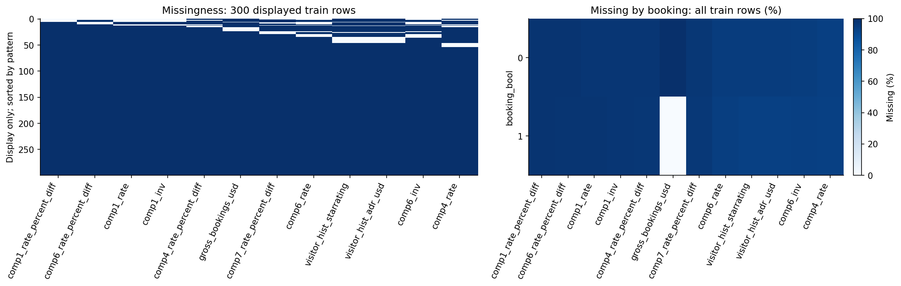
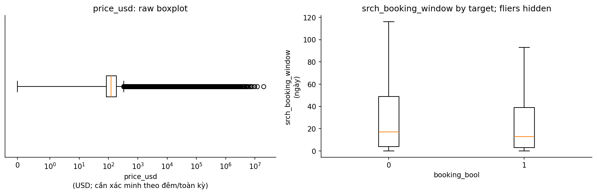
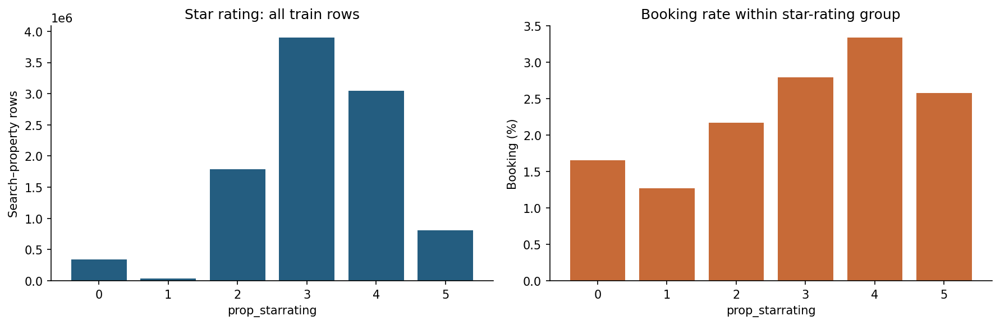
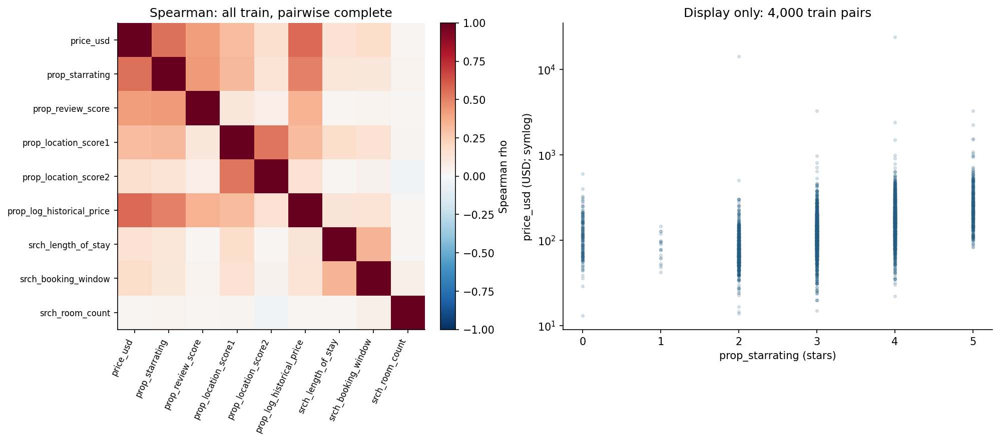

# EXPEDIA — Hiểu tìm kiếm, click và booking ở cấp khách sạn hiển thị

> Phạm vi: EDA trên dữ liệu gốc. Không làm sạch/thay thế dữ liệu, không tạo tập feature, không huấn luyện mô hình.

Ngày phân tích: 2026-11-01. Đây không phải ngày thu thập dữ liệu.

## Tóm tắt điều hành — dữ liệu là gì, đáng tin đến đâu, dùng cho việc gì

1. **Đơn vị:** 9,917,530 cặp search-property, 54 cột thuộc 399,344 searches; test 6,622,629 cặp, 50 cột. Mẫu số phải phân biệt dòng và search (mục 1).

2. **Nhãn toàn bộ train:** click 4.47%, booking 2.79%, booking/click 62.34%. Tử số/mẫu số cụ thể ở mục 2.

3. **Chọn mẫu:** có 0 search hoàn toàn không click trong train hiện tại; không suy CTR/CVR toàn website từ các tỷ lệ này. Bảng cấu trúc nhóm ở mục 2.

4. **Missing khác theo đối thủ:** comp5_rate thiếu 55.19% nhưng comp1_rate 97.62%; không khái quát toàn bộ 24 cột đều >93%. Heatmap/pattern và bảng missing ở mục 2.

5. **Giá đuôi dài — toàn bộ train:** mean 241.78 USD, median 122.07 USD; hàng rào IQR gắn cờ 586,503 giá không thiếu (5.91%). Phân vị, hàng rào và số đếm đều tính trên toàn bộ train, xem boxplot ở mục 2.

6. **Tương quan và nhóm — toàn bộ train:** Spearman giá–hạng sao là 0.552; booking rate theo sao và vị trí xem mục 3–4. Giá, sao và vị trí không phải các cơ chế độc lập đã được kiểm soát.

7. **Leakage/schema:** gross_bookings_usd là kết quả sau booking; position chỉ có trong train; click thực tế không dùng để chấm trước click. Bảng schema và kiểm tra logic ở mục 2/phụ lục.

8. **Tính phù hợp:** phù hợp nghiên cứu propensity/xếp hạng theo search, chưa phải marketing propensity theo user. Không có user ID và không có nhóm search không click nên giới hạn suy rộng phải được giữ trong kết luận (mục 5–6).

## 1. Tổng quan bộ dữ liệu

### Nguồn gốc và phạm vi thu thập

Nguồn công bố: [trang dữ liệu/nghiên cứu gốc](https://www.kaggle.com/c/expedia-personalized-sort/data). [Giấy phép/điều khoản và trang phân phối](https://storage.googleapis.com/kaggle-media/competitions/kaggle/3504/media/Expedia%20Personalized%20Sort%20Official%20Competition%20Rules%20Final.pdf). Thông tin nào chưa được lưu hoặc chưa xác minh được được ghi rõ, không điền bằng giả định.

**Thông tin nguồn và phiên bản**

| item | description |
| --- | --- |
| Tên / nơi công bố | Expedia / Kaggle — Personalize Expedia Hotel Searches, ICDM 2013 |
| Năm công bố | 2013 |
| Mục đích thu thập/công bố | Cá nhân hóa thứ tự khách sạn trong danh sách tìm kiếm dựa trên click/booking. |
| Cách thu thập / quần thể | Search logs, thông tin property, giá/đối thủ và thứ tự hiển thị. Cơ chế chọn search vào bản dữ liệu chưa được giải thích đầy đủ trong file local. |
| Thời gian bao phủ quan sát được | Search train 2012-11-01 00:01:37–2013-06-30 23:58:24; test 2012-11-01 00:03:24–2013-06-30 23:57:15 |
| Ngày tải raw | Chưa được ghi lại; không dùng mtime/ctime để thay ngày tải |
| Quy mô bảng train/chính | 9,917,530 dòng × 54 cột thô |
| Dung lượng mọi CSV của bộ hiện có | 4,133,987,302 byte = 3,942.48 MiB; gồm cả bảng phụ/benchmark nếu có |
| Phiên bản local | Nhận diện bằng tên file, bytes, số dòng và SHA-256 tại phụ lục |
| Giấy phép / điều khoản | Điều khoản cuộc thi Expedia, không xác nhận có giấy phép dữ liệu mở. Phần License trong rules nói về winning entry, không đồng nghĩa giấy phép công bố lại raw data. |

### Nguồn, đơn vị quan sát và câu hỏi propensity

Schema hiện có thuộc [Personalize Expedia Hotel Searches — ICDM 2013](https://www.kaggle.com/c/expedia-personalized-sort/data), khác cuộc thi Expedia Hotel Recommendations dự đoán hotel cluster. Train có **9,917,530 dòng, 54 cột**; test có **6,622,629 dòng, 50 cột**. Mỗi dòng là một cặp **search–property**, không phải một khách hàng hoặc một lượt search độc lập.

Hai nhãn là `click_bool` và `booking_bool`. Phù hợp với click/booking propensity trong ngữ cảnh danh sách tìm kiếm, hoặc nghiên cứu xếp hạng. Không có ID người dùng để trực tiếp hình thành bài toán CRM theo khách hàng; `srch_id` chỉ định danh lượt tìm kiếm.

Câu hỏi EDA: cấu trúc nhóm, quan hệ click–booking, khác biệt tỷ lệ theo ngữ cảnh/khách sạn/vị trí, thiếu dữ liệu theo nhóm cột, khác train–test, và giới hạn suy rộng tỷ lệ từ tập dữ liệu quan sát.

### Phương pháp tính: toàn bộ tập train

**Mọi thống kê train dùng toàn bộ 9,917,530 dòng thuộc 399,344 searches.** CSV được quét theo chunk 250,000 dòng; cột số raw và cờ NA được đệm tạm trên đĩa để tính chính xác trong RAM giới hạn. Cache bị xóa sau khi xuất báo cáo, không phải tập processed hay feature.

Phân vị dùng nội suy tuyến tính trên toàn bộ giá trị không thiếu; std dùng ddof=1 và skewness không chệch theo pandas. IQR và số đếm outlier dùng cùng quần thể đầy đủ. Spearman tính thứ hạng trung bình khi trùng giá trị, bỏ NA và xếp hạng lại riêng từng cặp. Không dùng quantile sketch hoặc mẫu 5% cho thống kê.

**Chỉ lấy mẫu để hiển thị:** scatter tối đa 4.000 điểm và hình pattern missing 300 dòng, seed=42. Histogram, boxplot, heatmap tương quan, bảng missing theo nhãn và mọi kết luận định lượng dùng toàn bộ train. Phạm vi trục giá 0–1.000 USD chỉ là cửa sổ hiển thị; số dòng ngoài cửa sổ được công bố, không bị xóa khỏi thống kê.

Test được quét đầy đủ để đối chiếu schema, khóa, missing, mean/std/min/max và phân phối category/thời gian; không gộp test vào thống kê train. Khóa ghép (srch_id,prop_id) được kiểm tra bằng cặp ID thật. Danh mục file có SHA-256 để nhận diện phiên bản nguồn.

**Phạm vi tính toán từng phân tích**

| analysis | source_train_rows | method |
| --- | --- | --- |
| Quy mô, khóa, missing, nhãn, category, nhóm, thời gian | 9,917,530 | Toàn bộ train; không lấy mẫu |
| Mean/std/min/max, p1/p25/p50/p75/p95/p99, skewness | 9,917,530 | Toàn bộ giá trị không thiếu của từng biến; count_nonnull tại phụ lục |
| IQR, số đếm outlier và boxplot | 9,917,530 | Toàn bộ giá trị không thiếu; giữ nguyên outlier |
| Spearman của 9 biến công bố | 9,917,530 | Toàn bộ cặp không thiếu; số dòng từng cặp tại phụ lục |
| Missing theo booking và tương quan cờ thiếu | 9,917,530 | Toàn bộ train |
| Scatter / hình pattern missing | 9,917,530 | Chỉ hiển thị tối đa 4.000 điểm / 300 dòng; không tính thống kê từ mẫu hiển thị |

## 2. Chất lượng dữ liệu

### Cấu trúc nhóm, nhãn và giới hạn quần thể

Train gồm **399,344 searches**, trung bình **24.83 khách sạn/search**. Có **0 search không click** trong tập train. Vì vậy tập đang phân tích không có nhóm search hoàn toàn không tương tác; không ước lượng tỷ lệ mọi người dùng trên website quyết định click từ tỷ lệ 4–5% trên các dòng này.

Trong raw, mọi booking đều có click ở cùng cặp search–property; tỷ số bookings/clicks là thống kê có điều kiện đúng trên tập hiện tại. Nó không chứng minh việc làm tăng click sẽ gây tăng booking, không tự xác lập chiến lược marketing hay hiệu quả triển khai.

`gross_bookings_usd` là thông tin sau booking. Giá trị hiện diện chỉ ở dòng có booking; có 1 booking bị thiếu gross. Không impute cột kết quả này thành feature. `position` là vị trí hiển thị quan sát được và không có trong test. Click thực tế không phải đầu vào hợp lệ của mô hình dự đoán trước click.

Các dòng trong một search phụ thuộc nhau. Vì vậy không đưa khoảng tin cậy nhị thức giả định mọi impression độc lập; nếu cần suy luận ở giai đoạn sau, phải xét cấu trúc nhóm. Nhóm khóa không trùng không đồng nghĩa người dùng độc lập vì không có user ID.

**Kích thước danh sách theo search**

| population | searches | mean_properties | median_properties | min_properties | max_properties | searches_multiple_timestamps |
| --- | --- | --- | --- | --- | --- | --- |
| train | 399,344 | 24.8346 | 29 | 5 | 38 | 0 |
| test | 266,230 | 24.8756 | 29 | 5 | 37 | 0 |

**Kiểm tra khóa và tính nhất quán kết quả**

| check | n |
| --- | --- |
| Train: cặp srch_id-prop_id trùng (beyond first) | 0 |
| Test: cặp srch_id-prop_id trùng | 0 |
| srch_id xuất hiện cả train và test | 0 |
| prop_id xuất hiện cả train và test | 128,953 |
| Train: search không click | 0 |
| Train: search có >1 booking | 0 |
| Train: booking=1 nhưng click=0 | 0 |
| Train: booking=1 nhưng gross thiếu | 1 |
| Train: booking=0 nhưng gross có giá trị | 0 |
| Train: nhãn ngoài {0,1} hoặc thiếu | 0 |

**Tỷ lệ với tử số/mẫu số cụ thể — toàn bộ train**

| metric | numerator | denominator | pct |
| --- | --- | --- | --- |
| Click / cặp search-property | 443,672 | 9,917,530 | 4.4736 |
| Booking / cặp search-property | 276,593 | 9,917,530 | 2.7889 |
| Booking / cặp đã click | 276,593 | 443,672 | 62.3418 |
| Search có booking / toàn bộ search train | 276,593 | 399,344 | 69.2618 |

### Missing, giá trị đặc biệt và chất lượng giá

Missing được trình bày đủ các cột ở phần schema, với so sánh train–test bên dưới. Nhóm comp có mức thiếu rất khác nhau theo đối thủ và loại thuộc tính; không suy từ top 15 cột thiếu nhiều nhất rằng cả nhóm đều thiếu >93%. Không có dữ liệu đối thủ không chứng minh khách sạn không có đối thủ. Thiếu lịch sử khách không đủ để kết luận khách mới/chưa đăng nhập. Giá 0 và giá cực lớn được định lượng bằng ngưỡng kiểm tra công bố trước; không tự kết luận lỗi, đổi đơn vị hoặc clipping. Định nghĩa giá theo đêm/toàn kỳ chưa được xác minh từ CSV.

**Toàn bộ 24 cột đối thủ — missing theo tập**

| column | train_missing_pct | test_missing_pct |
| --- | --- | --- |
| comp1_rate | 97.6223 | 97.6586 |
| comp1_inv | 97.4345 | 97.4743 |
| comp1_rate_percent_diff | 98.1356 | 98.156 |
| comp2_rate | 59.2577 | 59.2359 |
| comp2_inv | 57.1311 | 57.1107 |
| comp2_rate_percent_diff | 88.8092 | 88.7749 |
| comp3_rate | 69.1529 | 69.3113 |
| comp3_inv | 66.804 | 66.9643 |
| comp3_rate_percent_diff | 90.4814 | 90.5214 |
| comp4_rate | 93.7474 | 93.6915 |
| comp4_inv | 93.0177 | 92.9642 |
| comp4_rate_percent_diff | 97.3359 | 97.3044 |
| comp5_rate | 55.1875 | 55.0628 |
| comp5_inv | 52.3991 | 52.2728 |
| comp5_rate_percent_diff | 83.0502 | 83.0126 |
| comp6_rate | 95.135 | 95.0981 |
| comp6_inv | 94.715 | 94.668 |
| comp6_rate_percent_diff | 98.0508 | 98.0237 |
| comp7_rate | 93.6368 | 93.5586 |
| comp7_inv | 92.8089 | 92.7243 |
| comp7_rate_percent_diff | 97.1985 | 97.1561 |
| comp8_rate | 61.492 | 61.5682 |
| comp8_inv | 60.0668 | 60.1375 |
| comp8_rate_percent_diff | 87.641 | 87.6574 |

**Missing các cột ngoài comp**

| column | train_missing_pct | test_missing_pct |
| --- | --- | --- |
| srch_id | 0 | 0 |
| date_time | 0 | 0 |
| site_id | 0 | 0 |
| visitor_location_country_id | 0 | 0 |
| visitor_hist_starrating | 94.905 | 94.8589 |
| visitor_hist_adr_usd | 94.8817 | 94.8282 |
| prop_country_id | 0 | 0 |
| prop_id | 0 | 0 |
| prop_starrating | 0 | 0 |
| prop_review_score | 0.1475 | 0.1442 |
| prop_brand_bool | 0 | 0 |
| prop_location_score1 | 0 | 0 |
| prop_location_score2 | 21.9649 | 21.9689 |
| prop_log_historical_price | 0 | 0 |
| position | 0 | — |
| price_usd | 0 | 0 |
| promotion_flag | 0 | 0 |
| srch_destination_id | 0 | 0 |
| srch_length_of_stay | 0 | 0 |
| srch_booking_window | 0 | 0 |
| srch_adults_count | 0 | 0 |
| srch_children_count | 0 | 0 |
| srch_room_count | 0 | 0 |
| srch_saturday_night_bool | 0 | 0 |
| srch_query_affinity_score | 93.5915 | 93.5774 |
| orig_destination_distance | 32.4321 | 32.4334 |
| random_bool | 0 | 0 |
| click_bool | 0 | — |
| gross_bookings_usd | 97.2111 | — |
| booking_bool | 0 | — |

**Kiểm tra đuôi giá trên toàn bộ dữ liệu**

| population | rows | price_zero | price_negative | price_above_1000 | price_above_10000 |
| --- | --- | --- | --- | --- | --- |
| train | 9,917,530 | 54 | 0 | 27,018 | 3,936 |
| test | 6,622,629 | 80 | 0 | 17,251 | 2,628 |

### Pattern thiếu và tỷ lệ theo nhãn — toàn bộ train

Chọn 12 cột thiếu nhiều nhất theo toàn bộ train. Bảng tỷ lệ theo booking, số đếm và tương quan cờ NA dùng toàn bộ train; chỉ pattern bên trái hiển thị 300 dòng seed=42. Một booking bị thiếu gross được giữ trong số đếm, không làm tròn thành kết luận không có ngoại lệ.

**Missing theo booking — toàn bộ train (%)**

| booking_bool | comp1_rate_percent_diff | comp6_rate_percent_diff | comp1_rate | comp1_inv | comp4_rate_percent_diff | gross_bookings_usd | comp7_rate_percent_diff | comp6_rate | visitor_hist_starrating | visitor_hist_adr_usd | comp6_inv | comp4_rate |
| --- | --- | --- | --- | --- | --- | --- | --- | --- | --- | --- | --- | --- |
| 0 | 98.1331 | 98.0588 | 97.6186 | 97.4292 | 97.3392 | 100 | 97.2139 | 95.1559 | 94.9475 | 94.9243 | 94.7368 | 93.7516 |
| 1 | 98.2216 | 97.7733 | 97.7537 | 97.6196 | 97.2223 | 0.0004 | 96.6637 | 94.4073 | 93.4254 | 93.3953 | 93.9528 | 93.6043 |

**Số missing theo nhãn và mẫu số nhóm — toàn bộ train**

| booking_bool | full_group_n | comp1_rate_percent_diff | comp6_rate_percent_diff | comp1_rate | comp1_inv | comp4_rate_percent_diff | gross_bookings_usd | comp7_rate_percent_diff | comp6_rate | visitor_hist_starrating | visitor_hist_adr_usd | comp6_inv | comp4_rate |
| --- | --- | --- | --- | --- | --- | --- | --- | --- | --- | --- | --- | --- | --- |
| 0 | 9,640,937 | 9,460,949 | 9,453,784 | 9,411,344 | 9,393,088 | 9,384,407 | 9,640,937 | 9,372,327 | 9,173,919 | 9,153,825 | 9,151,593 | 9,133,518 | 9,038,528 |
| 1 | 276,593 | 271,674 | 270,434 | 270,380 | 270,009 | 268,910 | 1 | 267,365 | 261,124 | 258,408 | 258,325 | 259,867 | 258,903 |

Nhận xét: comp1_rate_percent_diff thiếu 98.14% trên toàn bộ train; chênh lệch missing lớn nhất giữa hai nhãn là 99.9996 điểm phần trăm ở gross_bookings_usd. Bảng tỷ lệ, số đếm và tương quan cờ thiếu dùng đủ 9,917,530 dòng. Chỉ hình pattern bên trái hiển thị 300 dòng, seed=42, sắp theo pattern, không theo thời gian. Ô xanh là NA. Không suy cơ chế MCAR/MAR/MNAR từ hình; cờ thiếu gross booking vẫn tiết lộ kết quả.

### Ngoại lai: lượng hóa trên toàn bộ train

Q1/Q3, hàng rào 1,5×IQR, số đếm và tỷ lệ outlier dùng toàn bộ giá trị không thiếu của từng biến. Boxplot tính từ cùng quần thể đầy đủ; không kết luận giá trị sai chỉ vì vượt hàng rào. Giá trị raw không bị thay thế hoặc xóa.

**Hàng rào IQR và outlier — toàn bộ train**

| column | population | nonnull_n | q1 | q3 | iqr | lower_fence | upper_fence | flagged_n | flagged_pct_nonnull | iqr_zero |
| --- | --- | --- | --- | --- | --- | --- | --- | --- | --- | --- |
| price_usd | toàn bộ train | 9,917,530 | 85 | 185 | 100 | -65 | 335 | 586,503 | 5.9138 | 0 |
| srch_booking_window | toàn bộ train | 9,917,530 | 4 | 49 | 45 | -63.5 | 116.5 | 829,119 | 8.3601 | 0 |
| srch_length_of_stay | toàn bộ train | 9,917,530 | 1 | 3 | 2 | -2 | 6 | 465,314 | 4.6918 | 0 |

Nhận xét: theo hàng rào Q1−1,5×IQR và Q3+1,5×IQR, price_usd có 586,503/9,917,530 giá trị bị gắn cờ (5.91%) trong toàn bộ train; đây là bất thường thống kê, chưa phải lỗi nhập liệu. Median srch_booking_window theo nhãn: 0=17.00, 1=13.00. Boxplot bên phải ẩn các điểm ngoài whisker để đọc vùng giữa, không xóa chúng khỏi bảng hay raw. Đơn vị xem từ điển; IQR=0 ở biến rời rạc có thể gắn cờ nhiều giá trị thật. Trục x boxplot raw dùng symlog; hàng rào IQR vẫn tính trên giá trị raw, không phải log.

## 3. Phân tích đơn biến

### Phân phối định lượng và phân loại

Mọi cột full_* trong bảng train dùng toàn bộ giá trị không thiếu, gồm cả percentile và skewness. Mean/std nhạy với giá cực lớn; đọc cùng median/p95/p99 và max của cùng quần thể. Bảng có 24 biến định lượng, gồm 8 tỷ lệ chênh giá đối thủ và gross_bookings_usd (cột kết quả, không phải feature). Test chỉ đối chiếu thống kê cơ bản, không tính percentile mẫu. Tỷ trọng category tính theo cặp search-property, không phải khách hoặc search; search nhiều khách sạn đóng góp nhiều dòng hơn.

Nhận xét: trên toàn bộ train, giá có mean 241.78 USD, median 122.07 USD và max 19726328.00 USD, cho thấy đuôi phải lớn. Histogram đếm tất cả giá trong 0–1.000 USD; 27,018 dòng trên 1.000 USD vẫn nằm trong thống kê/boxplot. Phân phối số ứng viên dùng đủ 399,344 searches.

### Biến phân loại và nhãn trên toàn bộ train

Hai biểu đồ giữ riêng số cặp và tỷ lệ booking trong mỗi nhóm hạng sao, dùng toàn bộ train.

**Hạng sao — toàn bộ train**

| prop_starrating | n | clicks | bookings | click_pct | booking_pct |
| --- | --- | --- | --- | --- | --- |
| 0 | 337,794 | 9,792 | 5,582 | 2.8988 | 1.6525 |
| 1 | 34,514 | 965 | 439 | 2.796 | 1.2719 |
| 2 | 1,788,994 | 60,596 | 38,892 | 3.3872 | 2.174 |
| 3 | 3,897,419 | 170,869 | 109,049 | 4.3842 | 2.798 |
| 4 | 3,045,848 | 164,118 | 101,691 | 5.3883 | 3.3387 |
| 5 | 812,961 | 37,332 | 20,940 | 4.5921 | 2.5758 |

Nhận xét: trong toàn bộ train, nhóm prop_starrating=4 có booking rate cao nhất trong bảng (3.34%, n=3,045,848); các nhóm có quy mô khác nhau. Mã 0 cần xác minh nghĩa, không mặc định là chất lượng bằng 0; chênh lệch không được điều chỉnh theo giá/vị trí.

## 4. Phân tích đa biến, thời gian và nhóm con

### Mối liên hệ với click/booking theo nhóm

Tất cả bảng dùng toàn bộ train. Phân nhóm giá và booking window chỉ là công cụ đọc bảng EDA; không xuất feature. Tỷ lệ có thể phản ánh vị trí hiển thị, thành phần search, thương hiệu, thời gian và cơ chế chọn mẫu cùng lúc. Không coi chênh lệch promotion_flag là uplift từ khuyến mãi. Bảng không kiểm định nhiều giả thuyết hoặc khẳng định quan hệ nhân quả.

**Tỷ lệ click/booking theo prop_starrating; mẫu số là số cặp trong nhóm**

| prop_starrating | n | clicks | bookings | click_pct | booking_pct | n_under_100 |
| --- | --- | --- | --- | --- | --- | --- |
| 0 | 337,794 | 9,792 | 5,582 | 2.8988 | 1.6525 | 0 |
| 1 | 34,514 | 965 | 439 | 2.796 | 1.2719 | 0 |
| 2 | 1,788,994 | 60,596 | 38,892 | 3.3872 | 2.174 | 0 |
| 3 | 3,897,419 | 170,869 | 109,049 | 4.3842 | 2.798 | 0 |
| 4 | 3,045,848 | 164,118 | 101,691 | 5.3883 | 3.3387 | 0 |
| 5 | 812,961 | 37,332 | 20,940 | 4.5921 | 2.5758 | 0 |

**Tỷ lệ click/booking theo price_group; mẫu số là số cặp trong nhóm**

| price_group | n | clicks | bookings | click_pct | booking_pct | n_under_100 |
| --- | --- | --- | --- | --- | --- | --- |
| <=0 | 54 | 3 | 3 | 5.5556 | 5.5556 | 1 |
| (0,50] | 476,747 | 21,119 | 12,987 | 4.4298 | 2.7241 | 0 |
| (50,100] | 3,122,427 | 148,113 | 99,943 | 4.7435 | 3.2008 | 0 |
| (100,150] | 2,731,429 | 131,984 | 84,533 | 4.832 | 3.0948 | 0 |
| (150,250] | 2,326,363 | 101,679 | 59,608 | 4.3707 | 2.5623 | 0 |
| (250,500] | 1,089,425 | 36,566 | 18,092 | 3.3564 | 1.6607 | 0 |
| (500,1000] | 144,067 | 3,353 | 1,110 | 2.3274 | 0.7705 | 0 |
| >1000 | 27,018 | 855 | 317 | 3.1646 | 1.1733 | 0 |

**Tỷ lệ click/booking theo window_group; mẫu số là số cặp trong nhóm**

| window_group | n | clicks | bookings | click_pct | booking_pct | n_under_100 |
| --- | --- | --- | --- | --- | --- | --- |
| <=0 | 556,154 | 24,235 | 19,161 | 4.3576 | 3.4453 | 0 |
| 1–7 | 2,833,346 | 126,553 | 89,579 | 4.4666 | 3.1616 | 0 |
| 8–30 | 2,950,085 | 131,739 | 82,929 | 4.4656 | 2.8111 | 0 |
| 31–90 | 2,345,949 | 105,136 | 58,437 | 4.4816 | 2.491 | 0 |
| 91–180 | 924,791 | 41,695 | 20,353 | 4.5086 | 2.2008 | 0 |
| 181–365 | 304,402 | 14,132 | 6,069 | 4.6425 | 1.9937 | 0 |
| >365 | 2,803 | 182 | 65 | 6.493 | 2.3189 | 0 |

### Tương quan và tương tác — toàn bộ train

Ma trận Spearman của 9 biến dùng toàn bộ cặp không thiếu, xếp hạng lại riêng từng cặp. Số cặp hợp lệ có tại phụ lục. Chỉ scatter hiển thị tối đa 4.000 điểm seed=42. Chưa thực hiện kiểm định nhiều giả thuyết hoặc kết luận nhân quả/đa cộng tuyến từ tương quan.

**Ma trận Spearman — toàn bộ train**

| column | price_usd | prop_starrating | prop_review_score | prop_location_score1 | prop_location_score2 | prop_log_historical_price | srch_length_of_stay | srch_booking_window | srch_room_count |
| --- | --- | --- | --- | --- | --- | --- | --- | --- | --- |
| price_usd | 1 | 0.5523 | 0.4197 | 0.309 | 0.1616 | 0.5698 | 0.1447 | 0.1818 | 0.0166 |
| prop_starrating | 0.5523 | 1 | 0.4247 | 0.323 | 0.1371 | 0.5011 | 0.1243 | 0.1142 | 0.0372 |
| prop_review_score | 0.4197 | 0.4247 | 1 | 0.1141 | 0.0631 | 0.3443 | 0.0197 | 0.0361 | 0.0106 |
| prop_location_score1 | 0.309 | 0.323 | 0.1141 | 1 | 0.5334 | 0.315 | 0.1724 | 0.1524 | 0.0275 |
| prop_location_score2 | 0.1616 | 0.1371 | 0.0631 | 0.5334 | 1 | 0.1554 | 0.0196 | 0.0418 | -0.0331 |
| prop_log_historical_price | 0.5698 | 0.5011 | 0.3443 | 0.315 | 0.1554 | 1 | 0.1287 | 0.137 | 0.0105 |
| srch_length_of_stay | 0.1447 | 0.1243 | 0.0197 | 0.1724 | 0.0196 | 0.1287 | 1 | 0.3391 | 0.0153 |
| srch_booking_window | 0.1818 | 0.1142 | 0.0361 | 0.1524 | 0.0418 | 0.137 | 0.3391 | 1 | 0.0564 |
| srch_room_count | 0.0166 | 0.0372 | 0.0106 | 0.0275 | -0.0331 | 0.0105 | 0.0153 | 0.0564 | 1 |

Nhận xét: Spearman giá–hạng sao trên toàn bộ cặp hợp lệ của train là 0.552; cặp có |rho| lớn nhất trong ma trận là price_usd–prop_log_historical_price (rho=0.570, n=9,917,530). Ma trận tính lại thứ hạng trên các dòng không thiếu của từng cặp; số dòng từng cặp ở phụ lục. Scatter chỉ hiển thị tối đa 4.000 điểm, seed=42, trục y symlog để đọc đuôi dài. Không biến đổi raw, không chọn feature hoặc kết luận nhân quả/đa cộng tuyến từ tương quan.

### Vị trí hiển thị và cơ chế tiếp xúc

`position` và `random_bool` cần được đọc cùng nhau: khách sạn được hiển thị ở vị trí khác nhau có cơ hội được xem/click khác nhau. Biểu đồ mô tả liên hệ trong từng giá trị cờ; không ước lượng tác động nhân quả của vị trí, xác suất exposure hoặc áp dụng hiệu chỉnh bias. Theo [nghiên cứu dùng dữ liệu Expedia](https://hamsabastani.github.io/proxies.pdf), random_bool=1 đánh dấu danh sách được sắp ngẫu nhiên; vẫn cần xác minh định nghĩa và quy trình tạo tập trước khi suy luận can thiệp. Không dùng position làm feature mặc định cho schema test hiện có.

**Toàn bộ random_bool × position, giữ số dòng mỗi ô**

| random_bool | position | n | clicks | bookings | click_pct | booking_pct |
| --- | --- | --- | --- | --- | --- | --- |
| 0 | 1 | 277,662 | 59,827 | 54,126 | 21.5467 | 19.4935 |
| 0 | 2 | 277,652 | 40,678 | 35,974 | 14.6507 | 12.9565 |
| 0 | 3 | 277,622 | 31,088 | 27,062 | 11.198 | 9.7478 |
| 0 | 4 | 266,073 | 24,500 | 21,057 | 9.208 | 7.914 |
| 0 | 5 | 16,672 | 321 | 199 | 1.9254 | 1.1936 |
| 0 | 6 | 277,308 | 19,837 | 16,885 | 7.1534 | 6.0889 |
| 0 | 7 | 271,435 | 16,238 | 13,657 | 5.9823 | 5.0314 |
| 0 | 8 | 265,486 | 13,722 | 11,479 | 5.1686 | 4.3238 |
| 0 | 9 | 259,865 | 11,499 | 9,527 | 4.425 | 3.6661 |
| 0 | 10 | 237,876 | 10,018 | 8,266 | 4.2114 | 3.4749 |
| 0 | 11 | 20,337 | 153 | 68 | 0.7523 | 0.3344 |
| 0 | 12 | 249,246 | 8,683 | 7,134 | 3.4837 | 2.8622 |
| 0 | 13 | 244,658 | 7,641 | 6,169 | 3.1231 | 2.5215 |
| 0 | 14 | 239,642 | 6,720 | 5,442 | 2.8042 | 2.2709 |
| 0 | 15 | 234,762 | 6,203 | 4,985 | 2.6423 | 2.1234 |
| 0 | 16 | 212,417 | 5,301 | 4,275 | 2.4956 | 2.0126 |
| 0 | 17 | 20,557 | 85 | 32 | 0.4135 | 0.1557 |
| 0 | 18 | 225,419 | 4,873 | 3,869 | 2.1618 | 1.7164 |
| 0 | 19 | 220,940 | 4,366 | 3,477 | 1.9761 | 1.5737 |
| 0 | 20 | 216,469 | 3,973 | 3,147 | 1.8354 | 1.4538 |
| 0 | 21 | 211,938 | 3,674 | 2,861 | 1.7335 | 1.3499 |
| 0 | 22 | 190,234 | 3,162 | 2,437 | 1.6622 | 1.2811 |
| 0 | 23 | 19,674 | 59 | 22 | 0.2999 | 0.1118 |
| 0 | 24 | 202,691 | 3,051 | 2,357 | 1.5052 | 1.1629 |
| 0 | 25 | 198,022 | 2,676 | 2,114 | 1.3514 | 1.0676 |
| 0 | 26 | 193,411 | 2,490 | 1,957 | 1.2874 | 1.0118 |
| 0 | 27 | 188,936 | 2,375 | 1,825 | 1.257 | 0.9659 |
| 0 | 28 | 184,559 | 2,090 | 1,619 | 1.1324 | 0.8772 |
| 0 | 29 | 179,912 | 1,865 | 1,430 | 1.0366 | 0.7948 |
| 0 | 30 | 174,730 | 1,737 | 1,321 | 0.9941 | 0.756 |
| 0 | 31 | 168,703 | 1,606 | 1,225 | 0.952 | 0.7261 |
| 0 | 32 | 159,192 | 1,427 | 1,071 | 0.8964 | 0.6728 |
| 0 | 33 | 150,677 | 1,294 | 1,005 | 0.8588 | 0.667 |
| 0 | 34 | 142,218 | 1,217 | 930 | 0.8557 | 0.6539 |
| 0 | 35 | 127,223 | 1,003 | 744 | 0.7884 | 0.5848 |
| 0 | 36 | 99,323 | 727 | 576 | 0.732 | 0.5799 |
| 0 | 37 | 55,520 | 401 | 315 | 0.7223 | 0.5674 |
| 0 | 38 | 16,424 | 119 | 96 | 0.7245 | 0.5845 |
| 0 | 39 | 2,293 | 16 | 12 | 0.6978 | 0.5233 |
| 0 | 40 | 100 | 1 | 1 | 1 | 1 |
| 1 | 1 | 120,907 | 17,171 | 2,227 | 14.2018 | 1.8419 |
| 1 | 2 | 120,814 | 13,056 | 1,749 | 10.8067 | 1.4477 |
| 1 | 3 | 120,862 | 10,962 | 1,505 | 9.0698 | 1.2452 |
| 1 | 4 | 120,354 | 9,414 | 1,202 | 7.8219 | 0.9987 |
| 1 | 5 | 1,928 | 108 | 14 | 5.6017 | 0.7261 |
| 1 | 6 | 120,792 | 8,446 | 1,036 | 6.9922 | 0.8577 |
| 1 | 7 | 117,788 | 7,223 | 885 | 6.1322 | 0.7513 |
| 1 | 8 | 114,876 | 6,298 | 718 | 5.4824 | 0.625 |
| 1 | 9 | 112,146 | 5,784 | 641 | 5.1576 | 0.5716 |
| 1 | 10 | 108,891 | 5,105 | 605 | 4.6882 | 0.5556 |
| 1 | 11 | 1,990 | 42 | 4 | 2.1106 | 0.201 |
| 1 | 12 | 107,088 | 4,621 | 544 | 4.3151 | 0.508 |
| 1 | 13 | 104,762 | 4,265 | 474 | 4.0711 | 0.4525 |
| 1 | 14 | 102,376 | 3,864 | 432 | 3.7743 | 0.422 |
| 1 | 15 | 100,146 | 3,596 | 386 | 3.5908 | 0.3854 |
| 1 | 16 | 96,956 | 3,418 | 328 | 3.5253 | 0.3383 |
| 1 | 17 | 1,941 | 13 | 0 | 0.6698 | 0 |
| 1 | 18 | 95,593 | 3,037 | 318 | 3.177 | 0.3327 |
| 1 | 19 | 93,463 | 2,854 | 278 | 3.0536 | 0.2974 |
| 1 | 20 | 91,379 | 2,806 | 261 | 3.0707 | 0.2856 |
| 1 | 21 | 89,204 | 2,505 | 231 | 2.8082 | 0.259 |
| 1 | 22 | 86,184 | 2,365 | 206 | 2.7441 | 0.239 |
| 1 | 23 | 1,781 | 19 | 2 | 1.0668 | 0.1123 |
| 1 | 24 | 84,954 | 2,197 | 219 | 2.5861 | 0.2578 |
| 1 | 25 | 82,742 | 1,999 | 179 | 2.4159 | 0.2163 |
| 1 | 26 | 80,651 | 1,992 | 200 | 2.4699 | 0.248 |
| 1 | 27 | 78,535 | 1,815 | 163 | 2.3111 | 0.2076 |
| 1 | 28 | 76,412 | 1,718 | 161 | 2.2483 | 0.2107 |
| 1 | 29 | 74,179 | 1,606 | 123 | 2.165 | 0.1658 |
| 1 | 30 | 71,690 | 1,544 | 114 | 2.1537 | 0.159 |
| 1 | 31 | 69,025 | 1,478 | 148 | 2.1413 | 0.2144 |
| 1 | 32 | 64,381 | 1,298 | 115 | 2.0161 | 0.1786 |
| 1 | 33 | 60,834 | 1,269 | 113 | 2.086 | 0.1858 |
| 1 | 34 | 56,515 | 1,117 | 94 | 1.9765 | 0.1663 |
| 1 | 35 | 48,503 | 939 | 80 | 1.936 | 0.1649 |
| 1 | 36 | 34,954 | 619 | 50 | 1.7709 | 0.143 |
| 1 | 37 | 18,293 | 316 | 29 | 1.7274 | 0.1585 |
| 1 | 38 | 4,952 | 65 | 9 | 1.3126 | 0.1817 |
| 1 | 39 | 781 | 12 | 2 | 1.5365 | 0.2561 |
| 1 | 40 | 30 | 0 | 0 | 0 | 0 |

Nhận xét: tại vị trí nhỏ nhất quan sát được, random_bool=0: click 21.55%, booking 19.49%, n=277,662; random_bool=1: click 14.20%, booking 1.84%, n=120,907. Chênh lệch giữa các cơ chế xếp hạng và sự phụ thuộc theo vị trí cho thấy CTR không chỉ phản ánh sở thích; đây chưa phải ước lượng nhân quả của thứ hạng.

### Thời gian và so sánh train–test

Khoảng thời gian và phân bố category được tính trực tiếp, không giả định test nằm sau train. Tháng đầu/cuối có thể không đầy đủ. Total variation so sánh phân phối category ở cấp dòng, không đại diện đầy đủ cho drift ở cấp search/user. Test không có nhãn nên không tính click/booking rate cho test. Bất kỳ đánh giá tương lai nào ở giai đoạn sau cần giữ nguyên srch_id trong một tập và thiết kế thời gian theo mục tiêu triển khai; chưa thực hiện chia tập ở đây.

**Khoảng thời gian toàn bộ mỗi tập**

| population | min_date_time | max_date_time | searches |
| --- | --- | --- | --- |
| train | 2012-11-01 00:01:37 | 2013-06-30 23:58:24 | 399,344 |
| test | 2012-11-01 00:03:24 | 2013-06-30 23:57:15 | 266,230 |

**Khác biệt category train–test, toàn bộ dòng**

| column | total_variation_0_1 | test_only_categories |
| --- | --- | --- |
| srch_destination_id | 0.0961 | 4,701 |
| prop_country_id | 0.0053 | 2 |
| visitor_location_country_id | 0.0048 | 5 |
| site_id | 0.0025 | 0 |
| comp3_inv | 0.0016 | 0 |
| comp3_rate | 0.0016 | 0 |
| srch_saturday_night_bool | 0.0014 | 0 |
| comp5_inv | 0.0013 | 0 |
| comp5_rate | 0.0012 | 0 |
| random_bool | 0.001 | 0 |
| comp8_rate | 0.0009 | 0 |
| comp7_inv | 0.0008 | 0 |
| prop_starrating | 0.0008 | 0 |
| comp8_inv | 0.0008 | 0 |
| comp7_rate | 0.0008 | 0 |
| comp4_inv | 0.0006 | 0 |
| comp4_rate | 0.0006 | 0 |
| comp6_inv | 0.0005 | 0 |
| comp1_rate | 0.0004 | 0 |
| comp1_inv | 0.0004 | 0 |
| comp6_rate | 0.0004 | 0 |
| comp2_rate | 0.0004 | 0 |
| comp2_inv | 0.0003 | 0 |
| prop_brand_bool | 0.0002 | 0 |
| promotion_flag | 0.0002 | 0 |

Nhận xét: tỷ lệ click theo tháng dao động 4.37–4.56%, booking 2.63–2.86% trong train. Khoảng thời gian chưa đủ nhiều chu kỳ năm để khẳng định mùa vụ bền vững; quy mô dòng còn phụ thuộc số property/search.

## 5. Hạn chế, rủi ro và quyền riêng tư

Tách điều đã quan sát khỏi nguyên nhân chưa được chứng minh. Không diễn giải chênh lệch nhóm thành đặc điểm cố hữu của giới tính/tuổi/quốc gia và không thực hiện nhận diện lại cá nhân.

**Rủi ro và giới hạn sử dụng**

| issue | evidence_or_limit |
| --- | --- |
| Quyền riêng tư | Không có user ID trực tiếp trong schema; thời gian, vị trí quốc gia và hồ sơ lịch sử vẫn là thông tin hành vi. Không suy lại danh tính. |
| Quần thể | Train không có search không click; xếp hạng, exposure và cách chọn mẫu làm tỷ lệ khác toàn bộ traffic. |
| Phụ thuộc / bias | Nhiều property trong một search phụ thuộc nhau; chưa có user ID để kiểm soát searches lặp của cùng người. |
| Rò rỉ | gross_bookings_usd là kết quả; position không có trong test; click tương lai không dùng để dự đoán trước click. |
| Đồng ý / quyền sử dụng | CSV không có biểu mẫu đồng ý hay hồ sơ pháp lý thu thập. Không suy dữ liệu công khai = đồng ý cho mọi mục đích; đọc điều khoản nguồn, không tự gán giấy phép mở. |
| Giới hạn suy luận | EDA là mô tả, không phải kiểm định tác động can thiệp. Khoảng Wilson nếu có chỉ theo giả định độc lập; chưa đánh giá chất lượng mô hình hoặc tính công bằng của mô hình. |

## 6. Kết luận và đề xuất bước tiếp theo

### Kết luận và câu hỏi còn mở

**Đã kiểm chứng trên toàn bộ train:** 9,917,530 cặp search-property thuộc 399,344 searches; click 4.47%, booking 2.79%, booking/click 62.34%. Không có search hoàn toàn không click trong tập train hiện tại. Số cột đối thủ là 24 và tỷ lệ missing khác nhau mạnh theo đối thủ. Gross bookings là kết quả; position không có trong test.

**Mức độ phù hợp:** phù hợp nghiên cứu propensity/xếp hạng ở cấp khách sạn trong search, chưa phải propensity marketing theo user hoặc CTR/CVR toàn website. Two-stage click/booking là một khả năng định nghĩa bài toán, không phải kết luận bắt buộc từ tỷ số booking/click cao.

**Cần xác minh:** cơ chế đưa search vào dữ liệu và nhóm không click bị thiếu; tính sẵn có của từng điểm do Expedia sinh; nghĩa/đơn vị và cách hình thành giá; quy trình random_bool; khả năng nhận diện người dùng và lần tìm kiếm lặp; phạm vi áp dụng ngoài dữ liệu lịch sử.

Không class weighting, resampling, imputation, clipping, encoding, feature engineering hay train/rank model. Không tạo tập processed hoặc tự quyết định loại cột missing cao. Các câu hỏi và thống kê ở đây phục vụ hiểu dữ liệu trước giai đoạn tiếp theo.

### Đề xuất bước tiếp theo — chưa thực hiện

Các lựa chọn dưới đây là hướng nghiên cứu dựa trên EDA, không phải các phép tiền xử lý/feature/model đã được áp dụng. Chốt đối tượng, t0, thời hạn nhãn và tiêu chí kinh doanh trước; fit mọi phép biến đổi ở tập train sau khi thiết kế đánh giá.

**Đề xuất và cơ sở dữ liệu**

| topic | eda_basis | proposal_only |
| --- | --- | --- |
| Missing / giá | Comp/history thiếu nhiều nhưng có quy luật | Thử chiến lược missing trên train sau khi hiểu nghĩa NA; không ép drop/giữ mọi cột chỉ từ missing rate |
| Mã hóa / chuẩn hóa | Nhiều ID; giá đuôi dài | Category encoding và xử lý giá chỉ trong train, xác minh đơn vị; scaling không mặc định với cây |
| Cân bằng lớp | Click/booking hiếm ở cấp cặp | Nếu thử sampling/weight, chỉ thực hiện trên train và kiểm tra lại calibration; giữ đủ group search |
| Feature engineering (đề xuất) | Thuộc tính property trong cùng search có quan hệ tương đối | Có thể nghiên cứu giá/vị trí tương đối trong tập ứng viên có sẵn tại t0; không dùng vị trí/booking sau sự kiện |
| Hướng mô hình (đề xuất) | Search-property với hai hành vi | So sánh baseline propensity hoặc learning-to-rank theo mục tiêu; chia theo srch_id và đánh giá thời gian/calibration, chưa chọn phương án cuối |

## Phụ lục — từ điển và bảng chi tiết

### Từ điển đủ 54 cột và schema train–test

Các ID được đọc thành số nhưng mang ý nghĩa phân loại. Nhóm đối thủ có **8 × 3 = 24 cột**, không phải 16. Bốn cột chỉ có ở train là position, click_bool, booking_bool, gross_bookings_usd. Sau khi tách bốn cột này, có 50 cột chung với test; đây là số cột schema, chưa phải số feature được phê duyệt sử dụng. Nếu srch_id chỉ làm khóa nhóm thì còn 49 cột ứng viên; prop_id vẫn cần quyết định cách dùng phù hợp ở giai đoạn sau.

**Schema và missing toàn bộ train**

| column | pandas_dtype | full_missing_n | full_missing_pct | in_test | meaning | role_or_caution | role | unit | observed_domain_and_basis |
| --- | --- | --- | --- | --- | --- | --- | --- | --- | --- |
| srch_id | int64 | 0 | 0 | 1 | ID lượt tìm kiếm | Khóa nhóm, không phải ID người dùng | định danh / khóa nhóm, không phải số liên tục | mã/nhãn phân loại, không có đơn vị vật lý | Khóa/mã; không in giá trị định danh cá nhân trong báo cáo |
| date_time | object | 0 | 0 | 1 | Thời điểm tìm kiếm | Thời gian, không giả định timezone không được công bố | đầu vào ứng viên; chưa xác nhận khả dụng tại t0 | ngày/giờ theo định dạng nguồn; timezone chưa xác minh | Toàn train: 2012-11-01 00:01:37–2013-06-30 23:58:24 |
| site_id | int64 | 0 | 0 | 1 | ID website/điểm bán Expedia | Phân loại | đầu vào ứng viên; chưa xác nhận khả dụng tại t0 | mã/nhãn phân loại, không có đơn vị vật lý | Toàn file: 34 mã khác nhau |
| visitor_location_country_id | int64 | 0 | 0 | 1 | ID quốc gia vị trí người tìm | Phân loại, không phải mã có thứ tự | đầu vào ứng viên; chưa xác nhận khả dụng tại t0 | mã/nhãn phân loại, không có đơn vị vật lý | Toàn file: 218 mã khác nhau |
| visitor_hist_starrating | float64 | 9,412,233 | 94.905 | 1 | Mức sao trung bình trong lịch sử khách | NA không đủ chứng minh khách mới/chưa đăng nhập | đầu vào ứng viên; chưa xác nhận khả dụng tại t0 | sao | Toàn file: [1, 5]; NA thống kê riêng |
| visitor_hist_adr_usd | float64 | 9,409,918 | 94.8817 | 1 | ADR lịch sử của khách, USD | Cần xác minh cửa sổ lịch sử và cách tính | đầu vào ứng viên; chưa xác nhận khả dụng tại t0 | USD | Toàn file: [0, 2768.93]; NA thống kê riêng |
| prop_country_id | int64 | 0 | 0 | 1 | ID quốc gia khách sạn | Phân loại | đầu vào ứng viên; chưa xác nhận khả dụng tại t0 | mã/nhãn phân loại, không có đơn vị vật lý | Toàn file: 172 mã khác nhau |
| prop_id | int64 | 0 | 0 | 1 | ID khách sạn | Thực thể có thể lặp qua searches; không phải số liên tục | định danh / khóa nhóm, không phải số liên tục | mã/nhãn phân loại, không có đơn vị vật lý | Khóa/mã; không in giá trị định danh cá nhân trong báo cáo |
| prop_starrating | int64 | 0 | 0 | 1 | Hạng sao khách sạn | 0 cần xác minh nghĩa; không tự xem là 0 sao chất lượng thấp | đầu vào ứng viên; chưa xác nhận khả dụng tại t0 | sao | Toàn file: [0, 5]; NA thống kê riêng |
| prop_review_score | float64 | 14,630 | 0.1475 | 1 | Điểm review khách sạn | 0 và NA là hai trường hợp cần phân biệt | đầu vào ứng viên; chưa xác nhận khả dụng tại t0 | điểm theo thang nguồn | Toàn file: [0, 5]; NA thống kê riêng |
| prop_brand_bool | int64 | 0 | 0 | 1 | Cờ thuộc thương hiệu/chuỗi | Nhị phân; cố định nhãn 0/1 khi vẽ | đầu vào ứng viên; chưa xác nhận khả dụng tại t0 | cờ 0/1 | Toàn file: 0, 1 |
| prop_location_score1 | float64 | 0 | 0 | 1 | Điểm vị trí thứ nhất | Thước đo do nguồn cung cấp | đầu vào ứng viên; chưa xác nhận khả dụng tại t0 | điểm theo thang nguồn | Toàn file: [0, 6.98]; NA thống kê riêng |
| prop_location_score2 | float64 | 2,178,380 | 21.9649 | 1 | Điểm vị trí thứ hai | Thước đo do nguồn cung cấp; có NA | đầu vào ứng viên; chưa xác nhận khả dụng tại t0 | điểm theo thang nguồn | Toàn file: [0, 1]; NA thống kê riêng |
| prop_log_historical_price | float64 | 0 | 0 | 1 | Log giá lịch sử khách sạn | Không tự khôi phục tiền khi chưa biết cơ số/cách tính | đầu vào ứng viên; chưa xác nhận khả dụng tại t0 | log giá; cơ số cần xác minh | Toàn file: [0, 6.21]; NA thống kê riêng |
| position | int64 | 0 | 0 | 0 | Vị trí hiển thị quan sát được | Có trong train, không có trong test; có ảnh hưởng vị trí | metadata hiển thị, chỉ có train | thứ hạng hiển thị | Toàn file: 40 mã khác nhau |
| price_usd | float64 | 0 | 0 | 1 | Giá hiển thị cho khách sạn trong search, USD | Cần xác minh đơn vị giá theo đêm/toàn kỳ; có đuôi cực lớn | đầu vào ứng viên; chưa xác nhận khả dụng tại t0 | USD; cần xác minh theo đêm/toàn kỳ | Toàn file: [0, 1.97263e+07]; NA thống kê riêng |
| promotion_flag | int64 | 0 | 0 | 1 | Cờ hiển thị khuyến mãi | Liên hệ quan sát không chứng minh tác động khuyến mãi | đầu vào ứng viên; chưa xác nhận khả dụng tại t0 | cờ 0/1 | Toàn file: 0, 1 |
| srch_destination_id | int64 | 0 | 0 | 1 | ID điểm đến tìm kiếm | Phân loại | đầu vào ứng viên; chưa xác nhận khả dụng tại t0 | mã/nhãn phân loại, không có đơn vị vật lý | Toàn file: 23715 mã khác nhau |
| srch_length_of_stay | int64 | 0 | 0 | 1 | Số đêm lưu trú tìm kiếm | Số đếm | đầu vào ứng viên; chưa xác nhận khả dụng tại t0 | đêm | Toàn file: [1, 59]; NA thống kê riêng |
| srch_booking_window | int64 | 0 | 0 | 1 | Số ngày từ search đến ngày đến | Đơn vị ngày | đầu vào ứng viên; chưa xác nhận khả dụng tại t0 | ngày | Toàn file: [0, 498]; NA thống kê riêng |
| srch_adults_count | int64 | 0 | 0 | 1 | Số người lớn trong search | Số đếm | đầu vào ứng viên; chưa xác nhận khả dụng tại t0 | người | Toàn file: [1, 9]; NA thống kê riêng |
| srch_children_count | int64 | 0 | 0 | 1 | Số trẻ em trong search | Số đếm | đầu vào ứng viên; chưa xác nhận khả dụng tại t0 | người | Toàn file: [0, 9]; NA thống kê riêng |
| srch_room_count | int64 | 0 | 0 | 1 | Số phòng trong search | Số đếm | đầu vào ứng viên; chưa xác nhận khả dụng tại t0 | phòng | Toàn file: [1, 8]; NA thống kê riêng |
| srch_saturday_night_bool | int64 | 0 | 0 | 1 | Cờ kỳ lưu trú có đêm thứ Bảy | Nhị phân | đầu vào ứng viên; chưa xác nhận khả dụng tại t0 | cờ 0/1 | Toàn file: 0, 1 |
| srch_query_affinity_score | float64 | 9,281,966 | 93.5915 | 1 | Điểm liên quan query–property do nguồn cung cấp | Cần xác minh cách sinh và tính sẵn có | đầu vào ứng viên; chưa xác nhận khả dụng tại t0 | điểm theo thang nguồn | Toàn file: [-326.567, -2.4941]; NA thống kê riêng |
| orig_destination_distance | float64 | 3,216,461 | 32.4321 | 1 | Khoảng cách nguồn–điểm đến theo nguồn | Đơn vị cần xác minh; không tự gán km | đầu vào ứng viên; chưa xác nhận khả dụng tại t0 | khoảng cách; đơn vị cần xác minh | Toàn file: [0.01, 11693]; NA thống kê riêng |
| random_bool | int64 | 0 | 0 | 1 | Cờ danh sách được sắp ngẫu nhiên | Phân tích ảnh hưởng vị trí; không tự suy ra exposure propensity | đầu vào ứng viên; chưa xác nhận khả dụng tại t0 | cờ 0/1 | Toàn file: 0, 1 |
| comp1_rate | float64 | 9,681,724 | 97.6223 | 1 | So sánh giá với đối thủ 1, mã phân loại | Không coi mã -1/0/1 là giá; xác minh hướng so sánh theo nguồn | đầu vào ứng viên; chưa xác nhận khả dụng tại t0 | mã/nhãn phân loại, không có đơn vị vật lý | Toàn file: -1.0, 0.0, 1.0 |
| comp1_inv | float64 | 9,663,097 | 97.4345 | 1 | So sánh tồn phòng với đối thủ 1 | Mã phân loại; NA không phải không có đối thủ | đầu vào ứng viên; chưa xác nhận khả dụng tại t0 | mã/nhãn phân loại, không có đơn vị vật lý | Toàn file: -1.0, 0.0, 1.0 |
| comp1_rate_percent_diff | float64 | 9,732,623 | 98.1356 | 1 | Chênh lệch giá phần trăm đối thủ 1 | NA có thể theo điều kiện sinh dữ liệu; xác minh mẫu số/hướng | đầu vào ứng viên; chưa xác nhận khả dụng tại t0 | % theo định nghĩa nguồn | Toàn file: [2, 30389]; NA thống kê riêng |
| comp2_rate | float64 | 5,876,897 | 59.2577 | 1 | So sánh giá với đối thủ 2, mã phân loại | Không coi mã -1/0/1 là giá; xác minh hướng so sánh theo nguồn | đầu vào ứng viên; chưa xác nhận khả dụng tại t0 | mã/nhãn phân loại, không có đơn vị vật lý | Toàn file: -1.0, 0.0, 1.0 |
| comp2_inv | float64 | 5,665,992 | 57.1311 | 1 | So sánh tồn phòng với đối thủ 2 | Mã phân loại; NA không phải không có đối thủ | đầu vào ứng viên; chưa xác nhận khả dụng tại t0 | mã/nhãn phân loại, không có đơn vị vật lý | Toàn file: -1.0, 0.0, 1.0 |
| comp2_rate_percent_diff | float64 | 8,807,683 | 88.8092 | 1 | Chênh lệch giá phần trăm đối thủ 2 | NA có thể theo điều kiện sinh dữ liệu; xác minh mẫu số/hướng | đầu vào ứng viên; chưa xác nhận khả dụng tại t0 | % theo định nghĩa nguồn | Toàn file: [2, 1.43992e+06]; NA thống kê riêng |
| comp3_rate | float64 | 6,858,257 | 69.1529 | 1 | So sánh giá với đối thủ 3, mã phân loại | Không coi mã -1/0/1 là giá; xác minh hướng so sánh theo nguồn | đầu vào ứng viên; chưa xác nhận khả dụng tại t0 | mã/nhãn phân loại, không có đơn vị vật lý | Toàn file: -1.0, 0.0, 1.0 |
| comp3_inv | float64 | 6,625,309 | 66.804 | 1 | So sánh tồn phòng với đối thủ 3 | Mã phân loại; NA không phải không có đối thủ | đầu vào ứng viên; chưa xác nhận khả dụng tại t0 | mã/nhãn phân loại, không có đơn vị vật lý | Toàn file: -1.0, 0.0, 1.0 |
| comp3_rate_percent_diff | float64 | 8,973,523 | 90.4814 | 1 | Chênh lệch giá phần trăm đối thủ 3 | NA có thể theo điều kiện sinh dữ liệu; xác minh mẫu số/hướng | đầu vào ứng viên; chưa xác nhận khả dụng tại t0 | % theo định nghĩa nguồn | Toàn file: [2, 199266]; NA thống kê riêng |
| comp4_rate | float64 | 9,297,431 | 93.7474 | 1 | So sánh giá với đối thủ 4, mã phân loại | Không coi mã -1/0/1 là giá; xác minh hướng so sánh theo nguồn | đầu vào ứng viên; chưa xác nhận khả dụng tại t0 | mã/nhãn phân loại, không có đơn vị vật lý | Toàn file: -1.0, 0.0, 1.0 |
| comp4_inv | float64 | 9,225,059 | 93.0177 | 1 | So sánh tồn phòng với đối thủ 4 | Mã phân loại; NA không phải không có đối thủ | đầu vào ứng viên; chưa xác nhận khả dụng tại t0 | mã/nhãn phân loại, không có đơn vị vật lý | Toàn file: -1.0, 0.0, 1.0 |
| comp4_rate_percent_diff | float64 | 9,653,317 | 97.3359 | 1 | Chênh lệch giá phần trăm đối thủ 4 | NA có thể theo điều kiện sinh dữ liệu; xác minh mẫu số/hướng | đầu vào ứng viên; chưa xác nhận khả dụng tại t0 | % theo định nghĩa nguồn | Toàn file: [2, 1.00158e+06]; NA thống kê riêng |
| comp5_rate | float64 | 5,473,236 | 55.1875 | 1 | So sánh giá với đối thủ 5, mã phân loại | Không coi mã -1/0/1 là giá; xác minh hướng so sánh theo nguồn | đầu vào ứng viên; chưa xác nhận khả dụng tại t0 | mã/nhãn phân loại, không có đơn vị vật lý | Toàn file: -1.0, 0.0, 1.0 |
| comp5_inv | float64 | 5,196,697 | 52.3991 | 1 | So sánh tồn phòng với đối thủ 5 | Mã phân loại; NA không phải không có đối thủ | đầu vào ứng viên; chưa xác nhận khả dụng tại t0 | mã/nhãn phân loại, không có đơn vị vật lý | Toàn file: -1.0, 0.0, 1.0 |
| comp5_rate_percent_diff | float64 | 8,236,524 | 83.0502 | 1 | Chênh lệch giá phần trăm đối thủ 5 | NA có thể theo điều kiện sinh dữ liệu; xác minh mẫu số/hướng | đầu vào ứng viên; chưa xác nhận khả dụng tại t0 | % theo định nghĩa nguồn | Toàn file: [2, 607561]; NA thống kê riêng |
| comp6_rate | float64 | 9,435,043 | 95.135 | 1 | So sánh giá với đối thủ 6, mã phân loại | Không coi mã -1/0/1 là giá; xác minh hướng so sánh theo nguồn | đầu vào ứng viên; chưa xác nhận khả dụng tại t0 | mã/nhãn phân loại, không có đơn vị vật lý | Toàn file: -1.0, 0.0, 1.0 |
| comp6_inv | float64 | 9,393,385 | 94.715 | 1 | So sánh tồn phòng với đối thủ 6 | Mã phân loại; NA không phải không có đối thủ | đầu vào ứng viên; chưa xác nhận khả dụng tại t0 | mã/nhãn phân loại, không có đơn vị vật lý | Toàn file: -1.0, 0.0, 1.0 |
| comp6_rate_percent_diff | float64 | 9,724,218 | 98.0508 | 1 | Chênh lệch giá phần trăm đối thủ 6 | NA có thể theo điều kiện sinh dữ liệu; xác minh mẫu số/hướng | đầu vào ứng viên; chưa xác nhận khả dụng tại t0 | % theo định nghĩa nguồn | Toàn file: [2, 1.12569e+06]; NA thống kê riêng |
| comp7_rate | float64 | 9,286,453 | 93.6368 | 1 | So sánh giá với đối thủ 7, mã phân loại | Không coi mã -1/0/1 là giá; xác minh hướng so sánh theo nguồn | đầu vào ứng viên; chưa xác nhận khả dụng tại t0 | mã/nhãn phân loại, không có đơn vị vật lý | Toàn file: -1.0, 0.0, 1.0 |
| comp7_inv | float64 | 9,204,355 | 92.8089 | 1 | So sánh tồn phòng với đối thủ 7 | Mã phân loại; NA không phải không có đối thủ | đầu vào ứng viên; chưa xác nhận khả dụng tại t0 | mã/nhãn phân loại, không có đơn vị vật lý | Toàn file: -1.0, 0.0, 1.0 |
| comp7_rate_percent_diff | float64 | 9,639,692 | 97.1985 | 1 | Chênh lệch giá phần trăm đối thủ 7 | NA có thể theo điều kiện sinh dữ liệu; xác minh mẫu số/hướng | đầu vào ứng viên; chưa xác nhận khả dụng tại t0 | % theo định nghĩa nguồn | Toàn file: [2, 30216]; NA thống kê riêng |
| comp8_rate | float64 | 6,098,487 | 61.492 | 1 | So sánh giá với đối thủ 8, mã phân loại | Không coi mã -1/0/1 là giá; xác minh hướng so sánh theo nguồn | đầu vào ứng viên; chưa xác nhận khả dụng tại t0 | mã/nhãn phân loại, không có đơn vị vật lý | Toàn file: -1.0, 0.0, 1.0 |
| comp8_inv | float64 | 5,957,142 | 60.0668 | 1 | So sánh tồn phòng với đối thủ 8 | Mã phân loại; NA không phải không có đối thủ | đầu vào ứng viên; chưa xác nhận khả dụng tại t0 | mã/nhãn phân loại, không có đơn vị vật lý | Toàn file: -1.0, 0.0, 1.0 |
| comp8_rate_percent_diff | float64 | 8,691,823 | 87.641 | 1 | Chênh lệch giá phần trăm đối thủ 8 | NA có thể theo điều kiện sinh dữ liệu; xác minh mẫu số/hướng | đầu vào ứng viên; chưa xác nhận khả dụng tại t0 | % theo định nghĩa nguồn | Toàn file: [2, 149400]; NA thống kê riêng |
| click_bool | int64 | 0 | 0 | 0 | Khách sạn có click trong search, 0/1 | Target/biến kết quả; không dùng click tương lai dự đoán trước click | đích | cờ 0/1 | Toàn file: 0, 1 |
| gross_bookings_usd | float64 | 9,640,938 | 97.2111 | 0 | Giá trị booking ghi nhận, USD | Kết quả sau booking; presence gần như tiết lộ nhãn | kết quả / nguy cơ rò rỉ đích | USD | Toàn file: [0, 167741]; NA thống kê riêng |
| booking_bool | int64 | 0 | 0 | 0 | Khách sạn được book trong search, 0/1 | Target | đích | cờ 0/1 | Toàn file: 0, 1 |

### Danh mục file, dung lượng và SHA-256

Phiên bản local được xác định bằng các giá trị dưới đây; không suy ngày tải từ ngày sửa file.

**Danh mục file; ba benchmark là thứ tự kết quả trên test, không phải dữ liệu train bổ sung**

| file | data_lines | columns | bytes | sha256 |
| --- | --- | --- | --- | --- |
| basicPythonBenchmark.csv | 6,622,629 | 2 | 92,985,279 | 7de0c115bd3a2a90bc9db65f4679233c0088a2b334868a6b06dde7af08d5a485 |
| randomBenchmark.csv | 6,622,629 | 2 | 92,985,279 | 5f28a62102d125a406cdd397181205b4b7af8ceb417e6e964ca16b13aeb01b5f |
| test.csv | 6,622,629 | 50 | 1,496,916,672 | be1d56681726315393c829f7c94f85d4f8c886748a903e6ec120bb8080538205 |
| testOrderBenchmark.csv | 6,622,629 | 2 | 92,985,279 | 42ecaf9f4bbca6ed62be0e3199523151e513584d39fa5d47adb752a5c7d76adf |
| train.csv | 9,917,530 | 54 | 2,358,114,793 | 84a53139ea92df1e9400f84852facbd78f3136f366a08440f4ab4518e71a49a9 |

### Bảng đơn biến đầy đủ

Các bảng thống kê dưới đây bổ sung cho các biểu đồ ở phần chính. Top category không phải toàn bộ domain; đối chiếu từ điển.

**Train: thống kê chính xác toàn bộ giá trị không thiếu**

| column | full_count_nonnull | full_mean | full_std | full_min | full_max | full_p1 | full_p25 | full_p50 | full_p75 | full_p95 | full_p99 | full_skewness |
| --- | --- | --- | --- | --- | --- | --- | --- | --- | --- | --- | --- | --- |
| visitor_hist_starrating | 505,297 | 3.3746 | 0.6922 | 1 | 5 | 2 | 2.92 | 3.44 | 3.94 | 4.5 | 5 | -0.0758 |
| visitor_hist_adr_usd | 507,612 | 176.5885 | 108.4348 | 0 | 2,768.93 | 43.9043 | 110.33 | 151.83 | 214.35 | 362.44 | 568.53 | 3.6927 |
| prop_starrating | 9,917,530 | 3.1815 | 1.0502 | 0 | 5 | 0 | 3 | 3 | 4 | 5 | 5 | -0.6662 |
| prop_review_score | 9,902,900 | 3.7777 | 1.0508 | 0 | 5 | 0 | 3.5 | 4 | 4.5 | 4.5 | 5 | -2.2399 |
| prop_location_score1 | 9,917,530 | 2.876 | 1.5321 | 0 | 6.98 | 0 | 1.79 | 2.77 | 4.04 | 5.54 | 6.28 | 0.1222 |
| prop_location_score2 | 7,739,150 | 0.1304 | 0.1595 | 0 | 1 | 0.0003 | 0.019 | 0.0691 | 0.1806 | 0.4793 | 0.7194 | 1.9366 |
| prop_log_historical_price | 9,917,530 | 4.3168 | 1.8362 | 0 | 6.21 | 0 | 4.44 | 4.91 | 5.31 | 5.92 | 6.21 | -1.7375 |
| price_usd | 9,917,530 | 241.7825 | 14,341.8095 | 0 | 19,726,328 | 34 | 85 | 122.07 | 185 | 356 | 599 | 541.4245 |
| srch_length_of_stay | 9,917,530 | 2.39 | 2.0668 | 1 | 59 | 1 | 1 | 2 | 3 | 6 | 10 | 3.5635 |
| srch_booking_window | 9,917,530 | 37.6238 | 52.108 | 0 | 498 | 0 | 4 | 17 | 49 | 150 | 244 | 2.4058 |
| srch_adults_count | 9,917,530 | 1.9726 | 0.8591 | 1 | 9 | 1 | 2 | 2 | 2 | 4 | 5 | 2.334 |
| srch_children_count | 9,917,530 | 0.3487 | 0.7297 | 0 | 9 | 0 | 0 | 0 | 0 | 2 | 3 | 2.4991 |
| srch_room_count | 9,917,530 | 1.1108 | 0.4241 | 1 | 8 | 1 | 1 | 1 | 1 | 2 | 3 | 6.4488 |
| srch_query_affinity_score | 635,564 | -24.3028 | 15.808 | -326.5675 | -2.4941 | -76.138 | -31.0851 | -20.5149 | -13.4057 | -7.4557 | -4.797 | -2.3566 |
| orig_destination_distance | 6,701,069 | 1,307.018 | 2,030.2826 | 0.01 | 11,692.98 | 0.94 | 141.12 | 387.18 | 1,509.03 | 5,846.416 | 9,684.1 | 2.3787 |
| comp1_rate_percent_diff | 184,907 | 244.9404 | 1,159.0551 | 2 | 30,389 | 2 | 7 | 10 | 16 | 77 | 6,512 | 5.2584 |
| comp2_rate_percent_diff | 1,109,847 | 20.0816 | 1,455.845 | 2 | 1,439,917 | 2 | 7 | 11 | 20 | 47 | 100 | 908.1598 |
| comp3_rate_percent_diff | 944,007 | 26.9792 | 1,023.3857 | 2 | 199,266 | 2 | 7 | 11 | 18 | 44 | 100 | 120.607 |
| comp4_rate_percent_diff | 264,213 | 155.7236 | 5,060.417 | 2 | 1,001,584 | 2 | 7 | 11 | 19 | 46 | 122 | 61.7963 |
| comp5_rate_percent_diff | 1,681,006 | 28.3825 | 1,190.7359 | 2 | 607,561 | 2 | 7 | 12 | 21 | 53 | 98 | 180.8972 |
| comp6_rate_percent_diff | 193,312 | 23.0139 | 2,560.4287 | 2 | 1,125,686 | 2 | 6 | 11 | 18 | 46 | 112 | 439.5771 |
| comp7_rate_percent_diff | 277,838 | 20.1419 | 136.218 | 2 | 30,216 | 2 | 7 | 12 | 20 | 49 | 128 | 189.3555 |
| comp8_rate_percent_diff | 1,225,707 | 23.21 | 946.2088 | 2 | 149,400 | 2 | 7 | 11 | 17 | 36 | 66 | 123.1379 |
| gross_bookings_usd | 276,592 | 386.5301 | 801.0732 | 0 | 167,740.59 | 47.08 | 124.24 | 219.42 | 431.76 | 1,222.952 | 2,536.2034 | 91.2273 |

**Test: đối chiếu count/mean/std/min/max toàn file**

| column | full_count_nonnull | full_mean | full_std | full_min | full_max |
| --- | --- | --- | --- | --- | --- |
| visitor_hist_starrating | 340,476 | 3.3564 | 0.6912 | 1 | 5 |
| visitor_hist_adr_usd | 342,511 | 174.5589 | 106.9481 | 0 | 1,654.92 |
| prop_starrating | 6,622,629 | 3.1824 | 1.0484 | 0 | 5 |
| prop_review_score | 6,613,080 | 3.78 | 1.0479 | 0 | 5 |
| prop_location_score1 | 6,622,629 | 2.8814 | 1.5332 | 0 | 6.98 |
| prop_location_score2 | 5,167,707 | 0.1305 | 0.1595 | 0 | 1 |
| prop_log_historical_price | 6,622,629 | 4.3164 | 1.8355 | 0 | 6.21 |
| price_usd | 6,622,629 | 213.0988 | 8,332.4874 | 0 | 5,513,008 |
| srch_length_of_stay | 6,622,629 | 2.3845 | 2.0462 | 1 | 50 |
| srch_booking_window | 6,622,629 | 37.5551 | 51.9371 | 0 | 498 |
| srch_adults_count | 6,622,629 | 1.9732 | 0.863 | 1 | 9 |
| srch_children_count | 6,622,629 | 0.3456 | 0.7262 | 0 | 9 |
| srch_room_count | 6,622,629 | 1.1113 | 0.4294 | 1 | 8 |
| srch_query_affinity_score | 425,344 | -24.0337 | 15.3296 | -307.9764 | -2.4941 |
| orig_destination_distance | 4,474,686 | 1,302.1814 | 2,030.6995 | 0.01 | 12,047.99 |
| comp1_rate_percent_diff | 122,124 | 262.5105 | 1,216.2352 | 2 | 16,980 |
| comp2_rate_percent_diff | 743,396 | 20.4845 | 1,245.1052 | 2 | 986,116 |
| comp3_rate_percent_diff | 627,731 | 29.3602 | 1,172.4081 | 2 | 231,891 |
| comp4_rate_percent_diff | 178,518 | 68.6567 | 2,789.9298 | 2 | 212,366 |
| comp5_rate_percent_diff | 1,125,010 | 26.6372 | 949.9212 | 2 | 172,936 |
| comp6_rate_percent_diff | 130,882 | 24.9787 | 2,764.1067 | 2 | 999,900 |
| comp7_rate_percent_diff | 188,342 | 20.5995 | 135.9684 | 2 | 29,141 |
| comp8_rate_percent_diff | 817,402 | 23.0979 | 903.7328 | 2 | 149,400 |

**Top 12 category/cột — toàn bộ train**

| column | value | n | pct_all_rows |
| --- | --- | --- | --- |
| site_id | 5 | 6,164,803 | 62.1607 |
| site_id | 14 | 964,105 | 9.7212 |
| site_id | 15 | 618,620 | 6.2376 |
| site_id | 24 | 475,893 | 4.7985 |
| site_id | 32 | 355,805 | 3.5876 |
| site_id | 18 | 258,751 | 2.609 |
| site_id | 16 | 181,436 | 1.8294 |
| site_id | 12 | 148,636 | 1.4987 |
| site_id | 19 | 82,566 | 0.8325 |
| site_id | 9 | 82,298 | 0.8298 |
| site_id | 22 | 82,135 | 0.8282 |
| site_id | 11 | 69,698 | 0.7028 |
| visitor_location_country_id | 219 | 5,778,805 | 58.2686 |
| visitor_location_country_id | 100 | 990,487 | 9.9872 |
| visitor_location_country_id | 55 | 580,072 | 5.849 |
| visitor_location_country_id | 216 | 434,568 | 4.3818 |
| visitor_location_country_id | 220 | 350,433 | 3.5335 |
| visitor_location_country_id | 129 | 250,828 | 2.5291 |
| visitor_location_country_id | 31 | 185,743 | 1.8729 |
| visitor_location_country_id | 99 | 137,151 | 1.3829 |
| visitor_location_country_id | 59 | 123,412 | 1.2444 |
| visitor_location_country_id | 92 | 93,280 | 0.9406 |
| visitor_location_country_id | 158 | 86,076 | 0.8679 |
| visitor_location_country_id | 103 | 71,313 | 0.7191 |
| prop_country_id | 219 | 6,052,976 | 61.0331 |
| prop_country_id | 100 | 622,810 | 6.2799 |
| prop_country_id | 55 | 376,219 | 3.7935 |
| prop_country_id | 31 | 309,434 | 3.1201 |
| prop_country_id | 99 | 268,393 | 2.7062 |
| prop_country_id | 129 | 185,182 | 1.8672 |
| prop_country_id | 215 | 161,447 | 1.6279 |
| prop_country_id | 220 | 141,443 | 1.4262 |
| prop_country_id | 59 | 138,254 | 1.394 |
| prop_country_id | 216 | 123,954 | 1.2498 |
| prop_country_id | 98 | 113,229 | 1.1417 |
| prop_country_id | 158 | 81,817 | 0.825 |
| prop_starrating | 3 | 3,897,419 | 39.2983 |
| prop_starrating | 4 | 3,045,848 | 30.7118 |
| prop_starrating | 2 | 1,788,994 | 18.0387 |
| prop_starrating | 5 | 812,961 | 8.1972 |
| prop_starrating | 0 | 337,794 | 3.406 |
| prop_starrating | 1 | 34,514 | 0.348 |
| prop_brand_bool | 1 | 6,290,731 | 63.4304 |
| prop_brand_bool | 0 | 3,626,799 | 36.5696 |
| promotion_flag | 0 | 7,777,708 | 78.4238 |
| promotion_flag | 1 | 2,139,822 | 21.5762 |
| srch_saturday_night_bool | 1 | 4,961,307 | 50.0256 |
| srch_saturday_night_bool | 0 | 4,956,223 | 49.9744 |
| random_bool | 0 | 6,977,878 | 70.359 |
| random_bool | 1 | 2,939,652 | 29.641 |
| srch_destination_id | 8,192 | 140,182 | 1.4135 |
| srch_destination_id | 4,562 | 114,350 | 1.153 |
| srch_destination_id | 9,402 | 82,842 | 0.8353 |
| srch_destination_id | 10,979 | 69,369 | 0.6995 |
| srch_destination_id | 8,347 | 64,198 | 0.6473 |
| srch_destination_id | 13,292 | 63,602 | 0.6413 |
| srch_destination_id | 13,870 | 60,151 | 0.6065 |
| srch_destination_id | 18,774 | 53,072 | 0.5351 |
| srch_destination_id | 23,904 | 52,679 | 0.5312 |
| srch_destination_id | 24,700 | 49,130 | 0.4954 |
| srch_destination_id | 13,216 | 48,447 | 0.4885 |
| srch_destination_id | 5,143 | 45,754 | 0.4613 |
| comp1_rate | — | 9,681,724 | 97.6223 |
| comp1_rate | 1 | 132,077 | 1.3318 |
| comp1_rate | 0 | 84,558 | 0.8526 |
| comp1_rate | -1 | 19,171 | 0.1933 |
| comp1_inv | — | 9,663,097 | 97.4345 |
| comp1_inv | 0 | 241,050 | 2.4305 |
| comp1_inv | 1 | 10,533 | 0.1062 |
| comp1_inv | -1 | 2,850 | 0.0287 |
| comp2_rate | — | 5,876,897 | 59.2577 |
| comp2_rate | 0 | 3,221,003 | 32.4779 |
| comp2_rate | 1 | 499,985 | 5.0414 |
| comp2_rate | -1 | 319,645 | 3.223 |
| comp2_inv | — | 5,665,992 | 57.1311 |
| comp2_inv | 0 | 4,011,180 | 40.4454 |
| comp2_inv | 1 | 204,286 | 2.0598 |
| comp2_inv | -1 | 36,072 | 0.3637 |
| comp3_rate | — | 6,858,257 | 69.1529 |
| comp3_rate | 0 | 2,417,159 | 24.3726 |
| comp3_rate | 1 | 347,919 | 3.5081 |
| comp3_rate | -1 | 294,195 | 2.9664 |
| comp3_inv | — | 6,625,309 | 66.804 |
| comp3_inv | 0 | 2,995,501 | 30.2041 |
| comp3_inv | 1 | 242,930 | 2.4495 |
| comp3_inv | -1 | 53,790 | 0.5424 |
| comp4_rate | — | 9,297,431 | 93.7474 |
| comp4_rate | 0 | 413,459 | 4.169 |
| comp4_rate | -1 | 108,532 | 1.0943 |
| comp4_rate | 1 | 98,108 | 0.9892 |
| comp4_inv | — | 9,225,059 | 93.0177 |
| comp4_inv | 0 | 607,809 | 6.1286 |
| comp4_inv | 1 | 75,543 | 0.7617 |
| comp4_inv | -1 | 9,119 | 0.0919 |
| comp5_rate | — | 5,473,236 | 55.1875 |
| comp5_rate | 0 | 3,234,017 | 32.6091 |
| comp5_rate | 1 | 655,637 | 6.6109 |
| comp5_rate | -1 | 554,640 | 5.5925 |
| comp5_inv | — | 5,196,697 | 52.3991 |
| comp5_inv | 0 | 4,368,523 | 44.0485 |
| comp5_inv | 1 | 298,564 | 3.0105 |
| comp5_inv | -1 | 53,746 | 0.5419 |
| comp6_rate | — | 9,435,043 | 95.135 |
| comp6_rate | 0 | 323,036 | 3.2572 |
| comp6_rate | 1 | 110,840 | 1.1176 |
| comp6_rate | -1 | 48,611 | 0.4902 |
| comp6_inv | — | 9,393,385 | 94.715 |
| comp6_inv | 0 | 473,323 | 4.7726 |
| comp6_inv | 1 | 45,237 | 0.4561 |
| comp6_inv | -1 | 5,585 | 0.0563 |
| comp7_rate | — | 9,286,453 | 93.6368 |
| comp7_rate | 0 | 406,050 | 4.0943 |
| comp7_rate | 1 | 158,917 | 1.6024 |
| comp7_rate | -1 | 66,110 | 0.6666 |
| comp7_inv | — | 9,204,355 | 92.8089 |
| comp7_inv | 0 | 637,060 | 6.4236 |
| comp7_inv | 1 | 67,390 | 0.6795 |
| comp7_inv | -1 | 8,725 | 0.088 |
| comp8_rate | — | 6,098,487 | 61.492 |
| comp8_rate | 0 | 2,964,040 | 29.8869 |
| comp8_rate | -1 | 543,457 | 5.4798 |
| comp8_rate | 1 | 311,546 | 3.1414 |
| comp8_inv | — | 5,957,142 | 60.0668 |
| comp8_inv | 0 | 3,796,532 | 38.281 |
| comp8_inv | 1 | 101,511 | 1.0236 |
| comp8_inv | -1 | 62,345 | 0.6286 |
| position | 1 | 398,569 | 4.0188 |
| position | 3 | 398,484 | 4.018 |
| position | 2 | 398,466 | 4.0178 |
| position | 6 | 398,100 | 4.0141 |
| position | 7 | 389,223 | 3.9246 |
| position | 4 | 386,427 | 3.8964 |
| position | 8 | 380,362 | 3.8352 |
| position | 9 | 372,011 | 3.751 |
| position | 12 | 356,334 | 3.593 |
| position | 13 | 349,420 | 3.5233 |
| position | 10 | 346,767 | 3.4965 |
| position | 14 | 342,018 | 3.4486 |
| click_bool | 0 | 9,473,858 | 95.5264 |
| click_bool | 1 | 443,672 | 4.4736 |
| booking_bool | 0 | 9,640,937 | 97.2111 |
| booking_bool | 1 | 276,593 | 2.7889 |

### Bảng phụ thuộc và bảng chéo chi tiết

Spearman dùng toàn bộ dòng không thiếu của từng cặp trong 9 biến công bố, xếp hạng lại sau khi bỏ NA. Số dòng hợp lệ được báo riêng từng cặp. Đây là thống kê mô tả, chưa chọn feature; biến ngữ cảnh lặp cho nhiều khách sạn cùng search nên số dòng không phải số người độc lập. Giá, sao, vị trí và giá lịch sử có thông tin chồng lặp; chưa loại hoặc kết hợp cột.

**12 cặp có |rho| lớn nhất — toàn bộ train**

| column_a | column_b | full_pairwise_nonnull_n | full_spearman_rho |
| --- | --- | --- | --- |
| price_usd | prop_log_historical_price | 9,917,530 | 0.5698 |
| price_usd | prop_starrating | 9,917,530 | 0.5523 |
| prop_location_score1 | prop_location_score2 | 7,739,150 | 0.5334 |
| prop_starrating | prop_log_historical_price | 9,917,530 | 0.5011 |
| prop_starrating | prop_review_score | 9,902,900 | 0.4247 |
| price_usd | prop_review_score | 9,902,900 | 0.4197 |
| prop_review_score | prop_log_historical_price | 9,902,900 | 0.3443 |
| srch_length_of_stay | srch_booking_window | 9,917,530 | 0.3391 |
| prop_starrating | prop_location_score1 | 9,917,530 | 0.323 |
| prop_location_score1 | prop_log_historical_price | 9,917,530 | 0.315 |
| price_usd | prop_location_score1 | 9,917,530 | 0.309 |
| price_usd | srch_booking_window | 9,917,530 | 0.1818 |

**Đủ 36 cặp và số dòng không thiếu của từng cặp**

| column_a | column_b | full_pairwise_nonnull_n | full_spearman_rho |
| --- | --- | --- | --- |
| price_usd | prop_log_historical_price | 9,917,530 | 0.5698 |
| price_usd | prop_starrating | 9,917,530 | 0.5523 |
| prop_location_score1 | prop_location_score2 | 7,739,150 | 0.5334 |
| prop_starrating | prop_log_historical_price | 9,917,530 | 0.5011 |
| prop_starrating | prop_review_score | 9,902,900 | 0.4247 |
| price_usd | prop_review_score | 9,902,900 | 0.4197 |
| prop_review_score | prop_log_historical_price | 9,902,900 | 0.3443 |
| srch_length_of_stay | srch_booking_window | 9,917,530 | 0.3391 |
| prop_starrating | prop_location_score1 | 9,917,530 | 0.323 |
| prop_location_score1 | prop_log_historical_price | 9,917,530 | 0.315 |
| price_usd | prop_location_score1 | 9,917,530 | 0.309 |
| price_usd | srch_booking_window | 9,917,530 | 0.1818 |
| prop_location_score1 | srch_length_of_stay | 9,917,530 | 0.1724 |
| price_usd | prop_location_score2 | 7,739,150 | 0.1616 |
| prop_location_score2 | prop_log_historical_price | 7,739,150 | 0.1554 |
| prop_location_score1 | srch_booking_window | 9,917,530 | 0.1524 |
| price_usd | srch_length_of_stay | 9,917,530 | 0.1447 |
| prop_starrating | prop_location_score2 | 7,739,150 | 0.1371 |
| prop_log_historical_price | srch_booking_window | 9,917,530 | 0.137 |
| prop_log_historical_price | srch_length_of_stay | 9,917,530 | 0.1287 |
| prop_starrating | srch_length_of_stay | 9,917,530 | 0.1243 |
| prop_starrating | srch_booking_window | 9,917,530 | 0.1142 |
| prop_review_score | prop_location_score1 | 9,902,900 | 0.1141 |
| prop_review_score | prop_location_score2 | 7,739,061 | 0.0631 |
| srch_booking_window | srch_room_count | 9,917,530 | 0.0564 |
| prop_location_score2 | srch_booking_window | 7,739,150 | 0.0418 |
| prop_starrating | srch_room_count | 9,917,530 | 0.0372 |
| prop_review_score | srch_booking_window | 9,902,900 | 0.0361 |
| prop_location_score2 | srch_room_count | 7,739,150 | -0.0331 |
| prop_location_score1 | srch_room_count | 9,917,530 | 0.0275 |
| prop_review_score | srch_length_of_stay | 9,902,900 | 0.0197 |
| prop_location_score2 | srch_length_of_stay | 7,739,150 | 0.0196 |
| price_usd | srch_room_count | 9,917,530 | 0.0166 |
| srch_length_of_stay | srch_room_count | 9,917,530 | 0.0153 |
| prop_review_score | srch_room_count | 9,902,900 | 0.0106 |
| prop_log_historical_price | srch_room_count | 9,917,530 | 0.0105 |

### Các bảng quan hệ với nhãn đầy đủ

Các nhóm n nhỏ đã được gắn cờ; bảng chuyển vào phụ lục để thân báo cáo tập trung vào phát hiện.

**Tỷ lệ click/booking theo prop_starrating; mẫu số là số cặp trong nhóm**

| prop_starrating | n | clicks | bookings | click_pct | booking_pct | n_under_100 |
| --- | --- | --- | --- | --- | --- | --- |
| 0 | 337,794 | 9,792 | 5,582 | 2.8988 | 1.6525 | 0 |
| 1 | 34,514 | 965 | 439 | 2.796 | 1.2719 | 0 |
| 2 | 1,788,994 | 60,596 | 38,892 | 3.3872 | 2.174 | 0 |
| 3 | 3,897,419 | 170,869 | 109,049 | 4.3842 | 2.798 | 0 |
| 4 | 3,045,848 | 164,118 | 101,691 | 5.3883 | 3.3387 | 0 |
| 5 | 812,961 | 37,332 | 20,940 | 4.5921 | 2.5758 | 0 |

**Tỷ lệ click/booking theo prop_brand_bool; mẫu số là số cặp trong nhóm**

| prop_brand_bool | n | clicks | bookings | click_pct | booking_pct | n_under_100 |
| --- | --- | --- | --- | --- | --- | --- |
| 0 | 3,626,799 | 160,997 | 92,903 | 4.4391 | 2.5616 | 0 |
| 1 | 6,290,731 | 282,675 | 183,690 | 4.4935 | 2.92 | 0 |

**Tỷ lệ click/booking theo promotion_flag; mẫu số là số cặp trong nhóm**

| promotion_flag | n | clicks | bookings | click_pct | booking_pct | n_under_100 |
| --- | --- | --- | --- | --- | --- | --- |
| 0 | 7,777,708 | 314,417 | 192,672 | 4.0425 | 2.4772 | 0 |
| 1 | 2,139,822 | 129,255 | 83,921 | 6.0405 | 3.9219 | 0 |

**Tỷ lệ click/booking theo srch_saturday_night_bool; mẫu số là số cặp trong nhóm**

| srch_saturday_night_bool | n | clicks | bookings | click_pct | booking_pct | n_under_100 |
| --- | --- | --- | --- | --- | --- | --- |
| 0 | 4,956,223 | 220,576 | 133,726 | 4.4505 | 2.6981 | 0 |
| 1 | 4,961,307 | 223,096 | 142,867 | 4.4967 | 2.8796 | 0 |

**Tỷ lệ click/booking theo site_id; mẫu số là số cặp trong nhóm**

| site_id | n | clicks | bookings | click_pct | booking_pct | n_under_100 |
| --- | --- | --- | --- | --- | --- | --- |
| 1 | 22,298 | 1,115 | 596 | 5.0004 | 2.6729 | 0 |
| 2 | 11,875 | 569 | 296 | 4.7916 | 2.4926 | 0 |
| 3 | 7,015 | 363 | 184 | 5.1746 | 2.623 | 0 |
| 4 | 27,243 | 1,327 | 644 | 4.871 | 2.3639 | 0 |
| 5 | 6,164,803 | 267,356 | 173,575 | 4.3368 | 2.8156 | 0 |
| 6 | 4,807 | 292 | 120 | 6.0745 | 2.4964 | 0 |
| 7 | 64,157 | 2,948 | 2,237 | 4.595 | 3.4868 | 0 |
| 8 | 62 | 2 | 1 | 3.2258 | 1.6129 | 1 |
| 9 | 82,298 | 3,949 | 1,934 | 4.7984 | 2.35 | 0 |
| 10 | 19,346 | 888 | 421 | 4.5901 | 2.1762 | 0 |
| 11 | 69,698 | 3,187 | 1,886 | 4.5726 | 2.706 | 0 |
| 12 | 148,636 | 7,216 | 3,702 | 4.8548 | 2.4906 | 0 |
| 13 | 17,372 | 918 | 423 | 5.2844 | 2.435 | 0 |
| 14 | 964,105 | 42,664 | 26,830 | 4.4252 | 2.7829 | 0 |
| 15 | 618,620 | 28,000 | 17,451 | 4.5262 | 2.821 | 0 |
| 16 | 181,436 | 8,535 | 4,494 | 4.7041 | 2.4769 | 0 |
| 17 | 12,377 | 698 | 296 | 5.6395 | 2.3915 | 0 |
| 18 | 258,751 | 12,719 | 6,713 | 4.9155 | 2.5944 | 0 |
| 19 | 82,566 | 4,798 | 1,706 | 5.8111 | 2.0662 | 0 |
| 20 | 248 | 11 | 10 | 4.4355 | 4.0323 | 0 |
| 21 | 7,471 | 346 | 197 | 4.6312 | 2.6369 | 0 |
| 22 | 82,135 | 4,165 | 2,247 | 5.0709 | 2.7357 | 0 |
| 23 | 24,128 | 1,168 | 658 | 4.8408 | 2.7271 | 0 |
| 24 | 475,893 | 22,953 | 14,354 | 4.8231 | 3.0162 | 0 |
| 25 | 24,764 | 1,182 | 585 | 4.7731 | 2.3623 | 0 |
| 26 | 33,291 | 1,668 | 882 | 5.0104 | 2.6494 | 0 |
| 27 | 9,669 | 461 | 395 | 4.7678 | 4.0852 | 0 |
| 28 | 8,988 | 485 | 178 | 5.3961 | 1.9804 | 0 |
| 29 | 59,011 | 2,760 | 1,572 | 4.6771 | 2.6639 | 0 |
| 30 | 7,047 | 372 | 190 | 5.2788 | 2.6962 | 0 |
| 31 | 50,009 | 2,402 | 2,188 | 4.8031 | 4.3752 | 0 |
| 32 | 355,805 | 17,058 | 9,098 | 4.7942 | 2.557 | 0 |
| 33 | 1,355 | 78 | 23 | 5.7565 | 1.6974 | 0 |
| 34 | 20,251 | 1,019 | 507 | 5.0319 | 2.5036 | 0 |

**Tỷ lệ click/booking theo price_group; mẫu số là số cặp trong nhóm**

| price_group | n | clicks | bookings | click_pct | booking_pct | n_under_100 |
| --- | --- | --- | --- | --- | --- | --- |
| <=0 | 54 | 3 | 3 | 5.5556 | 5.5556 | 1 |
| (0,50] | 476,747 | 21,119 | 12,987 | 4.4298 | 2.7241 | 0 |
| (50,100] | 3,122,427 | 148,113 | 99,943 | 4.7435 | 3.2008 | 0 |
| (100,150] | 2,731,429 | 131,984 | 84,533 | 4.832 | 3.0948 | 0 |
| (150,250] | 2,326,363 | 101,679 | 59,608 | 4.3707 | 2.5623 | 0 |
| (250,500] | 1,089,425 | 36,566 | 18,092 | 3.3564 | 1.6607 | 0 |
| (500,1000] | 144,067 | 3,353 | 1,110 | 2.3274 | 0.7705 | 0 |
| >1000 | 27,018 | 855 | 317 | 3.1646 | 1.1733 | 0 |

**Tỷ lệ click/booking theo window_group; mẫu số là số cặp trong nhóm**

| window_group | n | clicks | bookings | click_pct | booking_pct | n_under_100 |
| --- | --- | --- | --- | --- | --- | --- |
| <=0 | 556,154 | 24,235 | 19,161 | 4.3576 | 3.4453 | 0 |
| 1–7 | 2,833,346 | 126,553 | 89,579 | 4.4666 | 3.1616 | 0 |
| 8–30 | 2,950,085 | 131,739 | 82,929 | 4.4656 | 2.8111 | 0 |
| 31–90 | 2,345,949 | 105,136 | 58,437 | 4.4816 | 2.491 | 0 |
| 91–180 | 924,791 | 41,695 | 20,353 | 4.5086 | 2.2008 | 0 |
| 181–365 | 304,402 | 14,132 | 6,069 | 4.6425 | 1.9937 | 0 |
| >365 | 2,803 | 182 | 65 | 6.493 | 2.3189 | 0 |

### Các bảng thời gian và drift chi tiết

Khoảng thời gian và phân bố category được tính trực tiếp, không giả định test nằm sau train. Tháng đầu/cuối có thể không đầy đủ. Total variation so sánh phân phối category ở cấp dòng, không đại diện đầy đủ cho drift ở cấp search/user. Test không có nhãn nên không tính click/booking rate cho test. Bất kỳ đánh giá tương lai nào ở giai đoạn sau cần giữ nguyên srch_id trong một tập và thiết kế thời gian theo mục tiêu triển khai; chưa thực hiện chia tập ở đây.

**Khoảng thời gian toàn bộ mỗi tập**

| population | min_date_time | max_date_time | searches |
| --- | --- | --- | --- |
| train | 2012-11-01 00:01:37 | 2013-06-30 23:58:24 | 399,344 |
| test | 2012-11-01 00:03:24 | 2013-06-30 23:57:15 | 266,230 |

**Train: tỷ lệ theo tháng**

| year_month | n | clicks | bookings | click_pct | booking_pct |
| --- | --- | --- | --- | --- | --- |
| 2012-11 | 990,772 | 44,309 | 28,013 | 4.4722 | 2.8274 |
| 2012-12 | 957,195 | 42,372 | 26,708 | 4.4267 | 2.7902 |
| 2013-01 | 1,224,353 | 53,459 | 32,196 | 4.3663 | 2.6296 |
| 2013-02 | 1,177,863 | 52,119 | 32,580 | 4.4249 | 2.766 |
| 2013-03 | 1,400,821 | 62,848 | 38,738 | 4.4865 | 2.7654 |
| 2013-04 | 1,291,801 | 58,209 | 36,169 | 4.506 | 2.7999 |
| 2013-05 | 1,397,042 | 63,658 | 39,950 | 4.5566 | 2.8596 |
| 2013-06 | 1,477,683 | 66,698 | 42,239 | 4.5137 | 2.8585 |

**Khác biệt category train–test, toàn bộ dòng**

| column | total_variation_0_1 | test_only_categories |
| --- | --- | --- |
| srch_destination_id | 0.0961 | 4,701 |
| prop_country_id | 0.0053 | 2 |
| visitor_location_country_id | 0.0048 | 5 |
| site_id | 0.0025 | 0 |
| comp3_inv | 0.0016 | 0 |
| comp3_rate | 0.0016 | 0 |
| srch_saturday_night_bool | 0.0014 | 0 |
| comp5_inv | 0.0013 | 0 |
| comp5_rate | 0.0012 | 0 |
| random_bool | 0.001 | 0 |
| comp8_rate | 0.0009 | 0 |
| comp7_inv | 0.0008 | 0 |
| prop_starrating | 0.0008 | 0 |
| comp8_inv | 0.0008 | 0 |
| comp7_rate | 0.0008 | 0 |
| comp4_inv | 0.0006 | 0 |
| comp4_rate | 0.0006 | 0 |
| comp6_inv | 0.0005 | 0 |
| comp1_rate | 0.0004 | 0 |
| comp1_inv | 0.0004 | 0 |
| comp6_rate | 0.0004 | 0 |
| comp2_rate | 0.0004 | 0 |
| comp2_inv | 0.0003 | 0 |
| prop_brand_bool | 0.0002 | 0 |
| promotion_flag | 0.0002 | 0 |

### Đồng xuất hiện missing — toàn bộ train

Tương quan Pearson/phi của cờ NA cho 12 cột thiếu nhiều nhất dùng tất cả dòng train, kể cả các dòng không được hiển thị trong hình pattern. Correlation không xác định MCAR/MAR/MNAR; cờ chỉ dùng EDA.

**Correlation cờ thiếu — toàn bộ train**

| column | comp1_rate_percent_diff | comp6_rate_percent_diff | comp1_rate | comp1_inv | comp4_rate_percent_diff | gross_bookings_usd | comp7_rate_percent_diff | comp6_rate | visitor_hist_starrating | visitor_hist_adr_usd | comp6_inv | comp4_rate |
| --- | --- | --- | --- | --- | --- | --- | --- | --- | --- | --- | --- | --- |
| comp1_rate_percent_diff | 1 | 0.1727 | 0.8832 | 0.8494 | 0.0389 | -0.0011 | 0.1739 | 0.2528 | 0.0065 | 0.0065 | 0.2564 | 0.0554 |
| comp6_rate_percent_diff | 0.1727 | 1 | 0.1851 | 0.1892 | -0.0104 | 0.0034 | 0.4524 | 0.6235 | 0.0173 | 0.0173 | 0.5969 | -0.0225 |
| comp1_rate | 0.8832 | 0.1851 | 1 | 0.9618 | 0.0336 | -0.0015 | 0.1934 | 0.3039 | 0.0073 | 0.0073 | 0.3067 | 0.0568 |
| comp1_inv | 0.8494 | 0.1892 | 0.9618 | 1 | 0.0315 | -0.002 | 0.1898 | 0.3095 | 0.0075 | 0.0075 | 0.3177 | 0.0529 |
| comp4_rate_percent_diff | 0.0389 | -0.0104 | 0.0336 | 0.0315 | 1 | 0.0012 | -0.0175 | -0.0257 | 0.0103 | 0.0101 | -0.0268 | 0.6406 |
| gross_bookings_usd | -0.0011 | 0.0034 | -0.0015 | -0.002 | 0.0012 | 1 | 0.0055 | 0.0057 | 0.0114 | 0.0114 | 0.0058 | 0.001 |
| comp7_rate_percent_diff | 0.1739 | 0.4524 | 0.1934 | 0.1898 | -0.0175 | 0.0055 | 1 | 0.417 | 0.0214 | 0.0214 | 0.4149 | -0.0321 |
| comp6_rate | 0.2528 | 0.6235 | 0.3039 | 0.3095 | -0.0257 | 0.0057 | 0.417 | 1 | 0.0275 | 0.0275 | 0.9573 | -0.0399 |
| visitor_hist_starrating | 0.0065 | 0.0173 | 0.0073 | 0.0075 | 0.0103 | 0.0114 | 0.0214 | 0.0275 | 1 | 0.9973 | 0.029 | 0.0179 |
| visitor_hist_adr_usd | 0.0065 | 0.0173 | 0.0073 | 0.0075 | 0.0101 | 0.0114 | 0.0214 | 0.0275 | 0.9973 | 1 | 0.029 | 0.0177 |
| comp6_inv | 0.2564 | 0.5969 | 0.3067 | 0.3177 | -0.0268 | 0.0058 | 0.4149 | 0.9573 | 0.029 | 0.029 | 1 | -0.0418 |
| comp4_rate | 0.0554 | -0.0225 | 0.0568 | 0.0529 | 0.6406 | 0.001 | -0.0321 | -0.0399 | 0.0179 | 0.0177 | -0.0418 | 1 |

### Số nhóm và nhóm hiếm — các cột kiểm kê toàn file

Các ID/property/search không được coi là đại lượng liên tục; số thực thể/khóa trong phần kiểm tra cấu trúc nhóm. Bảng dưới kiểm kê các category được quét đầy đủ, không khẳng định đây là toàn bộ schema.

**Category cardinality**

| column | groups | groups_under_100 | rows_in_rare_groups | pct_rows_rare |
| --- | --- | --- | --- | --- |
| site_id | 34 | 1 | 62 | 0.0006 |
| visitor_location_country_id | 218 | 36 | 2,021 | 0.0204 |
| prop_country_id | 172 | 25 | 976 | 0.0098 |
| prop_starrating | 6 | 0 | 0 | 0 |
| prop_brand_bool | 2 | 0 | 0 | 0 |
| promotion_flag | 2 | 0 | 0 | 0 |
| srch_saturday_night_bool | 2 | 0 | 0 | 0 |
| random_bool | 2 | 0 | 0 | 0 |
| srch_destination_id | 23,715 | 15,903 | 533,870 | 5.3831 |
| comp1_rate | 4 | 0 | 0 | 0 |
| comp1_inv | 4 | 0 | 0 | 0 |
| comp2_rate | 4 | 0 | 0 | 0 |
| comp2_inv | 4 | 0 | 0 | 0 |
| comp3_rate | 4 | 0 | 0 | 0 |
| comp3_inv | 4 | 0 | 0 | 0 |
| comp4_rate | 4 | 0 | 0 | 0 |
| comp4_inv | 4 | 0 | 0 | 0 |
| comp5_rate | 4 | 0 | 0 | 0 |
| comp5_inv | 4 | 0 | 0 | 0 |
| comp6_rate | 4 | 0 | 0 | 0 |
| comp6_inv | 4 | 0 | 0 | 0 |
| comp7_rate | 4 | 0 | 0 | 0 |
| comp7_inv | 4 | 0 | 0 | 0 |
| comp8_rate | 4 | 0 | 0 | 0 |
| comp8_inv | 4 | 0 | 0 | 0 |
| position | 40 | 0 | 0 | 0 |
| click_bool | 2 | 0 | 0 | 0 |
| booking_bool | 2 | 0 | 0 | 0 |

## Tái lập và kiểm soát phạm vi

Chạy notebook theo thứ tự từ đầu, hoặc chạy `python scripts/build_descriptive_reports.py --dataset EXPEDIA` tại thư mục gốc. Script chỉ đọc CSV raw, viết báo cáo/biểu đồ và lưu notebook trong notebooks/; không sửa raw, không ghi data/processed, không gọi pipeline huấn luyện. Các thời điểm phân tích dùng Asia/Ho_Chi_Minh. SHA-256 ở danh mục file nhận diện nguồn; số dòng theo CSV parser được đối chiếu với data_lines của file chính. Ngày tải raw chưa được ghi nhận; không suy từ mtime/ctime. Expedia tính thống kê trên toàn bộ train, gồm quantile tuyến tính, skewness không chệch theo pandas và Spearman xếp hạng trung bình cho ties, loại NA theo từng cặp. Chỉ scatter (tối đa 4.000 điểm) và hình pattern missing (300 dòng) lấy mẫu hiển thị với numpy default_rng, seed=42; các bảng và heatmap tổng hợp dùng toàn bộ train. Cột raw được đệm tạm trên đĩa để giới hạn RAM và xóa sau khi xuất báo cáo; không tạo tập processed. Test chỉ là đối chiếu schema/chất lượng và các phân phối tổng hợp, không dùng tính thống kê train. Script thực thi các cell bằng IPython trong cùng tiến trình và lưu output thật vào notebook; không khởi tạo kernel mạng. Phụ thuộc dựng báo cáo gồm pandas, numpy, scipy, matplotlib, nbformat và IPython; có thể mở notebook bằng Jupyter để Run All.

**Môi trường thực thi**

| component | value |
| --- | --- |
| Python | 3.14.2 |
| pandas | 2.3.3 |
| numpy | 2.4.1 |
| matplotlib | 3.10.8 |
| Phương pháp | Thống kê mô tả, không mô hình |
| Chunk CSV lớn | 250000 |
