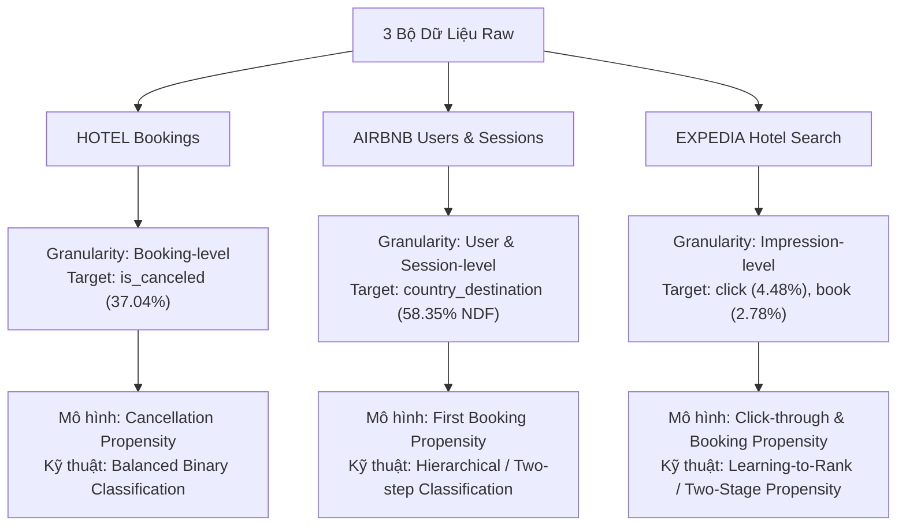

# 📊 BÁO CÁO THỐNG KÊ MÔ TẢ TỔNG QUAN 3 BỘ DỮ LIỆU
### (Hotel Booking Demand, Airbnb New User Bookings, Expedia Hotel Search)

---

## 📌 1. Bảng Tổng Hợp & So Sánh Nhanh (Executive Summary)

Dưới đây là bảng ma trận so sánh tổng quan giữa 3 bộ dữ liệu được lưu trữ trong thư mục [`data/raw/`](file:///c:/Users/admin/Documents/Thực tập VSF/Propensity/data/raw/):

| Tiêu chí | 🏨 HOTEL (Hotel Bookings) | 🏠 AIRBNB (New User Bookings) | ✈️ EXPEDIA (Hotel Search) |
| :--- | :--- | :--- | :--- |
| **Quy mô dữ liệu** | 1 file CSV (~16.1 MB) | 5 file CSV (~633 MB) | 2 file chính + benchmarks (~3.8 GB) |
| **Số lượng bản ghi** | **119,390** giao dịch đặt phòng | **213,451** người dùng (`train_users`) **10,567,737** sự kiện (`sessions`) | **~9,910,000** hiển thị tìm kiếm (`train`) (Phân tích mẫu chuẩn 500,000 dòng) |
| **Số lượng thuộc tính**| **32** cột | **16** cột (`users`), **6** cột (`sessions`), **7** cột (`countries`) | **54** cột (`train`), **50** cột (`test`) |
| **Cấp độ bản ghi (Granularity)**| Booking-level (Mỗi dòng là một đơn đặt phòng) | User-level & Event/Session-level (Nhật ký hành vi người dùng) | Search Impression-level (Mỗi dòng là một khách sạn hiển thị theo lượt search) |
| **Biến mục tiêu chính (Target)** | `is_canceled` (Hủy phòng: 0 / 1) | `country_destination` (Mã quốc gia đến; NDF: chưa book) | `click_bool` (Nhấp xem: 0 / 1) `booking_bool` (Đặt phòng: 0 / 1) |
| **Tỷ lệ sự kiện mục tiêu** | **37.04%** hủy phòng | **58.35% NDF** (chưa từng book) **29.22% US** (đặt phòng nội địa Mỹ) **12.43%** các nước khác | **4.48%** lượt click **2.78%** lượt booking *(Tỷ lệ Click-to-Book: 62.0%)* |
| **Bài toán Propensity tương ứng** | **Cancellation / Churn Propensity** (Dự đoán xu hướng hủy phòng) | **First Booking Propensity** (Dự đoán xu hướng đặt phòng lần đầu) | **Two-stage Click & Booking Propensity** (Dự đoán xu hướng click và đặt phòng) |

---

## 🏨 2. Báo Cáo Chi Tiết: Tập Dữ Liệu HOTEL (Hotel Booking Demand)

### 2.1. Cấu trúc & Kích thước Dữ liệu
- **File nguồn**: [`data/raw/HOTEL/hotel_bookings.csv`](file:///c:/Users/admin/Documents/Thực tập VSF/Propensity/data/raw/HOTEL/hotel_bookings.csv)
- **Kích thước**: **119,390 dòng** và **32 cột** thuộc tính (~16.07 MB).
- **Phân loại khách sạn**:
  - **City Hotel (Khách sạn đô thị)**: 79,330 đơn (**66.45%**).
  - **Resort Hotel (Khách sạn nghỉ dưỡng)**: 40,060 đơn (**33.55%**).

### 2.2. Kiểm tra Chất lượng Dữ liệu & Giá trị Khuyết thiếu (Missing Values)
- `company`: thiếu **112,593 dòng** (**94.31%**) - đa phần khách hàng đặt phòng cá nhân, chỉ số ít đặt qua hợp đồng công ty.
- `agent`: thiếu **16,340 dòng** (**13.69%**) - khách hàng đặt trực tiếp không qua đại lý trung gian.
- `country`: thiếu **488 dòng** (**0.41%**) - thiếu thông tin quốc tịch.
- `children`: thiếu **4 dòng** (**0.003%**).
- **Dòng trùng lặp (Duplicates)**: 31,994 dòng (**26.8%**) do nhiều lượt đặt có thuộc tính tương đồng hoặc cùng nhóm khách đặt nhiều phòng cùng lúc.

### 2.3. Thống kê Biến Mục tiêu: `is_canceled`
- **0 (Không hủy / Check-in thành công)**: 75,166 đơn (**62.96%**).
- **1 (Hủy đặt phòng)**: 44,224 đơn (**37.04%**).
- **Nhận xét**: Tỷ lệ hủy đơn lên tới 37% là một bài toán kinh doanh nghiêm trọng đối với ngành khách sạn, làm giảm công suất phòng và doanh thu. Việc xây dựng mô hình dự đoán xu hướng hủy (Cancellation Propensity) giúp khách sạn chủ động chiến lược Overbooking hợp lý hoặc yêu cầu đặt cọc trước.

### 2.4. Thống kê Mô tả Biến Định lượng (Numerical Features)

| Tên biến | Đơn vị | Count | Mean | Std | Min | 25% (Q1) | 50% (Median) | 75% (Q3) | Max |
| :--- | :--- | :--- | :--- | :--- | :--- | :--- | :--- | :--- | :--- |
| `lead_time` | Ngày đặt trước | 119,390 | 104.01 | 106.86 | 0 | 18.0 | **69.0** | 160.0 | **737.0** |
| `stays_in_week_nights` | Đêm ngày thường | 119,390 | 2.50 | 1.91 | 0 | 1.0 | **2.0** | 3.0 | 50.0 |
| `stays_in_weekend_nights`| Đêm cuối tuần | 119,390 | 0.93 | 1.00 | 0 | 0.0 | **1.0** | 2.0 | 19.0 |
| `adults` | Người lớn | 119,390 | 1.86 | 0.58 | 0 | 2.0 | **2.0** | 2.0 | 55.0 |
| `children` | Trẻ em | 119,386 | 0.10 | 0.40 | 0 | 0.0 | **0.0** | 0.0 | 10.0 |
| `adr` | Giá trung bình/ngày (EUR) | 119,390 | 101.83 | 50.54 | **-6.38** | 69.29 | **94.58** | 126.0 | **5400.0** |
| `booking_changes` | Lần đổi lịch | 119,390 | 0.22 | 0.65 | 0 | 0.0 | **0.0** | 0.0 | 21.0 |
| `days_in_waiting_list` | Ngày chờ xác nhận | 119,390 | 2.32 | 17.59 | 0 | 0.0 | **0.0** | 0.0 | 391.0 |
| `previous_cancellations`| Lần hủy trước đây | 119,390 | 0.09 | 0.84 | 0 | 0.0 | **0.0** | 0.0 | 26.0 |
| `total_of_special_requests`| Yêu cầu đặc biệt | 119,390 | 0.57 | 0.79 | 0 | 0.0 | **0.0** | 1.0 | 5.0 |

> **Phát hiện Outliers quan trọng:**
> - `adr` có giá trị âm (-6.38) do điều chỉnh hoàn tiền/hoàn voucher, và giá trị cực đại 5,400 EUR (lỗi nhập liệu). Cần kẹp biên (clipping) trong pipeline.
> - `lead_time` có độ lệch phải (right-skewed) rất mạnh, trung vị chỉ 69 ngày nhưng tối đa lên tới hơn 2 năm (737 ngày).

### 2.5. Thống kê Mô tả Biến Định tính (Categorical Features)
- **Kênh tiếp cận (`market_segment`)**: Online TA (**47.30%**), Offline TA/TO (**20.29%**), Groups (**16.59%**), Direct (**10.56%**), Corporate (**4.44%**).
- **Kênh phân phối (`distribution_channel`)**: TA/TO (**81.98%**), Direct (**12.27%**), Corporate (**5.59%**).
- **Chính sách đặt cọc (`deposit_type`)**: No Deposit (**87.65%**), Non Refund (**12.22%**), Refundable (**0.14%**).
- **Loại khách hàng (`customer_type`)**: Transient - Khách lẻ (**75.06%**), Transient-Party (**21.04%**), Contract (**3.41%**).
- **Top 5 quốc gia của khách hàng**: Bồ Đào Nha (PRT: **40.87%**), Anh (GBR: **10.20%**), Pháp (FRA: **8.76%**), Tây Ban Nha (ESP: **7.21%**), Đức (DEU: **6.13%**).

---

## 🏠 3. Báo Cáo Chi Tiết: Tập Dữ Liệu AIRBNB (New User Bookings)

### 3.1. Cấu trúc & Kích thước Dữ liệu Đa Bảng
- **Thư mục nguồn**: [`data/raw/AIRBNB/`](file:///c:/Users/admin/Documents/Thực tập VSF/Propensity/data/raw/AIRBNB/)
- **Các bảng dữ liệu thành phần**:
  1. `train_users_2.csv` (23.7 MB): **213,451 dòng**, **16 cột** (Hồ sơ người dùng tập huấn luyện).
  2. `test_users.csv` (6.45 MB): **62,096 dòng**, **15 cột** (Hồ sơ người dùng tập kiểm thử).
  3. `sessions.csv` (602.4 MB): **10,567,737 bản ghi sự kiện**, **6 cột** của **135,483 người dùng duy nhất**.
  4. `countries.csv` (0.01 MB): **10 dòng**, **7 cột** (Khoảng cách km, diện tích km², ngôn ngữ điểm đến).
  5. `age_gender_bkts.csv` (0.01 MB): **420 dòng**, **5 cột** (Thống kê dân số theo nhóm tuổi và quốc gia).

### 3.2. Kiểm tra Chất lượng Dữ liệu & Giá trị Khuyết thiếu
- Trên bảng `train_users_2.csv`:
  - `date_first_booking`: thiếu **124,543 dòng** (**58.35%**) - tương đương với nhóm người dùng chưa từng đặt phòng.
  - `age`: thiếu **87,990 dòng** (**41.22%**) - tỷ lệ thiếu tuổi rất cao, người dùng thường bỏ qua khi đăng ký.
  - `first_affiliate_tracked`: thiếu **6,065 dòng** (**2.84%**).
  - `gender`: có tới **95,688 dòng** (**44.83%**) mang giá trị `-unknown-`.

### 3.3. Thống kê Biến Mục tiêu: Điểm đến Đặt phòng Đầu tiên (`country_destination`)

| Quốc gia điểm đến | Ý nghĩa | Số lượng người dùng | Tỷ lệ (%) |
| :--- | :--- | :--- | :--- |
| **`NDF`** | **No Destination Found (Chưa bao giờ đặt phòng)** | **124,543** | **58.35%** |
| **`US`** | **Nội địa Mỹ (United States)** | **62,376** | **29.22%** |
| `other` | Các quốc gia khác ngoài top | 10,094 | 4.73% |
| `FR` | Pháp (France) | 5,023 | 2.35% |
| `IT` | Ý (Italy) | 2,835 | 1.33% |
| `GB` | Vương quốc Anh (United Kingdom) | 2,324 | 1.09% |
| `ES` | Tây Ban Nha (Spain) | 2,249 | 1.05% |
| `CA` | Canada | 1,428 | 0.67% |
| `DE` | Đức (Germany) | 1,061 | 0.50% |
| `NL` | Hà Lan (Netherlands) | 762 | 0.36% |
| `AU` | Úc (Australia) | 539 | 0.25% |
| `PT` | Bồ Đào Nha (Portugal) | 217 | 0.10% |

> **Nhận định cốt lõi:**
> - Hơn **58% khách hàng đăng ký tài khoản nhưng không chuyển đổi thành giao dịch đặt phòng**.
> - Đối với 41.65% khách hàng có chuyển đổi, phần lớn là đặt phòng nội địa Mỹ (**29.22%**), các điểm đến quốc tế chỉ chiếm tổng cộng **12.43%**.

### 3.4. Thống kê Nhân khẩu học & Kênh Tiếp thị
- **Độ tuổi (`age`)**:
  - Dữ liệu thô tồn tại các giá trị cực đoan như tuổi = 1, tuổi = 2014 (do người dùng nhập năm sinh vào trường tuổi).
  - Lọc dải tuổi hợp lý từ 16 đến 100 tuổi (gồm 123,051 người dùng):
    - **Trung bình (Mean)**: **36.56 tuổi** | **Độ lệch chuẩn (Std)**: 11.69 | **Trung vị (Median)**: **34.0 tuổi**.
    - **Q1 (25%)**: 28.0 tuổi | **Q3 (75%)**: 42.0 tuổi (Tập trung đông nhất ở người trẻ và trung niên 25 - 40 tuổi).
- **Phương thức đăng ký (`signup_method`)**: Basic Email (**71.63%**), Facebook OAuth (**28.11%**), Google (**0.26%**).
- **Ứng dụng đăng ký (`signup_app`)**: Web trình duyệt máy tính (**85.60%**), iOS App (**8.91%**), Mobile Web (**2.93%**), Android App (**2.56%**).
- **Kênh tiếp thị (`affiliate_channel`)**: Direct - Trực tiếp (**64.52%**), SEM Brand (**12.20%**), SEM Non-Brand (**8.83%**), Other (**4.20%**), SEO (**4.06%**).

### 3.5. Thống kê Nhật ký Phiên Người dùng (`sessions.csv`)
- **Tổng số lượng sự kiện**: **10,567,737 dòng**.
- **Số người dùng duy nhất có ghi nhận session**: **135,483 user** (trung bình ~78 sự kiện tương tác / người dùng).
- **Phân phối thiết bị truy cập (`device_type`)**:
  - **Mac Desktop**: 3,594,286 lượt (**34.01%**).
  - **Windows Desktop**: 2,658,539 lượt (**25.16%**).
  - **iPhone**: 2,105,031 lượt (**19.92%**).
  - **Android Phone**: 839,637 lượt (**7.95%**).
  - **iPad Tablet**: 683,414 lượt (**6.47%**).
- **Thời lượng thao tác (`secs_elapsed`)**: Trung bình **31,311 giây** (~8.7 giờ tổng thời gian phiên), trung vị thời gian giữa 2 thao tác liên tiếp là **850 giây** (~14 phút).

---

## ✈️ 4. Báo Cáo Chi Tiết: Tập Dữ Liệu EXPEDIA (Personalized Hotel Search)

### 4.1. Cấu trúc & Kích thước Dữ liệu
- **Thư mục nguồn**: [`data/raw/EXPEDIA/`](file:///c:/Users/admin/Documents/Thực tập VSF/Propensity/data/raw/EXPEDIA/)
- **Kích thước file**:
  - `train.csv`: **2.25 GB** (~9,910,000 dòng, **54 cột**).
  - `test.csv`: **1.43 GB** (~6,620,000 dòng, **50 cột**).
  - Các file benchmark nộp bài: `basicPythonBenchmark.csv`, `randomBenchmark.csv`, `testOrderBenchmark.csv` (~88.7 MB mỗi file).
- **Phương pháp phân tích**: Sử dụng tập mẫu chuẩn đại diện **500,000 dòng** ngẫu nhiên để đánh giá thống kê mô tả nhanh và chuẩn xác.

### 4.2. Phân Nhóm 54 Thuộc Tính Dữ liệu
1. **Ngữ cảnh Tìm kiếm (Search Context - 10 cột)**: `srch_id`, `date_time`, `site_id`, `visitor_location_country_id`, `srch_length_of_stay`, `srch_booking_window`, `srch_adults_count`, `srch_children_count`, `srch_room_count`, `srch_saturday_night_bool`.
2. **Thuộc tính Khách sạn (Property Features - 10 cột)**: `prop_id`, `prop_country_id`, `prop_starrating`, `prop_review_score`, `prop_brand_bool`, `prop_location_score1`, `prop_location_score2`, `prop_log_historical_price`, `price_usd`, `promotion_flag`.
3. **Lịch sử Người dùng (User History - 2 cột)**: `visitor_hist_starrating`, `visitor_hist_adr_usd`.
4. **Thông tin Giá Đối thủ (Competitor Pricing - 16 cột)**: `comp1_rate` đến `comp8_rate`, `comp*_inv`, `comp*_rate_percent_diff`.
5. **Hành vi Tương tác Mục tiêu (Targets - 3 cột)**: `click_bool`, `booking_bool`, `gross_bookings_usd`.

### 4.3. Thống kê Biến Mục tiêu & Hành vi Chuyển đổi

| Cấp độ hành vi | Tên biến | Số lượng quan sát | Tỷ lệ trên tổng hiển thị (%) | Tỷ lệ chuyển đổi tương đối |
| :--- | :--- | :--- | :--- | :--- |
| **Lượt hiển thị (Impressions)** | `srch_id` | 500,000 | 100.0% | Gốc |
| **Lượt nhấp xem (Clicks)** | `click_bool` | 22,414 | **4.48%** | **4.48%** khách click xem |
| **Lượt đặt phòng (Bookings)** | `booking_bool`| 13,905 | **2.78%** | **2.78%** khách chốt đơn |

> **Phát hiện Vàng về Chuyển đổi:**
> - **Tỷ lệ Click-to-Book**: $\frac{13,905}{22,414} \approx$ **62.04%**!
> - Người dùng xem danh sách nhiều khách sạn nhưng rất hiếm khi click vào (chỉ 4.48%). Tuy nhiên, **một khi người dùng đã quyết định click vào xem chi tiết một khách sạn, xác suất họ đặt phòng lên tới 62%**.
> - Điều này khẳng định bài toán cốt lõi là **Click Propensity** (làm sao xếp hạng để khách hàng nhấp vào khách sạn phù hợp nhất).

### 4.4. Kiểm tra Giá trị Khuyết thiếu (Missing Values Pattern)
- **Nhóm thông tin đối thủ cạnh tranh**: thiếu từ **93.0% đến 98.1%** (`comp1_rate_percent_diff`: 98.15%, `comp6`: 97.98%, `comp1_rate`: 97.67%).
- **Nhóm lịch sử người dùng**: `visitor_hist_starrating` thiếu **94.85%**, `visitor_hist_adr_usd` thiếu **94.82%** (cho thấy phần lớn khách hàng là khách vãng lai hoặc không đăng nhập tài khoản khi tìm kiếm).
- **`gross_bookings_usd`**: thiếu **97.22%** (chỉ xuất hiện giá trị khi khách hàng thực hiện booking).
- **Điểm vị trí khách sạn (`prop_location_score2`)**: thiếu **21.9%**.
- **Điểm đánh giá chất lượng (`prop_review_score`)**: chỉ thiếu **0.14%** (700 / 500,000 dòng). Hạng sao (`prop_starrating`) đầy đủ 100%.

### 4.5. Thống kê Mô tả Biến Định lượng Chính

| Tên thuộc tính | Đơn vị | Mean | Std | Min | 25% (Q1) | 50% (Median) | 75% (Q3) | Max |
| :--- | :--- | :--- | :--- | :--- | :--- | :--- | :--- | :--- |
| `prop_starrating` | Sao (0 - 5) | 3.19 | 1.05 | 0.0 | 3.0 | **3.0** | 4.0 | 5.0 |
| `prop_review_score`| Điểm review (0 - 5)| 3.79 | 1.04 | 0.0 | 3.5 | **4.0** | 4.5 | 5.0 |
| `price_usd` | Giá niêm yết (USD) | 208.65 | 3902.07 | 0.0 | 85.0 | **124.0** | 186.0 | 822,602.8 |
| `srch_length_of_stay`| Số đêm lưu trú | 2.38 | 2.03 | 1.0 | 1.0 | **2.0** | 3.0 | 28.0 |
| `srch_booking_window`| Ngày đặt trước | 37.75 | 52.15 | 0.0 | 4.0 | **17.0** | 48.0 | 467.0 |
| `srch_adults_count` | Số người lớn | 1.96 | 0.85 | 1.0 | 2.0 | **2.0** | 2.0 | 9.0 |
| `srch_children_count`| Số trẻ em | 0.35 | 0.72 | 0.0 | 0.0 | **0.0** | 0.0 | 8.0 |
| `srch_room_count` | Số phòng đặt | 1.10 | 0.40 | 1.0 | 1.0 | **1.0** | 1.0 | 8.0 |

### 4.6. Thống kê Biến Cờ Nhị phân & Phân loại
- `prop_brand_bool`: **63.5%** khách sạn thuộc chuỗi thương hiệu lớn, **36.5%** là khách sạn tư nhân độc lập.
- `promotion_flag`: **21.5%** khách sạn có gắn nhãn chương trình khuyến mãi / giảm giá.
- `srch_saturday_night_bool`: **50.2%** lượt tìm kiếm có ngày lưu trú rơi vào đêm thứ Bảy.

---

## 💡 5. Tổng Hợp So Sánh & Định Hướng Xây Dựng Mô Hình Propensity

### 5.1. So sánh về Mức độ Mất cân bằng Lớp (Class Imbalance)
- **HOTEL**: Mức độ mất cân bằng thấp nhất (**37.04%** class 1), thuật toán có thể học tốt trực tiếp với hàm mất mát Binary Cross-Entropy hoặc GBDT tiêu chuẩn.
- **AIRBNB**: Tỷ lệ chuyển đổi đặt phòng là **41.65%**, nhưng nếu phân rã thành đa lớp 10 quốc gia thì xuất hiện các lớp cực hiếm như Bồ Đào Nha (`PT`: 0.10%), Úc (`AU`: 0.25%).
- **EXPEDIA**: Mất cân bằng nhãn nghiêm trọng nhất đối với từng lượt hiển thị (**4.48% click** và **2.78% booking**). Cần sử dụng trọng số lớp (`scale_pos_weight`), lấy mẫu hoặc chuyển đổi bài toán sang Learning-to-Rank (LambdaMART).

### 5.2. So sánh về Giá trị Khuyết thiếu (Missing Data Strategy)
- **HOTEL**: Giá trị thiếu tập trung ở `company` và `agent`, giải pháp tốt nhất là tạo cờ nhị phân `has_agent = 1/0` và `has_company = 1/0`.
- **AIRBNB**: Giá trị thiếu nghiêm trọng ở `age` (41.22%) và `gender` (44.83%). Cần tạo category riêng `'Unknown'` cho biến phân loại và kỹ thuật impute median kèm cờ `age_is_missing = 1/0`.
- **EXPEDIA**: Tỷ lệ thiếu trên 90% ở nhóm giá đối thủ và lịch sử khách hàng không phải là lỗi dữ liệu mà mang ý nghĩa nghiệp vụ (khách mới / khách sạn không có đối thủ cạnh tranh trên trang tìm kiếm). Không được drop cột mà phải mã hóa cờ `has_competitor_data` và `has_user_history`.

---

## 🔗 Liên Kết Đến Các Báo Cáo Chi Tiết Dưới Dạng Jupyter Notebook

Bạn có thể mở và tương tác trực tiếp với các biểu đồ trực quan hóa chi tiết thông qua 3 notebook đã được sinh sẵn:
1. 🏨 **HOTEL**: [`notebooks/HOTEL/hotel_descriptive_report.ipynb`](file:///c:/Users/admin/Documents/Thực tập VSF/Propensity/notebooks/HOTEL/hotel_descriptive_report.ipynb)
2. 🏠 **AIRBNB**: [`notebooks/AIRBNB/airbnb_descriptive_report.ipynb`](file:///c:/Users/admin/Documents/Thực tập VSF/Propensity/notebooks/AIRBNB/airbnb_descriptive_report.ipynb)
3. ✈️ **EXPEDIA**: [`notebooks/EXPEDIA/expedia_descriptive_report.ipynb`](file:///c:/Users/admin/Documents/Thực tập VSF/Propensity/notebooks/EXPEDIA/expedia_descriptive_report.ipynb)
